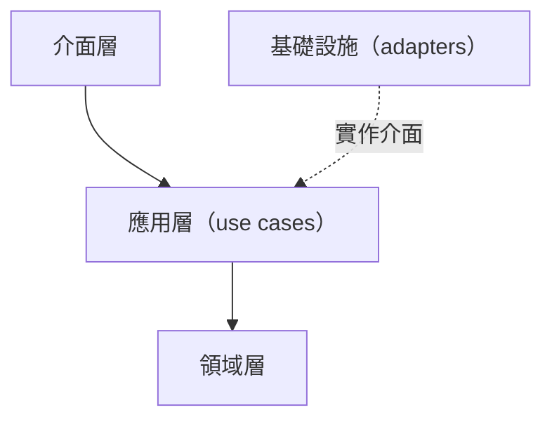
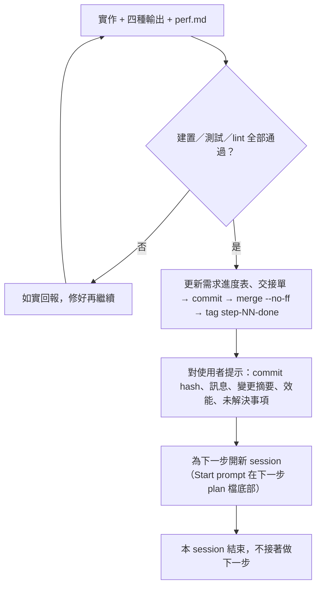

# {{PROJECT_NAME}} — 總體計畫（Master Plan）

> 進度：[current-status.md](current-status.md)（需求進度表）｜ 架構：[architecture.md](architecture.md) ｜ 決策：[decisions.md](decisions.md) ｜ 工作規則：[../AGENTS.md](../AGENTS.md)
> 建立日期：{{DATE}}。本檔回答「整個專案要做什麼、不做什麼、分幾步做」；每一步的細節在 `docs/plan/<ID>-<slug>.md`，目前做到哪在 `docs/current-status.md`。

## 修改紀錄

| 日期 | 修改者 | 說明 |
|---|---|---|
| {{DATE}} | 範本 | 建立 |

## 1. 要做什麼

TODO(project): 用一到三段話說明產品要做什麼、給誰用、成功的樣子。

**這一版不做**：TODO(project): 明確列出不做的事，避免範圍擴張。

## 2. 架構總覽

TODO(project): 一張結構圖加三到五句說明。依賴方向、模組切分的細節放 `architecture.md`，這裡只放總覽。

### 為什麼這樣切（目的／原因／效果）

TODO(project): 每個主要切分各一句：目的、原因、效果。

## 3. SOLID 對應

| 原則 | 在本專案的落實方式 |
|---|---|
| S | TODO(project) |
| O | TODO(project) |
| L | TODO(project) |
| I | TODO(project) |
| D | TODO(project) |

## 4. 效能策略與測試

TODO(project): 效能目標、量測方法與預算；沒有效能需求就寫「無」。測試分類與驗證指令見 `AI_CONTEXT.md`「建置與測試」。

## 5. 實作步驟

每一步在 `docs/plan/` 有一份計畫檔（範本 [plan/_template.md](plan/_template.md)），做法依 `project-rules.md` 的 Step Protocol。步驟的狀態寫在 `docs/current-status.md` 的需求進度表，本表只放順序與依賴。

| 步驟 | 層級 | 主題 | 關鍵產出 | 主要量測 |
|---|---|---|---|---|
| S01 | TODO(project) | TODO(project) | TODO(project) | TODO(project) |

為什麼這個順序：TODO(project)。

## 6. 每一步的輸出規範（4 種輸出形式）

適用範圍：Step Protocol 的步驟與進度表中類型為「功能」的需求；小修正免。範本在 [steps/_template/](steps/_template/)。

| 輸出 | 用法 | 檔案 |
|---|---|---|
| 寫作 Writing | ASD-STE100 風格英文寫 Purpose／Reason／Effect，附繁中摘要；`tools/ste-lint.mjs` 檢查句長與被動語態 | `spec.md` |
| 圖解 Diagrams | Mermaid 結構圖、流程圖、序列圖、狀態圖 | `diagram.md` |
| 互動網頁 Web pages | 單檔 HTML，把概念變成能操作的小 App | `explainer.html` |
| 解說影片 Explainer videos | 一定交付分鏡腳本；實際影片是選配，要使用者同意 | `storyboard.md` |

**誠實說明**：STE-lint 只檢查句長與簡單的被動語態，不是完整的 ASD-STE100 驗證；影片是分鏡而非成片。

## 7. 每完成一步：commit、提示、開新 session

為什麼每步開新 session：每個步驟的上下文很大且彼此獨立；新 session 只靠 `AGENTS.md`、`docs/current-status.md` 與該步 plan 檔就能接手，不被前一步的雜訊拖累。

## 8. 風險與待決策

| # | 風險／問題 | 對策 | 何時處理 |
|---|---|---|---|
| 1 | TODO(project) | | |
