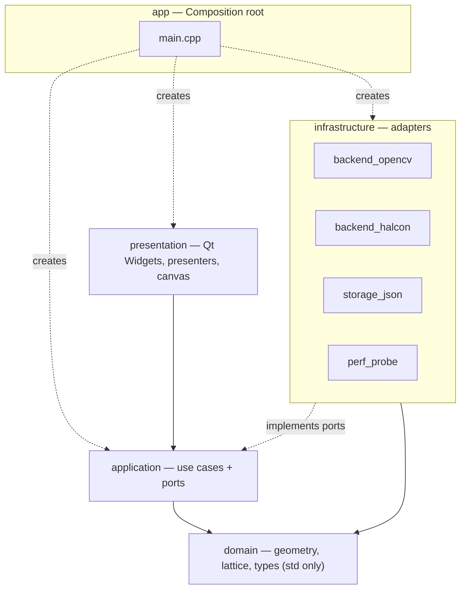

# AOI 程式 — 總體計畫（Master Plan）

> 互動版架構導覽：[docs/steps/S00-overview/explainer.html](steps/S00-overview/explainer.html)（用瀏覽器直接開，離線可用）
> 進度：[current-status.md](current-status.md) ｜ 效能：[perf-test-plan.md](perf-test-plan.md) ｜ 工作規則：[../AGENTS.md](../AGENTS.md)

## 1. 要做什麼

使用者在影像上**框一個樣本元件** → 程式找出所有相似元件 → 推算陣列間距與角度 → 對缺件補位 → 產生一排**檢測框**（"CAD objects"），每個框標示狀態（找到／推算補上／拒絕）。

**一份程式碼、兩個 back end（OpenCV、HALCON）**，執行時可切換，也能並排比較。

**這一版不做**：不用深度學習做 segmentation（規則陣列用傳統視覺更可解釋）；不從影像生成真正的 ECAD（Gerber/ODB++）；不做 3D。

## 2. 架構總覽



更多圖（類別圖、序列圖、狀態機、執行緒）：[steps/S00-overview/diagram.md](steps/S00-overview/diagram.md)。依賴規則表在 [architecture.md](architecture.md)。

### 為什麼這樣切（目的／原因／效果）

| 設計決定 | 目的 | 原因 | 預期效果 |
|---|---|---|---|
| `domain` 不依賴任何函式庫 | 放幾何與陣列規則 | 規則對兩個 back end 都一樣；純 C++ 可用精確數字測試 | 一份測過的程式碼，兩邊共用；速度可獨立量測 |
| 所有視覺運算藏在 port 後面 | 換 back end 不動核心 | 兩個函式庫的資料型別、座標、角度慣例不同 | 新增 back end ＝ 新增 adapter + 註冊 |
| 影像用 `ImageView` 傳遞 | 零複製 | 5 MP 影像複製成本高、也吃記憶體 | Qt／OpenCV／HALCON 讀同一份像素 |
| 搜尋跑在 worker、傳不可變快照 | 介面不凍結 | 搜尋可能數百毫秒以上 | 不需要鎖；可取消、可 latest-wins |
| 晶格引導的視窗驗證 | 找漏件、縮小搜尋範圍 | 陣列元件間距固定 | 補得到反光/低分數的元件；大影像上搜尋面積小很多（**要用 S10 量測驗證，板子越密優勢越小**） |
| 依賴方向由工具檢查 | 守住分層 | 靠自覺的架構會慢慢腐化 | `check-deps` 違規即測試失敗 |

## 3. SOLID 對應

| 原則 | 本專案的具體做法 | 怎麼驗證 |
|---|---|---|
| **S** 單一責任 | `LatticeEstimator` 只管幾何；`OpenCvPatternSearcher` 只管 OpenCV 比對；`RoiGraphicsItem` 只管繪製與把手；每個工具一個類別 | Code review；類別 > 300 行要說明 |
| **O** 開放封閉 | 新 back end、新工具、新匯出格式＝新增類別＋註冊，不改既有 use case | 新增 back end 的變更不得出現在 `application/`、`domain/` |
| **L** 里氏替換 | 所有 `IPatternSearcher` 遵守同一份契約（座標原點、角度方向、分數 0..1、排序、空結果行為、取消） | S09 契約測試對每個 back end 跑同一組 |
| **I** 介面隔離 | `ITemplateBuilder`、`IPatternSearcher`、`IRecipeStore`、`IProgressSink`、`IPerfProbe`、`IExecutor` 分開；View 只看窄介面 | 介面 ≤ 5 個方法 |
| **D** 依賴反轉 | use case 只依賴 port；具體 adapter 只在 `app/` 組裝 | `tools/check-deps.mjs`＋CMake link 可見性 |

## 4. 介面與 UX 原則

```
┌───────────────────────────────────────────────────────────────────┐
│ Open  Save   Back end: (OpenCV | HALCON)   [A/B]   Undo  Redo     │
├────┬────────────────────────────────────────────┬─────────────────┤
│ V  │                                            │ Objects         │
│ S  │             影像畫布                        │ 篩選: ● ● ○     │
│ +  │   (平移/縮放、ROI 框、提案預覽)             ├─────────────────┤
│ −  │                                            │ Match params    │
│    │                                            │ score ▬▬●▬▬     │
│    │                                            │ [Advanced ▾]    │
├────┴────────────────────────────────────────────┴─────────────────┤
│ Found 118 · Inferred 2 · 143 ms · OpenCV · zoom 100%              │
└───────────────────────────────────────────────────────────────────┘
```

| 原則 | 做法 | 為什麼 |
|---|---|---|
| 回饋要即時 | 點擊/拖曳 ≤ 50 ms 有視覺回饋；> 200 ms 顯示忙碌；> 1 s 顯示進度與取消 | 0.1 s／1 s／10 s 是人感受延遲的三個界線 |
| 狀態一眼看懂 | Sample＝藍實線粗、Found＝綠實線、Inferred＝琥珀虛線、Rejected＝紅點線 | **不只靠顏色**，線型也不同（色盲友善），對比符合 WCAG AA |
| 永遠可以反悔 | 所有修改走 Command；Ctrl+Z／Y；Esc 取消 | 自動產生的結果一定有錯，修正要便宜 |
| 讓人信任結果 | 狀態列顯示 back end、耗時、數量；每個框有分數與狀態；信心低時提示「建議檢查」 | 自動化工具最怕「不知道它有沒有做對」 |
| 無匹配也要有路走 | 錯誤訊息直接建議下一步（降低門檻、放大樣本…） | 死路是最糟的 UX |
| 鍵盤與滑鼠兼顧 | 游標中心縮放、Space＋拖曳平移、F 適配、Enter 接受、Del 刪除 | 重複性高的工作，效率靠快捷鍵 |

完整的 UX 規格與可點擊原型在 **S01**：[`ux/ux-spec.md`](ux/ux-spec.md)、[explainer.html](steps/S01-ux-spec/explainer.html)。S01 之後的修訂：加入樣本庫與區域掃描流程、Board › Component › Box 階層（[ADR-006](adr/006-sample-library-and-hierarchy.md)）；訊息不蓋在影像上。上方的版面草圖是 S01 前的版本。

## 5. 效能策略與測試

四個提速手段（**都是設計假設，由 S10 驗證**）：視窗搜尋、影像零複製、worker 執行緒、批次繪製。

三大類測試：**搜索比對時間**（T1–T6）、**介面更新時間**（U1–U4）、**介面互動**（I1–I6）。
預算目前是**提議值**，S02／S07 用本機實測校準。完整方法、矩陣、門檻見 [perf-test-plan.md](perf-test-plan.md)，機器可讀版見 [../perf/budgets.json](../perf/budgets.json)。

## 6. 實作步驟（由介面 → 系統 → 底層 → 驗證 → 發行）

| 步驟 | 層級 | 主題 | 關鍵產出 | 主要量測 |
|---|---|---|---|---|
| **S00** | 基礎 | 版控＋總體計畫＋架構導覽 | 本計畫、規則、預算、導覽頁 | — |
| [S01](plan/S01-ux-spec.md) | 介面 | UX 規格與可點擊原型 | 線框、狀態語言、ADR-001、原型 | UI 預算確認 |
| [S02](plan/S02-ui-shell.md) | 介面 | Qt UI 骨架與影像畫布 | MainWindow、畫布、批次繪製 | U1 U4 I1 I2 I5 |
| [S03](plan/S03-core.md) | 系統 | Ports、use case、DI、執行緒、PerfProbe | 可用假 back end 跑通的核心 | PerfProbe 成本 |
| [S04](plan/S04-presenter.md) | 系統 | Presenter、狀態機、復原/重做 | 畫面接上核心、可取消 | U2 U3 I3 I4 I6 |
| [S05](plan/S05-lattice.md) | 底層 | 晶格估計與補漏（純 C++） | 擬合、預測、NMS | T3 |
| [S06](plan/S06-image-storage.md) | 底層 | 影像緩衝、轉接器、Recipe | 零複製、合成板子產生器 | 載入時間、複製次數＝0 |
| [S07](plan/S07-opencv.md) | 底層 | OpenCV back end | 第一個可用的完整流程 | T1 T2a T4 T6 |
| [S08](plan/S08-halcon.md) | 底層 | HALCON back end | 第二個 back end | T2b T6 |
| [S09](plan/S09-contract-ab.md) | 底層 | 契約測試與 A/B 比較 | 可互換的證明、並排畫面 | 並排比較 |
| [S10](plan/S10-perf-harness.md) | 驗證 | 效能 harness 與回歸閘門 | 完整矩陣、報表、baseline | T5＋全部 |
| [S11](plan/S11-optimize.md) | 驗證 | 先量再改 | 每項優化的 before/after | 依報表 |
| [S12](plan/S12-release.md) | 發行 | 匯出、打包、文件 | v0.1.0 | Release 重跑 |

為什麼這個順序：**介面先定（S01–S02）**，因為 UX 錯誤改起來最貴；**系統骨架（S03–S04）**用假 back end 先跑通整條路；**純 domain 邏輯（S05）**在沒有視覺函式庫的情況下測好；**才接真實 back end（S07–S08）**，這時其他一切都已經可測。效能量測不等到最後：S02 就建立 UI 基準線，S07 建立搜尋基準線，S10 再整合。

## 7. 每一步的輸出規範（Karpathy 的 4 種輸出形式）

目的：讓讀者清楚知道**每個設計的目的、原因、效果**。

| 輸出 | 在本專案的用法 | 檔案 |
|---|---|---|
| 寫作 Writing | 用 ASD-STE100 風格（短句、主動語態、一詞一義）寫 Purpose／Reason／Effect，附繁中摘要；`tools/ste-lint.mjs` 檢查句長與被動語態 | `spec.md` |
| 圖解 Diagrams | 結構圖、類別圖、序列圖、狀態圖用 Mermaid；一張圖勝過一頁字 | `diagram.md` |
| 互動網頁 Web pages | 單檔 HTML，把概念變成能操作的小 App（slider、步進、切換）；本步驟的實測數字直接嵌入 | `explainer.html` |
| 解說影片 Explainer videos | 一定交付分鏡腳本；實際影片與語音合成是選配，要使用者同意 | `storyboard.md` |

範本在 [steps/_template/](steps/_template/)。S00 就是第一個範例。

**誠實說明**：STE-lint 只檢查句長與簡單的被動語態，不是完整的 ASD-STE100 驗證（沒有受控詞典）；影片是分鏡而非成片。

## 8. 每完成一步：commit、提示、開新 session

```
實作＋四種輸出＋perf.md
        │
        ▼
建置／測試／check-deps／ste-lint 全部通過？ ──否──► 如實回報，修好再繼續
        │是
        ▼
更新 current-status.md 與交接單 → commit → merge --no-ff 到 main → tag step-NN-done
        │
        ▼
對你提示：commit hash、訊息、變更摘要、效能結果、未解決事項
        │
        ▼
spawn_task：為下一步開新 session（prompt 在下一步 plan 檔底部）
        │
        ▼
本 session 結束，不接著做下一步
```

為什麼每步開新 session：每個步驟的上下文（程式碼細節、除錯過程）很大，彼此獨立；新 session 只靠 `AGENTS.md`（含它列出的必讀文件）、`current-status.md` 與該步 plan 檔就能接手，不會被前一步的雜訊拖累，也避免上下文過長導致品質下降。

## 9. 風險與待決策

| # | 風險／問題 | 對策 | 何時處理 |
|---|---|---|---|
| 1 | UI 工具集：Widgets＋QGraphicsView 還是 QML | 預設 Widgets＋QGraphicsView；S01 以 ADR-001 定案 | S01 |
| 2 | HALCON 授權在其他電腦／CI 不可用 | `AOI_WITH_HALCON` 選項；無授權時優雅降級；契約測試標示 SKIPPED | S03、S08、S09 |
| 3 | NCC（強度）與 shape model（邊緣）結果會不同 | 契約測試設容差；A/B 畫面可視化；ADR-004 記錄 | S09 |
| 4 | OpenCV 旋轉搜尋成本高 | 小角度預設、角度掃描、由粗到細 | S07 |
| 5 | 沒有真實板子影像 | 先用合成影像；請使用者提供 1–2 張去識別化實拍圖 | S07 前 |
| 6 | 兩函式庫的座標與角度慣例不同 | domain 規定唯一慣例，adapter 轉換，測試鎖住 | S03、S06、S08、S09 |
| 7 | MSVC 2022 工具鏈未驗證 | S02 第一件事 | S02 |
| 8 | 預算數字是提議值 | S02、S07 實測校準，之後才當閘門 | S02、S07 |
| 9 | 「視窗搜尋比較快」可能不成立（密集板子） | 不預設結論；S10 矩陣含元件密度，用數字決定 | S10 |
