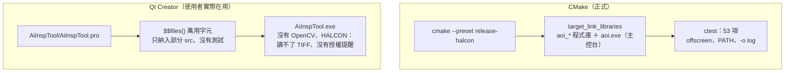
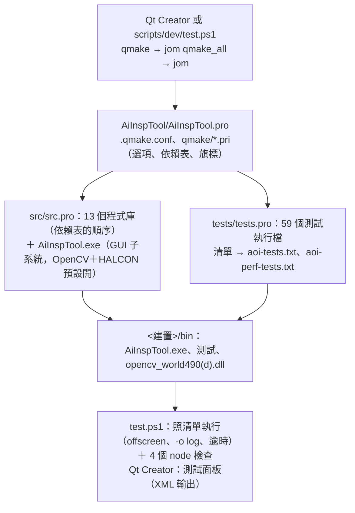

# ADR-018 建置只用 qmake：AiInspTool.pro 包含所有程式庫、程式與測試，移除 CMake

- 日期：2026-10-07
- 決定者：使用者 2026-10-07 決定四件事：（1）建置只用 qmake，`AiInspTool/AiInspTool.pro`（位置不變）包含所有程式庫、程式與所有 Qt Test，移除 CMake；（2）執行檔改叫 `AiInspTool.exe`（CMake 版是 `aoi.exe`）；（3）OpenCV 與 HALCON 預設編進去；（4）Qt Creator 的 Debug、Release、Profile 三種組態都要能建置（下一個 session 要在 Qt Creator 做 Designer 的 `.ui`）。`.pro` 的位置、依賴表、子系統、測試環境與測試清單的做法是 Claude Code (Claude Opus 5.5) 的提案並實作。
- 狀態：採用。取代 ADR-003 中「經 CTest 執行」的部分（見 ADR-003 的「後續」）；ADR-017 決定 1 的 `cmake/FindHalconLocal.cmake` 改由 `AiInspTool/qmake/aoi_halcon.pri` 負責（見 ADR-017 的「後續」）。

## 背景

S02–S08 有兩套建置：

- **CMake**（正式）：`CMakeLists.txt`、`cmake/`、`CMakePresets.json`，preset `release`／`release-opencv`／`release-halcon` 等，`ctest` 跑 53 個項目（Release＋OpenCV＋HALCON）。
- **qmake**（`AiInspTool/AiInspTool.pro`，給 Qt Creator）：用 `$$files()` 萬用字元納入一部分 `src/`，**沒有 OpenCV、HALCON，也沒有任何測試**。

使用者實際用 Qt Creator 跑的是 qmake 版（`AiInspTool\release\AiInspTool.exe`），所以讀 TIFF 失敗、看不到 HALCON 的授權提醒。之前的 session 只回報「qmake 建置成功」，沒有說這個版本少了哪些功能。兩套建置的功能不一樣，使用者看到的是功能少的那一套。

## 決定

1. **只有一套建置：qmake。** 刪除所有 `CMakeLists.txt`、`cmake/`、`CMakePresets.json`。結構（`AiInspTool/` 底下）：

   | 檔案 | 內容 |
   |---|---|
   | `AiInspTool.pro` | subdirs：`src`、`tests`（`AOI_BUILD_TESTS=ON`，排在 `src` 之後）；qmake 時印出這次建置有哪些功能 |
   | `.qmake.conf` | `AOI_ROOT`（repo 根目錄）、`AOI_QMAKE`（共用的 `.pri`）、`AOI_BUILD_ROOT`（`$$shadowed($$PWD)`：建置資料夾） |
   | `qmake/aoi_options.pri` | 選項、單一組態、`AOI_BUILD_TYPE`、輸出位置 |
   | `qmake/aoi_deps.pri` | 依賴表（下面第 3 點）與 `aoiClosure()` |
   | `qmake/aoi_opencv.pri`、`aoi_halcon.pri` | 找 OpenCV、HALCON |
   | `qmake/aoi_target.pri` | 編譯旗標、中間檔、Qt 模組、外部函式庫、連結 |
   | `qmake/aoi_lib.pri`、`aoi_test.pri` | 程式庫與測試的範本 |
   | `src/src.pro` | 13 個程式庫（依賴表的順序）與 `src/app/app.pro`（`AiInspTool.exe`） |
   | `tests/tests.pro` | 測試清單（下面第 8 點）、`tests/support/test_support.pro`、每個測試一個 `.pro` |

   每個 `.pro` **明確列出檔案**，不用萬用字元：新檔案要加進對應的 `.pro`。

2. **`.pro` 與 `.pri` 都放在 `AiInspTool/` 底下**，對照 `src/`、`tests/` 的結構（例如 `AiInspTool/src/domain/domain.pro`），原始碼用 `$$AOI_ROOT/src/...` 引用。理由（小範例實測）：subdirs 的子專案寫成 `../lib/lib.pro` 時，qmake 把同一段相對路徑套到建置資料夾上，子專案的 Makefile 與中間檔跑到 `<建置>/../lib`，也就是建置資料夾**外面**；Qt Creator 的 Debug、Release、Profile 各有一個建置資料夾，三種組態會共用、互相覆蓋同一個資料夾。放在 `AiInspTool/` 底下，子專案都在頂層 `.pro` 的「下面」，輸出留在各組態自己的資料夾。

3. **依賴表**（`qmake/aoi_deps.pri`）是 `docs/architecture.md` 分層規則的機器可讀版（CMake 時代由 `target_link_libraries` 表達）：`AOI_DEPS_<模組>`（直接依賴）、`AOI_QT_<模組>`（用到的 Qt 模組）、`AOI_EXT_<模組>`（opencv、halcon）。一個目標用到某個模組，就繼承它與所有間接依賴的 Qt 模組與外部函式庫（標頭互相 include，編譯與連結都要）。`src/src.pro` 的 `.depends` 直接取自這張表。沒有 Qt 模組的程式庫（domain、application、backend_fake、perf、threading、backend_opencv、backend_halcon）`CONFIG -= qt`：看不到 Qt 的標頭，誤 include 會編不過。改分層要三邊一起改：這張表、`docs/architecture.md`、`tools/check-deps.mjs` 的 `RULES`。

4. **選項預設全開**：`AOI_WITH_OPENCV`、`AOI_WITH_HALCON`、`AOI_BUILD_TESTS`、`AOI_DEMO_SCENE`（`ON`／`OFF`）。關掉的寫法是 qmake 的命令列變數（`qmake AiInspTool.pro AOI_WITH_HALCON=OFF`；Qt Creator 填在 qmake 步驟的「其他引數」），命令列的變數會傳到每個子專案。打開的選項找不到函式庫時 **`error()`**，說明怎麼用 `AOI_OPENCV_DIR`／`AOI_HALCON_SDK_DIR` 指定位置、怎麼關掉；不會悄悄關掉。qmake 的輸出（Qt Creator 的〔編譯輸出〕）列出這次建置的組態、OpenCV、HALCON 的版本與位置。

5. **單一組態**（`CONFIG -= debug_and_release`）：Debug ＝ `CONFIG+=debug`；Release ＝ 預設；Profile ＝ Release ＋ `CONFIG+=force_debug_info`（Qt Creator 的預設參數；`separate_debug_info` 在 MSVC 上沒有作用）。輸出：程式庫 `<建置>/lib`、執行檔與測試 `<建置>/bin`。中間檔（`.obj`、`.moc`、`.rcc`、`.uic`）各目標分開放（`<資料夾>/.obj/<目標>`）：同一個資料夾有好幾個 `.pro` 時（例如 `tests/core/`），共用的 `moc_predefs.h` 在 jom 並行建置時會互相踩到（上一個 session 實測）。

6. **編譯旗標與 CMake 版相同的部分**：自家程式碼 `-W4 -WX`、`-permissive-`、`-utf-8`、`-Zc:__cplusplus`、`-external:W0 -external:anglebrackets`、`-std:c++20`；Release 有 `-O2` 與 `NDEBUG`（mkspec 的 `DEFINES_RELEASE`，實際看過產生的 Makefile）。OpenCV、HALCON 的標頭用 `-external:I`（同時放進 `INCLUDEPATH` 給 Qt Creator 的程式碼模型）。**和 CMake 版不同的部分**：qmake 的 msvc mkspec 給所有目標 `UNICODE`、`_UNICODE`、`WIN32`、`WIN64`、`_ENABLE_EXTENDED_ALIGNED_STORAGE` 與 `-Zc:rvalueCast -Zc:inline -Zc:strictStrings -Zc:throwingNew -Zc:externConstexpr -FS`；程式碼呼叫 Windows API 都明寫 W 版（`HalconRuntime.cpp`），不受 `UNICODE` 影響，全部測試照樣通過。`/W4` 換掉了 mkspec 的 `-W3 -w34100 …`。

7. **HALCON**（ADR-017）：用到 backend_halcon 的目標得到 HALCON 的標頭與 `NOMINMAX`；程式與測試連結 `halconcpp.lib delayimp.lib version.lib`，`/DELAYLOAD:halconcpp.dll`，並且 `/IGNORE:4199`（「沒有從 halconcpp.dll 匯入任何東西，/DELAYLOAD 被忽略」：連了組裝根、但沒用到 HALCON 的測試一定會有，無害；第一次建置有 29 個，不關掉的話 Qt Creator 的〔問題〕面板每次都被它佔滿）。執行時的 DLL 與授權來自 `%HALCONROOT%`（安裝程式已放進 PATH）。

8. **OpenCV**：`AOI_OPENCV_DIR`（預設 `D:/opencv/opencv/build`）底下找 `include/` 與 `x64/vc*/lib/opencv_world*.lib`，Debug 用 d 版。DLL 由 `backend_opencv.pro` 的 `COPIES` 複製到 `<建置>/bin`（`AiInspTool.exe` 與測試的旁邊）：所有用到 OpenCV 的程式都在它之後建置，而且只有一個 Makefile 寫這個檔，jom 並行時不會互相踩到。只複製 OpenCV 的（Qt 的 DLL 放過去，Qt 會到執行檔旁邊找外掛而找不到）。

9. **資源**（`tokens.json`、`copy.json`，`AiInspTool/src/presentation/aoi_ux.qrc`）內嵌在**用到 presentation 的程式**裡（`aoi_target.pri`），不在 presentation 的靜態程式庫：靜態程式庫裡的資源沒有被參考，會被連結器丟掉（要另外呼叫 `Q_INIT_RESOURCE`）。`tst_theme_i18n`、`tst_messages` 讀得到兩個檔案，證明資源有內嵌。

10. **執行檔 `AiInspTool.exe`，GUI 子系統**（`/SUBSYSTEM:WINDOWS`；CMake 版是主控台）。理由：Qt Creator 對主控台程式預設「在終端機執行」，會多開一個視窗。啟動失敗的原因與 back end 的提醒仍用 `fprintf(stderr)` 寫出：被管線接走時（QProcess、Qt Creator 的〔應用程式輸出〕、`tst_cli`）拿得到，`--help` 與參數錯誤也照常寫到 stdout／stderr（實測）。直接在主控台執行、沒有重新導向時看不到 stderr（GUI 程式沒有主控台）；依 Qt 的說明，那時 `QCommandLineParser` 的 `--help` 與參數錯誤改用對話框（沒有在主控台上實測）。要在主控台看訊息：`AiInspTool.exe --backend halcon 2> err.txt`。

11. **測試的環境**：每個測試執行檔直接編進 `tests/support/test_environment.cpp`，在 `main` 之前設 `QT_QPA_PLATFORM=offscreen` 與 `QT_QPA_FONTDIR=%WINDIR%/Fonts`（已經有設定時不覆寫，例如要在真的視窗上量測時）。Qt Creator 直接執行測試時因此和 `scripts/dev/test.ps1` 得到一樣的環境（CMake 時代由 CTest 的 `ENVIRONMENT` 設定）。放在程式這邊、不放在靜態程式庫：沒有被參考的目的檔會被丟掉，初始化就不會執行。Qt 的 DLL 由 Qt Creator 與 `test.ps1` 放進 PATH；OpenCV 的 DLL 在 `bin/`；HALCON 在系統的 PATH。編譯定義照 CMake 版：`AOI_SOURCE_DIR`、`AOI_BUILD_TYPE`（`Release`／`Debug`／`Profile`）、`AOI_PERF_ENFORCE`（不是 Debug 時）、`AOI_DOMAIN_FIXTURES`、`AOI_INFRA_FIXTURES`、`AOI_SYNTHETIC_REFERENCE_HASH`、`AOI_WITH_OPENCV`／`AOI_WITH_HALCON`（連到對應 back end 的目標）、`tst_cli` 的 `AOI_EXE_PATH`（`<建置>/bin/AiInspTool.exe`）與 `AOI_FONT_DIR`。

12. **測試清單只有一份**：`AiInspTool/tests/tests.pro` 的 `AOI_TESTS`（單元與整合測試）與 `AOI_PERF_TESTS`（效能量測，CMake 時代的 label `perf`），條件照 CMake 版（OpenCV、HALCON 開時才有的）。qmake 時寫到 `<建置>/aoi-tests.txt`、`aoi-perf-tests.txt`。`scripts/dev/test.ps1`（qmake → `jom qmake_all` → jom，和 Qt Creator 相同）照清單執行，不看 `bin/` 裡有什麼檔案（不會跑到過期的執行檔）；每個項目逾時 300 秒、參數 `-o <log>,txt`、失敗時印出 log、最後列出通過數與「有跳過項目的測試」；不是 `-Perf` 時再跑 4 個 node 的檢查（`check_deps`、`check_deps_self_test`、`check_deps_catches_a_violation`（要失敗才算通過）、`s00_demo_fixture_is_current`）。node 的檢查只在 `test.ps1`，Qt Creator 的測試面板不跑。

## 證據

事實（已觀察）：

- **子專案的位置**（第 2 點）：小範例 `top/top.pro` 的 `SUBDIRS += ../lib/lib.pro`，在 `top/build/Desktop-Debug` 跑 `qmake -r`：子專案的 Makefile 出現在 `top/build/lib/Makefile.lib`，`OUT_PWD` ＝ `top/build/Desktop-Debug/../lib`。
- **Qt Test 的輸出**：純文字的 logger（預設、`-txt`、`-o -,txt`）在 stdout 被接走時一個字也不寫（S02 發現的現象，這次用 `System.Diagnostics.Process` 重現）；`-xml` 與 `-lightxml` 會寫（3 509、3 425 字元）。所以 `test.ps1` 照舊用 `-o <檔案>,txt`；Qt Creator 的測試面板用 XML 輸出，看得到結果。
- **Release 的旗標**：產生的 Makefile 有 `-O2 -MD … -W4 -WX … -DNDEBUG`；domain 的 `INCPATH` 沒有任何 Qt 的資料夾。
- **GUI 子系統的 stderr**：`tst_cli` 11 項全過（包括「沒有編進程式的 back end 結束碼 2、stderr 有原因」與「HALCON 的授權提醒在 stderr」）；`AiInspTool.exe --help`、`--demo`（缺值）、`--bogus` 經管線執行，輸出都在 stdout／stderr，沒有對話框。
- 等價、三種組態、實際啟動與效能的結果：見下面「驗證」。

## 否決的替代方案

- **`.pro` 放在原始碼旁邊**（`src/domain/domain.pro`，`SUBDIRS += ../src/...`）：輸出跑到建置資料夾外面（第 2 點的實測）。
- **保留 CMake，qmake 只給 Qt Creator 用**：就是這次的問題——兩套建置的功能會分岔，使用者用的那套少了功能也沒人發現。
- **Qt Creator 直接開 CMake 專案**：使用者決定用 qmake。
- **萬用字元（`$$files()`）**：舊 `.pro` 的做法；檔案被悄悄納入或漏掉，看 `.pro` 也不知道建了什麼。
- **主控台子系統**：Qt Creator 執行時多開一個終端機視窗（第 10 點）。
- **資源放在 presentation 的程式庫，再呼叫 `Q_INIT_RESOURCE`**：要改 presentation 的程式碼，而且每個讀資源的入口都要先呼叫；放在程式這邊不必改程式碼。
- **測試清單看 `bin/` 裡的 `tst_*.exe`**：測試從清單移除後，舊的執行檔還在，會被跑到。
- **每個測試一個資料夾**（避免同一個資料夾有好幾個 `.pro`）：59 個只有一個檔案的資料夾；中間檔分開放就解決了並行的問題。

## 後果

- 建置：在 Qt Creator 開 `AiInspTool/AiInspTool.pro`；命令列用 `scripts/dev/test.ps1`（`-Config Release|Debug|Profile`、`-NoOpenCv`、`-NoHalcon`、`-Perf`、`-Filter`、`-NoBuild`；`-BuildDir` 可以對 Qt Creator 的建置資料夾跑測試）。`env.ps1` 不再需要 CMake 與 Ninja，改加 jom（`D:\Qt\Tools\QtCreator\bin\jom`）。
- 新增原始碼：加進對應的 `.pro`（不會自動納入）。新增模組：在 `aoi_deps.pri` 登記（`AOI_PRO_`、`AOI_DEPS_`、`AOI_QT_`、`AOI_EXT_`、`AOI_MODULES`），並改 `docs/architecture.md` 與 `check-deps` 的 `RULES`。新增測試：`AiInspTool/tests/<資料夾>/<名稱>.pro`（照同資料夾的寫法）＋`tests/tests.pro` 的清單。
- Qt Creator 的「執行」設定會列出 `AiInspTool` 與所有測試，要選 `AiInspTool`。node 的檢查只在 `test.ps1`。
- 限制：repo 的路徑不能有空白（`AOI_SOURCE_DIR` 等字串定義由 qmake 直接放進命令列）；建置資料夾的路徑要夠短（Windows 路徑上限 260 字元，見 `AI_CONTEXT.md`）。`compile_commands.json` 不再產生（CMake 的 `CMAKE_EXPORT_COMPILE_COMMANDS`；本專案沒有工具依賴它）。
- **`docs/steps/S02`–`S08` 是歷史紀錄，不改**：裡面的指令指的是已移除的 CMake 建置。對照：

  | CMake（S02–S08 的文件） | qmake（現在） |
  |---|---|
  | `cmake --preset release`＋`cmake --build build/release` | `scripts/dev/test.ps1 -NoOpenCv -NoHalcon`，或 Qt Creator |
  | preset `release-opencv` | `test.ps1 -NoHalcon` |
  | preset `release-halcon`（OpenCV＋HALCON） | `test.ps1`（預設） |
  | preset `debug-*` | `test.ps1 -Config Debug …` |
  | preset `relwithdebinfo` | `test.ps1 -Config Profile` |
  | `ctest --preset <x>` | `test.ps1 …`（同一組參數） |
  | label `perf`、`ctest --preset perf*`、`test.ps1 -Perf` | `test.ps1 -Perf` |
  | `build/<preset>/test-logs/` | `build/qmake-<組態>[-noopencv][-nohalcon]/test-logs/` |
  | `build/<preset>/aoi.exe` | `<建置>/bin/AiInspTool.exe` |
  | `tests/*/CMakeLists.txt` 的測試與條件 | `AiInspTool/tests/tests.pro` |
  | `cmake/FindHalconLocal.cmake`、`AoiTargets.cmake` | `AiInspTool/qmake/aoi_halcon.pri`、`aoi_target.pri`、`aoi_test.pri` |

## 流程圖

修改前：

修改後（只有一套）：

## 驗證（2026-10-07／08，都實際執行過）

- **等價**（`scripts/dev/test.ps1`，移除 CMake 前後各跑一輪 8 種組合，全部通過；數量和 CMake 時代的 CTest 相同）：

  | | 兩個都關 | 只有 OpenCV | 只有 HALCON | OpenCV＋HALCON（預設） |
  |---|---|---|---|---|
  | Release | 45／45 | 50／50 | 48／48 | 53／53 |
  | Debug | 45／45 | 50／50 | 48／48 | 53／53 |

  第一輪 HALCON 的測試在 Release 與 Debug 都真的有跑（`tst_halcon_backend` 29 項、`tst_halcon_end_to_end` 12 項、`tst_halcon_library_matcher` 9 項，0 跳過）。第二輪（最終的程式碼）Release 也是；**第二輪的 Debug 從 15:06 起 HALCON 讀不到插著的 runtime dongle**（錯誤 2300，S08 也發生過一次），那兩組 HALCON 的測試整組跳過，`test.ps1` 把它們列在「有跳過項目的測試」。
- **Qt Creator 的三種組態**（Qt Creator 20 的 qmake 參數：Debug `CONFIG+=debug CONFIG+=qml_debug`；Release `CONFIG+=qtquickcompiler`；Profile `CONFIG+=qml_debug CONFIG+=qtquickcompiler CONFIG+=force_debug_info CONFIG+=separate_debug_info`；建置資料夾 `AiInspTool/build/Desktop_Qt_6_12_0_MSVC2022_64bit_{Debug,Release,Profile}`；qmake → `jom qmake_all` → jom）：三個都建置成功、0 個警告，`bin/` 有 `AiInspTool.exe`、59 個測試與 OpenCV 的 DLL（Debug 是 `opencv_world490d.dll`）。旗標：Debug `-Zi -MDd`、沒有 `NDEBUG`；Release `-O2 -MD -DNDEBUG`；Profile `-O2 -Zi -MD -DNDEBUG`。Profile 的建置跑全部測試（`test.ps1 -NoBuild -Config Profile -BuildDir …`）：53／53（dongle 讀不到，HALCON 的 3 個測試跳過）。
- **實際啟動**：`AiInspTool.exe --backend halcon <使用者的 0_0_B.tif>`（16 bit LZW；qmake 的 Release 建置，2026-10-07）：視窗開出影像、「影像位元數：自動（偵測：12 bit）」、back end 是 HALCON，stderr 有授權提醒（用 runtime 授權 3-7614034、SDK 的 dongle 3-7081033 沒插）。Qt Creator 模擬的 Release 建置（2026-10-08）：`--backend opencv` 開同一張 TIFF 成功；`--backend halcon` 在 dongle 讀不到時結束碼 2、stderr 寫出原因與可用的 back end。
- **錯誤的設定**：`AOI_OPENCV_DIR=D:/nowhere`、`AOI_HALCON_SDK_DIR=D:/nowhere`、`AOI_WITH_HALCON=no` 時 qmake 以結束碼 3 停下，訊息說明怎麼指定位置或關掉；兩個都關時 qmake 的輸出寫「OpenCV OFF (no TIFF, no OpenCV back end); HALCON OFF」。
- **效能**（`test.ps1 -Perf`，qmake 的 Release，單次，2026-10-08）：10 項都通過（有預算的 `perf_core`、`perf_lattice`、`perf_ui_s04`、`perf_ui_baseline` 在 Release 把預算當成失敗條件；U3 是已知超標）。和 CMake 時代的文件同一個量級：T1 p95 0.31 ms（S07：0.34–0.47）、T2a 56.8（67–72）、T4 29.0（30.5–32.7）、T6a 100%、T6b 0.106 px（0.106）、T3 0.48（S05：0.65–1.19）、U1b 3.9（S06：6.3–8.5）、U4-PNG 100（141–160）、I1 6.9（8.3–9.5）、U3 16.5（19.5–29.4，預算 16，仍超標）、I3 最大 25.9（12.8–26.0）。`perf_halcon` 因為讀不到 dongle 跳過；`perf_*_real` 沒設 `AOI_REAL_IMAGE_DIR`，照設計跳過。預算沒有改。
