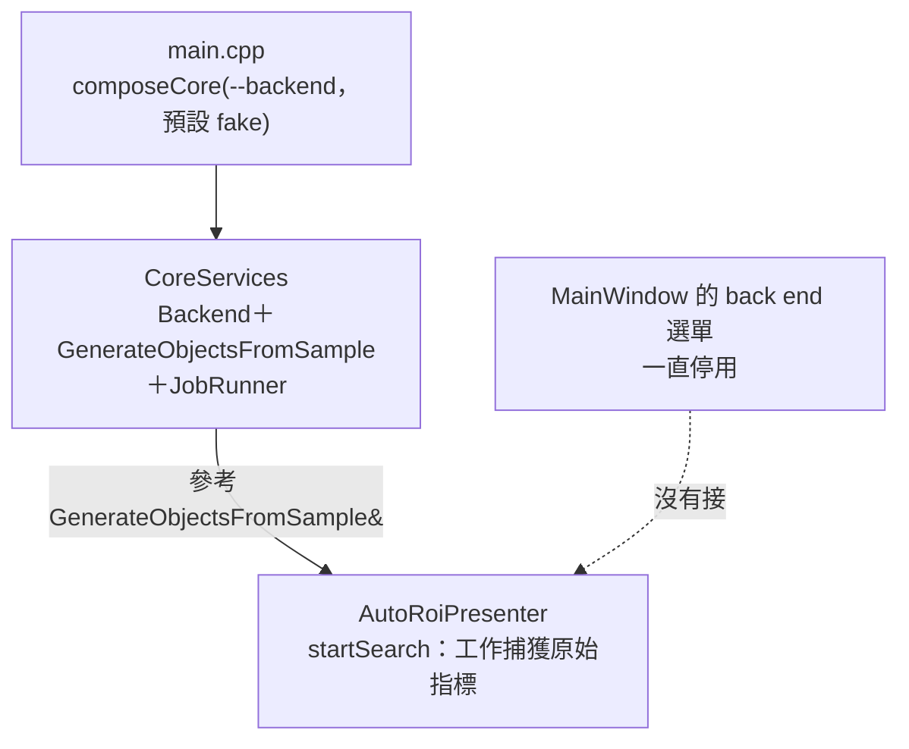
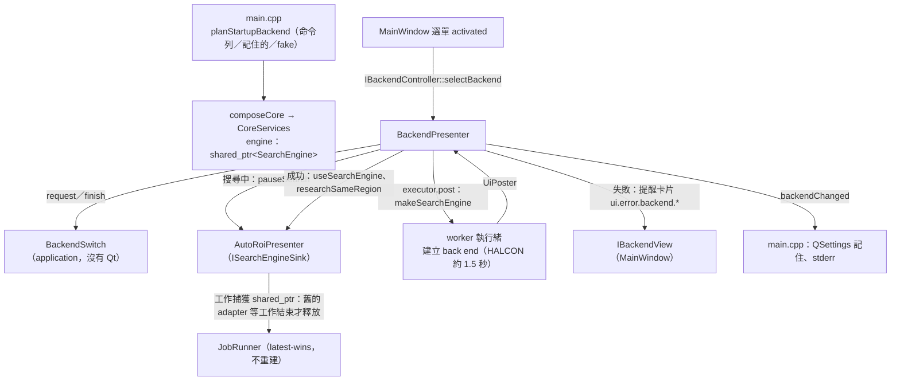

# ADR-021 執行中切換 back end：可共用的 `SearchEngine`、application 層的 `BackendSwitch`、背景建立、記住上次

- 日期：2026-10-08
- 決定者：使用者在 S09 之前的 session B 指定要做（back end 選單可以在執行中切換；切換時先取消進行中的工作；切到 HALCON 時授權檢查不能卡住 UI；失敗時顯示 `ui.error.backend.*` 卡片並回到原本的 back end；規則放 application、組裝放 app、presentation 只透過介面），並在開工時決定三件事：（1）**啟動時用記住的那一個**（沒有記錄時 fake）；（2）**畫面上有提案時切換，用新的 back end 重新搜尋同一個區域**；（3）提醒卡片被搜尋的卡片蓋過之後再出現，直到按〔關閉〕（第 1 件，見 ADR-017 的「後續（2026-10-08）」）。其餘（擁有權的做法、背景執行、設定檔的位置與格式、規則的切法）是 Claude Code (Claude Opus 5.5) 的提案並實作。
- 狀態：採用

## 背景

S03 起 back end 只在啟動時選（`--backend`），選單一直是停用的。Presenter 拿的是 `composeCore` 給的 `GenerateObjectsFromSample&` 與 `JobRunner&` 參考，use case 又參考 back end 的兩個 adapter。要在執行中換 back end，有三個問題：

1. **舊的 adapter 何時釋放**：`JobRunner` 是 latest-wins，取消時不等舊的工作停下（I4）；不可中斷的函式庫呼叫（OpenCV 的一次 `matchTemplate`、HALCON 的運算子）還在用舊的 adapter。直接換掉、釋放舊的，就是 use-after-free；等它停下，UI 就卡住。
2. **HALCON 的建立很慢**：第一次約 1.5 秒（授權檢查，ADR-017）。在 UI 執行緒建立，畫面會凍住。
3. **規則**：哪些狀態可以換、換的時候搜尋與提案怎麼辦、失敗時怎麼辦、啟動時用哪一個。ADR-011：規則放在沒有 Qt 的 application 層，用決定性的單元測試驗證。

## 決定

1. **`SearchEngine`（application/backend/SearchEngine.h）＝ back end ＋ 用它的 use case**，建好之後不變，以 `shared_ptr<const SearchEngine>` 交出去。Presenter 持有目前的那一份；**每個搜尋工作也持有一份**（`useCaseOf(engine)` 是和 engine 共用擁有權的 use case 指標）。換 back end 時 Presenter 只換掉自己的那一份；舊的 adapter 等最後一個用它的工作結束才釋放（在那個 worker 上）。執行緒池、`JobRunner`、`PerfProbe` 不重建（和 back end 無關）。`CoreServices` 的 `backend`、`generateObjects` 兩個欄位因此合成 `engine`。
2. **`BackendSwitch`（application/backend/BackendSwitch.h）是規則**，沒有 Qt：
   - `request(id)`：就是目前的 → 什麼都不做；正在換別的 → 不收（同一時間只換一個）；沒有這個 id、或登記成不可用 → 不必嘗試，回原因；其餘 → 開始（`pending()`）。
   - `finish(id, 成功與否)`：成功 → `current()` 換成新的；失敗 → `current()` 不變（回到原本的 back end）；不是正在換的那一個 → 忽略。
   - `pausesSearch(state)`：搜尋中就先作廢進行中的工作（latest-wins，不等它停下；它的結果回來時因世代不符被丟掉）。狀態**留在 Searching**，忙碌標示照舊；使用者按 Esc 照樣回到 Idle。
   - `researchAfter(outcome, state)`：成功時 Searching（暫停的）、Preview、NoMatch → 用新的 back end 搜尋同一個區域（使用者的決定 2；和改了角度範圍一樣走 `ParamsChanged`，舊的提案留在畫面上直到新的結果取代它，提案與文件的歷史都不動）；失敗時只有 Searching → 用原來的 back end 接著做，其餘維持原狀。
   - `planStartupBackend(命令列, 記住的, "fake")`：命令列有指定 → 用它、嚴格（不存在或不可用就結束碼 2，S03 起的行為不變）；否則先用 fake（視窗馬上出現），記住的那一個在視窗出現之後**經同一條切換路徑**在背景換過去，失敗時留在 fake、訊息列的卡片說原因（使用者的決定 1）。
3. **背景建立**（presentation 的 `BackendPresenter`，Qt 這一側）：在核心的執行緒池（和 `JobRunner` 同一個）上呼叫組裝根給的工廠（`makeSearchEngine`），結果經 `UiPoster` 回到 UI 執行緒。切換中選單停用、顯示要換成的那一個，狀態列最左邊是「切換到 HALCON…」；畫布與工具照常可用（期間開始的搜尋用舊的 back end，換好之後依 `researchAfter` 用新的再搜一次）。`BackendRegistry` 的契約改成「註冊完之後 `create` 可以從任何執行緒呼叫」；OpenCV 與 HALCON 的執行緒數只在第一次建立時設定（數字每次一樣，而且舊的工作可能還在跑，不要在那時重設全域的執行緒池）。
4. **失敗**：訊息列的提醒卡片（第 1 件的那一格，比搜尋的卡片低一級、按〔關閉〕才收起）顯示 `ui.error.backend.title`（換不過去的那一個）、`ui.error.backend.body`（{fallback} ＝ 仍在用的那一個）、原因（英文，例如 HALCON 的授權錯誤）、`ui.backend.reverted`（「仍使用 Fake (synthetic grid)。」）。選單回到原本的那一項；stderr 一行。成功而且新的 back end 有提醒時，照第 1 件顯示提醒卡片與狀態列的標示；沒有提醒時收起舊的。
5. **記住上次**：`QSettings` 的 INI 檔（`%APPDATA%\AOI\AutoCadCreated.ini`，鍵 `backend/last`；看得到、可以手改）。寫入的時機：選單切換成功、命令列指定的啟動成功；失敗不改（例如 dongle 暫時沒插，下次插上就好）。環境變數 `AOI_SETTINGS_DIR` 可以換資料夾（`tst_cli` 每次啟動用一個新的暫存資料夾，測試不碰使用者的設定）。stderr：開始換成記住的那一個、換成功、換失敗各一行（`tst_cli` 從外面驗證）。
6. **分層**：規則在 application（`BackendSwitch`、`SearchEngine`）；組裝在 app（`main.cpp` 給工廠、讀寫設定、接 stderr）；presentation 只透過介面：`IBackendController`（`availableBackends`、`selectBackend`、`applyNoticeAction`）、`IBackendView`（選單、狀態列的標示、提醒卡片）、`ISearchEngineSink`（`BackendPresenter` 對 `AutoRoiPresenter` 的窄介面：`interactionState`、`pauseSearch`、`useSearchEngine`、`researchSameRegion`）。依賴表沒有變。

## 證據

- `tst_backend_switch`（application，沒有 Qt）：每條要求與完成的規則、`pausesSearch` 與 `researchAfter` 對 8 個狀態、啟動的三種情況、`makeSearchEngine` 的成功與錯誤；**擁有權**：搜尋器卡在不可中斷的呼叫裡時放開 Presenter 的那一份，adapter 仍活著、工作用得到；工作結束之後才釋放。
- `tst_presenter`（產品的接線＋假 back end，真的 `QThreadPool`）：工廠卡在閘門上（模擬 1.5 秒的授權檢查）時事件迴圈照常跑、選單停用、狀態列「切換到 …」、工廠**不在 UI 執行緒**；成功後之後的搜尋用新的、提醒卡片與標示出現；預覽中切換 → 同一個區域用新的重新搜尋；搜尋中切換 → 舊的結果被丟掉、用新的搜尋；失敗 → 留在原本的、卡片有原因與「仍使用 …」、提案不動、不重新搜尋；不可用與不存在的 id 不必嘗試；換的期間不收別的要求。
- **真的 HALCON**（`tst_presenter` 的 `switchingToTheRealHalconKeepsTheUiThreadResponsive`，Release，這台機器的 runtime 授權）：切換總共 1 289、1 342 ms（兩次；第一次載入 DLL 與授權檢查都在 worker 上），`selectBackend` 0 ms 就返回，UI 執行緒事件迴圈最長的間隔 12 ms（5 ms 的計時器；門檻 200 ms）。拿不到授權時這一項跳過並寫出原因。另外用真的程式（設定檔記住 halcon、不給 `--backend`）啟動：stderr 依序是開始換、換成功、授權的提醒，程式繼續跑。
- `tst_cli`（真的 `AiInspTool.exe`）：命令列指定的被記住；記住的不能用時程式繼續跑、stderr 說原因、記住的值不被改；記住 opencv 時沒給 `--backend` 也換成 opencv（OpenCV 編進程式時）。
- 第 1 件的測試照舊通過（提醒卡片、狀態列的標示）。

## 否決的替代方案

- **換掉整個 `CoreServices`**（重建 executor、`JobRunner`）：`JobRunner` 解構時要等所有工作結束，UI 會卡住；而且執行緒池、probe 和 back end 無關。
- **換 back end 前同步等舊的工作停下**：不可中斷的呼叫可能要幾百毫秒（25 MP 的種子搜尋 0.27 秒，S07），違反 I4 的精神。
- **在 UI 執行緒建立**：HALCON 第一次 1.5 秒畫面凍住。
- **舊的 adapter 永遠不釋放**（例如啟動時的那一個一直留著）：能動，但每換一次就多留一份，而且擁有權變得說不清楚。
- **切換時保留提案、只有下一次搜尋才用新的**／**捨棄提案**：使用者選了「用新的重新搜尋」；保留的話狀態列的 back end 和畫面上的結果會不一致。
- **記住的值存在 Windows 登錄**（`QSettings` 在 Windows 的預設）：看不到、測試不好隔離；INI 檔可以用環境變數指到暫存資料夾。
- **記住的那一個在視窗出現之前同步建立**：記住 HALCON 時每次啟動先等 1.5 秒才看到視窗；而且失敗時要另寫一條「不結束、改用 fake」的路徑。改成視窗出現之後走同一條切換路徑，成功與失敗的畫面都和選單切換一樣。
- **切換期間停用畫布與工具**：期間開始的搜尋用舊的 back end、換好之後再搜一次，結果一樣正確；停用反而讓使用者以為程式卡住。

## 後果與限制

- **HALCON 的授權探測整個程式只做一次**（`halconLicense()` 快取，ADR-017）：第一次切到 HALCON 失敗（例如 dongle 沒插）之後，插上 dongle 再切換仍然失敗，要重新啟動程式。沒有改，因為 HALCON 自己在同一個行程裡是否會重新檢查授權沒有驗證過。
- 從 HALCON 換到別的 back end，HALCON 仍然在這個行程裡初始化著（授權寫 `SESSIONS=1`）；會不會佔住授權、讓別的 HALCON 程式拿不到，沒有驗證。
- 搜尋時 back end 無法使用的錯誤卡片（S08 的 `errorCard`，`ErrorCode::BackendUnavailable`）標題仍把錯誤訊息當成 back end 名稱（S08 留下的，這次沒有改）；切換失敗用的是新的卡片，不受影響。
- 換 back end 不進復原堆疊（ADR-002 規則 6）。重新搜尋產生的新提案取代舊的，和改角度範圍一樣。
- `copy.json` 新增 `ui.backend.switching`、`ui.backend.reverted`。`--backend` 的說明改成「預設：上次用的，沒有就是 fake」。

## 流程圖

修改前：

修改後：

