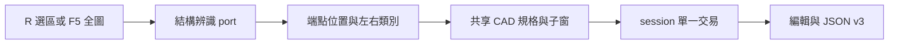

# ADR-036：Socket 選區結構辨識與共享 CAD 規格

- 日期：2026-10-29
- 狀態：採用
- 計畫：R08.9–R08.11

## 決策

使用者要求選區本身只限制處理範圍，不能把它當 NCC 樣本。本決策取代 ADR-034 樣本搜尋作為 Socket 預設入口；舊 API 保留相容驗證。影片僅能觀察到操作，不能據此斷定其內部模型或高度圖來源。

OpenCV adapter 以多閾值、端點與相鄰大焊墊配對、尺度族群及重複排列證據定位水平端點。application 將觀察映射到左右兩種共享 CAD profile，建立 Body 及 Window。CAD 尺寸採族群估計或指定值；後續沿用文件規格，不隨每個反光亮區變動。晶格只校正已觀察的位置，不增加缺格物件。

單框改尺寸使用 copy-on-write；重新註冊保留人工編輯。空結果不清除既有物件。影像與工作世代沿用既有所有權、取消及背景執行規則。

## 限制與證據

這是 Socket 水平端點的規則模型，不是通用 PCB 深度模型。結構品質是啟發式分數；檢測窗不代表已執行缺陷判定。合成干擾物、無相鄰焊墊、共享類型、人工覆寫、存讀與無 NCC 呼叫均有測試。實圖局部 24 個、全圖 686 個候選；沒有完整人工標註，不宣稱 precision／recall。後續 R09 另做 OBB 及實例分割。
