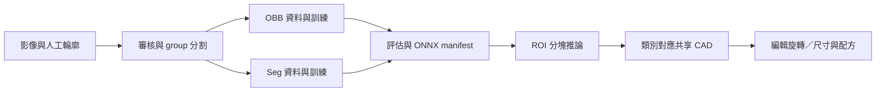

# ADR-037：PCB 雙模型學習工作台

- 日期：2026-10-29
- 狀態：採用
- 計畫：R09

## 決策

先交付 R08，再依使用者授權接續兩種深度學習模式。以獨立 PySide6 工作視窗承載模型工具，不把 Torch／Python 嵌進現有 C++／Qt 程序。共用專案入口啟動器提供規則 Socket 與 PCB 深度學習選項；C++ 五層依賴保持不變。工作台程式放 tools/pcb_dl，環境放 build/pcb-dl-env，資料由使用者指定本機位置。

採 Ultralytics 的 OBB 及 instance segmentation 訓練／匯出接口；推論只載入 ONNX，由模型 manifest 記錄 task、類別、CAD 規格與訓練來源。缺少模型、類別名稱不一致或 CAD 對應未設定時明確拒絕生成，絕不退回規則冒充 AI。外觀 polygon／OBB 與 CAD 尺寸分離；共享的 profile 固定尺寸，instance 有各自位置與逆時針角度，內檢測窗依比例生成。

標註存成 polygon（矩形也能畫），可匯出分割輪廓與最小面積旋轉框。train/val/test 由來源板子／拍攝批次 group 分割，檢查重複影像、越界、退化輪廓、類別及審核狀態。資料需人工完成並標記 reviewed；不得把模型預測直接當正式標註。訓練、驗證、ONNX 匯出由獨立程序執行，記錄版本及參數，UI 可以取消自有工作。

影像按重疊 tile 推論，輸出還原全圖座標，跨 tile 以同類旋轉 IoU 去重。分割以輪廓最小面積框求軸向。只生成完全在 ROI 內的 CAD，人工編輯保留；未映射類別不自行猜尺寸。OBB 與長軸只能提供模 180 度軸向，不能推斷極性或 Pin 1。

## 驗證界線

測試標註往返、兩種資料匯出、群組隔離、旋轉／遮罩座標、去重、固定 CAD 規格、人工編輯與配方；以實際 ONNX 推論及短訓練驗證接線。合成示範模型只證明流程，不作真實 PCB 準確度證據。實際品質須有不同板子／批次的人工標註測試集。

參考：[OBB](https://docs.ultralytics.com/tasks/obb)、[Segmentation](https://docs.ultralytics.com/tasks/segment)。依賴授權依 Ultralytics 發行條款，部署前按使用方式處理。
