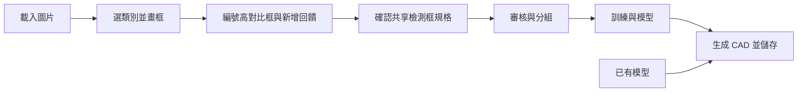

# ADR-038：PCB 工作台的任務引導與固定像素框線

- 日期：2026-10-29
- 狀態：採用
- 計畫：R09.9–R09.10

## 問題與現況

第一次使用者無法從單一長側欄理解標註、CAD 規格、訓練與推論的順序。內部參數名稱及所有操作同時出現，缺少目前工具、完成回饋及前置條件。畫框僅新增標註，使用者卻可能以為會立即搜尋。

框線使用 1 scene-unit 的 pen。5120×4096 圖片適配視窗後，線寬小於一個螢幕像素；文字忽略縮放仍可見，造成只見 resistor、看不見框的狀況。

## 決策

以五個可自由返回的任務頁取代長表單：載入圖片、標註元件、設定檢測框、訓練模型、產生與儲存。每頁有目標、操作提示、主要動作、阻塞原因，上一頁／下一頁固定在側欄底部。已有模型可直接進入最後一步。

只顯示當前任務需要的欄位。類別顯示中文且保留穩定英文 ID；框規格可從選取標註帶入，但須由使用者確認。訓練回合、輸入尺寸、信心門檻與分塊大小放在預設收合的進階區。訓練／匯出／生成按鈕以資料、審核、獨立分組、模型與規格狀態決定可用性，並在頁面說明缺什麼。

畫布使用 3 px cosmetic pen 加 6 px 深色外描邊；選取白色 4 px，頂點為固定 10 px 把手。編號與中文類別有深色底，不以顏色作唯一辨識。標籤、子框與模型輪廓依附主框，拖動時一起移動。極小拖曳不建立難以看見的框，而提示先放大。

儲存顯示明確路徑及狀態，Ctrl+S 儲存目前文件、Ctrl+Shift+S 另存標註。關閉時提供儲存／放棄／取消；存檔取消或錯誤不得關閉。升級既有視窗前透過原 UI 備份八個標註，不自動重分類或改動幾何。

畫布快取原圖 pixmap，標註更新不再重複轉換整張 20 MP 影像。模型／資料格式、C++ Socket 與 R07 均不改動。

## 驗證

首次啟動、未載圖／模型的前置條件、真實滑鼠標註、類別修正與 Undo、尺寸帶入、同板分組阻塞、存檔取消保留文件、極小拖曳提示，以及 5120×4096 適配與半倍率下的實際框線像素。保留 OBB／分割 ONNX 與配方存讀回歸；真實 PCB 模型品質仍另待標註資料。
