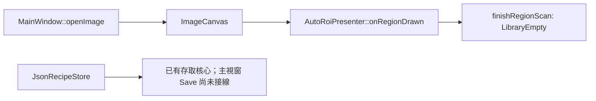

# R08 — Socket 焊點教學最小版本

## 修改紀錄

| 日期 | 修改者 | 說明 |
|---|---|---|
| 2026-10-28 | Codex (gpt-6.1-sol) | 建立需求、決策審查與驗收範圍。 |

## 目標與範圍

在既有 Qt 專案提供可執行的精簡視窗：載入 PCB／Socket 影像、圈選焊點區域、以可調亮度及面積篩選建立獨立可編輯的框、存取既有 JSON v3 配方。沿用 ImageCanvas、IImageSource、JsonRecipeStore 與分層規則。

2026-10-29 使用者明確修正操作目標：R 框選幾個焊點作樣本，F5 搜尋整張 Socket；結果尺寸統一採第一個樣本，依相似度篩選及去重，可編輯並保存樣本／配方。亮塊定位保留相容測試入口，不再作主要 UI 操作。

2026-10-29 最新需求取代上述主要操作：ROI 只限定處理區域，不當比對樣本。先以 Socket 結構模型辨識區域內端點與鄰接焊墊，分類／定位後套共享 CAD 規格及子檢測窗；不呼叫 NCC 樣本搜尋。舊功能保留相容驗證，不再作預設入口。

不包含深度模型訓練、缺陷 OK/NG、3D 量測、機台控制、樣本庫 UI。配方保存影像路徑與框幾何；原始影像另存，不嵌入配方。

## 細項

| 編號 | 細項 | 狀態 | 分支／commit | 驗證 |
|---|---|---|---|---|
| R08.1 | 理解現有接線、獨立教學資料模型與區域辨識 port | ✅ | fix/r07-multi-sample；R08 未提交 | 分層檢查 302 檔、0 違規；既有搜尋演算法未改。 |
| R08.2 | OpenCV 區域亮塊辨識、參數與取消 | ✅ | R08 未提交 | 合成圖座標／雜點／取消與真實圖 smoke 通過；最終選區 28 框。 |
| R08.3 | 精簡 Qt 視窗、框編輯、Undo/Redo、JSON 配方存讀 | ✅ | R08 未提交 | Qt Test 10 passed、0 failed、0 skipped；Release 與 Debug（無 OpenCV／HALCON）建置成功。 |
| R08.4 | 建置、回歸、操作示範、可執行交付與文件 | ⚠️ | R08 未提交 | PARTIALLY VERIFIED：四個失敗已於 R07.5–R07.7 修復；全量 67/67 無執行失敗、Socket 10/0/0。警示只保留既有 skip／XFAIL 與未驗資料，並非四個失敗仍未解決。 |
| R08.5 | 樣本持久化、固定輸出尺寸、全圖樣本搜尋 use case；沿用模板 port 與 NMS，不動 R07 晶格規則 | ✅ | 未提交 | PARTIALLY VERIFIED：合成正負例、多樣本去重、固定尺寸、弱樣本及取消通過；真實圖 3 樣本得到 632 個 44×24 結果。 |
| R08.6 | R 教樣本／F5 全圖搜尋、相似度門檻、樣本標示、編輯與配方還原 | ✅ | 未提交 | PARTIALLY VERIFIED：共享版本 15 passed／0 failed／0 skipped，含滑鼠教樣本、F5、存讀後樣本與門檻還原、千框拖移。 |
| R08.7 | 真實 Socket 全圖驗證、誤框／漏框觀察、完整回歸、執行版本與文件交付 | ✅ | 未提交；不 commit／push | PARTIALLY VERIFIED：Release、Debug 無 OpenCV／HALCON 建置成功；全量 67/67；執行包啟動成功；保留既有 skip／XFAIL，無完整標註不宣稱精確率。 |
| R08.8 | 重現並修正 1017 框場景的多選拖移卡死；對照既有畫布，驗證框選、拖移、Esc、Undo/Redo 與選取同步 | ⏳ | 既有工作目錄；不 commit／push | before：1017 框、5 框選取，放開後超過 10 秒逾時；單獨改為 Interactive 後 39.32 ms。待最終回歸。 |
| R08.9 | Socket 區域結構辨識：多閾值、端點尺度族群、鄰接焊墊、重複排列證據；不需使用者教樣本 | ✅ | 未提交 | PARTIALLY VERIFIED：合成亮度變動、孤立亮塊／無焊墊負例、真實 ROI 24 與全圖 686 通過。 |
| R08.10 | 區域辨識結果轉為分類共享 CAD 規格／定位框／子檢測窗，支援位置校正、單框編輯與配方存讀 | ✅ | 未提交 | PARTIALLY VERIFIED：共享類型／Body+Window、單框 copy-on-write、人工修改保留、JSON 存讀及無 NCC 呼叫通過。 |
| R08.11 | 預設 R 區域自動註冊、F5 全圖註冊、CAD 規格控制、真實圖截圖、回歸與新版執行包 | ✅ | 未提交；不 commit／push | PARTIALLY VERIFIED：Socket 專項 19/0/0；Release、Debug 無 CV／HALCON 成功；執行包 --help 與示範啟動成功。完整回歸見 status.md。 |

## 區域 CAD 自動註冊的決策審查（最新需求）

| 面向 | 決策／證據／驗證 |
|---|---|
| 架構 | recognizer port 回傳 Socket 端點觀察；application generator 套 CAD 規格與位置，app 組裝 OpenCV。UI 不依賴 cv。 |
| 範圍與信任 | 專案未有現成元件辨識權重；第一版明確為 Socket 水平端點結構模型，未知物件不冒稱通用 PCB 辨識。照片本機處理，不用高度圖。 |
| 資料契約 | CAD 規格由同族群／指定規格決定，多個 instance 共用 type，並有子檢測窗；不把每個亮區 bbox 或第一範本當 CAD。沿用 v3。 |
| 相容與編輯 | 載入支援 Body＋Window 與共享 type；單框改尺寸採 type copy-on-write，不連帶改其他框。樣本／舊 API 留相容驗證。 |
| 並行與可靠性 | 延用 owner、世代取消、背景工作；只修改選區內 CAD 物件，空／錯誤不動文件，不向 ROI 外產框。 |
| 精度與效能 | 結構配對與尺度族群抑制亮點／焊墊誤框；可用既有晶格校正已辨識的位置，不補未觀測格子。量測實際 ROI 與全圖，未標註不宣稱辨識率。 |
| 驗證 | 尺寸及反光變動、孤立亮塊、左右類別、共享 CAD、多窗、單一 ROI、存讀、無 NCC 呼叫、真實圖與完整回歸。 |

## R08.8 拖移修正的決策審查（2026-10-29）

| 面向 | Decision / Evidence / Verification |
|---|---|
| 架構、契約、所有權與並行 | 只改 Socket 視窗的表格更新；既有 SelectTool、session、Recipe、JobRunner 與 UI 執行緒責任不變。實際拖曳預覽與 move 已返回，阻塞在 refresh。測試驗證一次拖曳一個交易、Esc、Undo/Redo。 |
| 可靠性、選取與相容 | 沿用儲存格，僅在文字或 id 改變時寫入；保留選取訊號阻擋及 refreshSelection。以 5 框框選與存讀／刪除既有測試驗證同步，無新依賴。 |
| 效能與容量 | 持續內容欄寬計算改成批次後一次；第一個單變因實驗即消除 10 秒逾時。後續沿用儲存格，減少不變資料更新。量測 1017／5000 框、20 次 Move＋Release，三次紀錄範圍，不調高預算。 |
| 信任、交付與驗證 | 本機資料、不新增輸入或權限；重建 Release 程式與測試，不提交其他 session 的工作。無實際執行的真實影像或完整效能基準線不冒稱通過。 |

決策與前後流程：[ADR-034](../../../adr/034-socket-table-batch-column-sizing.md)、[R08.8 證據](tasks/drag-performance.md)。

## 樣本流程的決策審查（2026-10-29）

| 面向 | 決策／證據／驗證 |
|---|---|
| 架構 | application 新增樣本搜尋 port/use case，app 組裝 OpenCV；重用 ITemplateBuilder/IPatternSearcher。用合成圖證實全圖匹配。 |
| 契約 | Board 的 Sample 狀態保存樣本，Recipe.params 保存門檻；v3 不升版。輸出框採第一樣本大小，存讀逐欄驗證。 |
| 所有權與並行 | 保留 ImageView owner、JobRunner、世代與 UiPoster。測試取消／換圖不套舊結果。 |
| 可靠性 | 空結果、弱樣本與錯誤不清掉既有結果；重搜替換 Auto，保留樣本／人工框。Undo/Redo 作為單一交易。 |
| 信任與容量 | 本機比對，不上傳照片；限制樣本與匹配數，非法／過大樣本明確拒絕。 |
| 效能 | 固定角度、不做低分晶格推算；量真實全圖搜尋及 UI 回應，不冒稱辨識率。 |
| 交付與驗證 | 保留舊配方與 R07；新增相似干擾物、固定尺寸、多樣本去重及 UI 存讀測試，再跑完整回歸。 |

## 決策審查

| 面向 | Decision | Evidence | Verification |
|---|---|---|---|
| 架構與介面 | 新增獨立教學 session、偵測 port 與視窗；不改模板搜尋規則。 | AutoRoiPresenter::finishRegionScan 現為 LibraryEmpty；已有畫布和儲存 adapter。 | check-deps；既有搜尋契約回歸。 |
| 資料契約 | 使用 Recipe／Board／ComponentType，單框獨立類型；v3 JSON 不升版。未標定保留 umPerPixel=0。 | component.h、JsonRecipeStore::kSchemaVersion=3。 | 儲存再載入的框與像素尺寸相同。 |
| 所有權 | worker 持有 ImageView owner 和 detector；視窗解構取消並斷開 queued 回呼。 | ADR-014、JobRunner、UiPoster。 | 關閉／取消／換圖的舊結果不得套用。 |
| 並行與狀態 | 背景辨識 latest-wins；UI 更新只在主執行緒。 | JobRunner 與現有 Presenter 模式。 | 工作期間畫布不編輯；取消立即恢復。 |
| 可靠性與錯誤 | 空結果不清除舊框；配方先解碼影像並驗證尺寸才替換；QSaveFile 原子寫入。 | IRecipeStore 契約。 | 空區域、無效檔案、存檔失敗保持原資料。 |
| 信任邊界 | 檔案是資料，不執行配方內容；圖檔保留本機。 | 使用者授權本機 MVP。 | 非法幾何／過大候選數明確拒絕。 |
| 效能與容量 | 僅處理圈選區；限制候選數，取消點設在階段間。 | Socket 原圖 5314×4594；toGray8 支援有效位元數。 | 記錄真實圖區域延遲；不宣稱硬即時。 |
| 相容與交付 | 主程式加入口與 --socket；沿用 qmake、Rust 預設、OpenCV 選項。 | ADR-018、ADR-031。 | Release、Debug 建置；無 OpenCV 提供明確不可用訊息。 |
| 驗證 | 新增 focused Qt Test 與合成／真實圖驗證。 | tests/ui、test.ps1。 | 實際執行並記錄 exit code；跳過如實回報。 |

設計決策詳見 [ADR-033](../../../adr/033-socket-teaching-mvp.md)。

## 完成定義

- 可執行程式完成載圖、圈選、產生框、拖移／改大小／刪除／手動補框、存讀配方。
- 新增測試與既有單元／契約回歸完成；未驗或既有失敗清楚列出。
- 四種輸出及 perf.md 完成；計畫與交接文件更新。
- 保留開工時 R07、.archify、AiInspTool/cargo 的變更，不 commit／push。

## 現況流程

## Commit 參考

本次保留未提交；若另獲提交授權，依 project-rules.md 的格式記錄 Socket 教學視窗、區域辨識與配方往返驗證。

## Start prompt

繼續 R08 時先讀 AGENTS.md、docs/plans/INDEX.md、本計畫 plan.md 與 status.md；回覆使用繁體中文，保留 R07 未提交工作。
