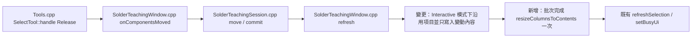

# R08.8 多選拖移卡頓診斷

## 修改紀錄

| 日期 | 修改者 | 說明 |
|---|---|---|
| 2026-10-29 | Codex (gpt-6.1-sol) | 建立實際滑鼠重現、單變因探測與局部修正。 |

## 現象與證據

- 使用者截圖：Socket 視窗 1017 ROI，框選數個後拖移造成「沒有回應」。
- 實際指令：設定 PATH 含 Qt bin、`QTEST_FUNCTION_TIMEOUT=10000` 後執行 `build/qmake-r08/bin/tst_solder_teaching.exe thousandBoxesMarqueeAndDragStayResponsive -o build/r08-samples/drag-before.txt,txt`。
- before：1017 框、選取 5 框，預覽返回，放開時逾時；10008–10024 ms，exit -1073740791。200 框、一次 mouseMove 也在放開後超過 5 秒；40 框放開約 426 ms。5 框只有約 13 ms。
- 所有權、文件交易與既有畫布不變。架構依賴、Recipe v3、背景辨識與儲存皆不需改動。

## 假說與單變因實驗

| 排序 | 假說與預測 | 結果 |
|---|---|---|
| 1 | 選取同步導致阻塞；刷新前清除表格選取應解除。 | 1017 框仍在刷新第一批儲存格逾時，排除主因。 |
| 2 | 逐格重建搭配持續內容欄寬計算；Interactive 應解除。 | 單獨改模式後，1017 框約 39.32 ms 返回。採用批次結束後調整一次欄寬。 |
| 3 | 文件 move 或快照太慢；進入 refresh 前就應阻塞。 | 探測已進入 refresh 的逐格更新，排除主因。 |

臨時 `[DEBUG-r08drag]` 探測已移除。錯誤版本的 Qt Test watchdog 會以 fatal 結束；最後使用 `-nocrashhandler` 避免 Windows crash handler 殘留，僅清理本次建立的測試行程。

## 修改前

## 修改後

決策見 [ADR-034](../../../../adr/034-socket-table-batch-column-sizing.md)。

## 最終量測

Release、同機器／Qt，5 框選取、1:1 顯示、20 次 Move 並處理事件，再 Release；三次獨立行程。包含 UI 同步返回，不代表放開後第一幀已顯示，也不是 p95。初始重現使用適配影像視角，單變因解除卡頓的 39.32 ms 亦是該視角；不能拿兩者算精確加速倍數。

| 場景 | 20 次 Move＋Release（ms） | 其中 Release（ms） |
|---|---|---|
| 1017 框 | 93.44、138.71、99.91 | 66.98、107.16、75.60 |
| 5000 框 | 429.44、243.69、199.75 | 405.98、217.45、180.29 |

`drag-final-{1,2,3}.txt` 各 4 passed、0 failed、0 skipped、exit 0，包含 init/cleanup 與兩個資料列。每列驗證框選 5 框、預覽不改 revision、放開只提交一次、位置、選取保留、Undo/Redo 與 Esc。最終可重現指令為相同測試名稱，加 `-nocrashhandler`；設定 `QTEST_FUNCTION_TIMEOUT=20000`。

只修欄寬但仍重建項目時，1:1 場景 1017／5000 的 Release 分別 198.21／726.19 ms；沿用儲存格後降低如上。仍保留完整場景建立與一次欄寬量測，5000 框有數百毫秒成本。沒有更動全專案預算，亦未重建無法代表本缺陷的全專案效能基準線。
