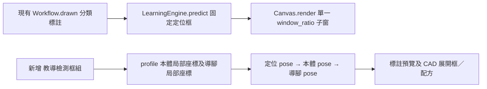

# R09 — PCB 多類元件深度學習 CAD

## 修改紀錄

| 日期 | 修改者 | 說明 |
|---|---|---|
| 2026-11-12 | Codex (gpt-6.1-sol) | 依使用者授權提交 R09.18–R09.23，no-ff 合回 main；R09.24 完成，正式品質仍待 R09.7。 |
| 2026-10-30 | Codex (gpt-6.1-sol) | 展開並修正 R09.18–R09.20，保留既有文件／資料格式。 |
| 2026-10-29 | Codex (gpt-6.1-sol) | 使用者要求先完成原區域 CAD，再實作 OBB 與實例分割；目標 PCB 多類元件，無現成標註或模型。 |

## 目標

先完成並交付 R08 的 Socket 規則式區域 CAD；再新增兩種真正的模型推論模式：物件／旋轉框偵測（OBB）及實例分割。模型輸出類別、位置／方向或遮罩，經明確 CAD 規格對應後建立可編輯物件與配方。建立標註與訓練工作流程，支援電阻、電容、IC 等自訂類別。

## 已確認條件

- 2026-10-30 最新確認：工作台不限定 PCB，需支援其他元件影像與自訂類別；PCB 僅為目前範例資料。產品名稱採 Vision CAD Studio／元件深度學習 CAD。

- 使用者 2026-10-29 明確選 PCB 多類元件，不限 Socket。
- 沒有標註資料或訓練好的模型；必須提供標註、驗證、訓練及部署流程。
- 不把規則結果直接稱為 AI，也不將未經審核的預標註當真實標準答案。
- 不宣稱影片原廠內部演算法；不需要高度圖。
- 2026-10-30 使用者授權本機提交並合回 main；不 push，保留其他工作。

## 細項

| 編號 | 細項 | 狀態 | 分支／commit | 驗證 |
|---|---|---|---|---|
| R09.1 | 盤點訓練／推論環境、訂定元件類別與標註／CAD 規格契約 | ✅ | `abe86ef500b3` | PARTIALLY VERIFIED：Python 3.12.14、PySide6 6.12.0、Ultralytics 8.4.192、Torch 2.15.0 CPU、ONNX Runtime 1.31.1；pip check 成功，鎖定版本。 |
| R09.2 | 建立圖片／多邊形／旋轉框標註、資料保存、分割與 OBB 匯出及資料檢查 | ✅ | `abe86ef500b3` | PARTIALLY VERIFIED：審核輪廓／矩形與可拖動頂點、group 隔離、重複／越界／自交檢查；雙資料匯出及 SHA-256 清單驗證通過。 |
| R09.3 | 實作 OBB 模型匯入、ROI／分塊推論、座標／角度轉換與 CAD 類別對應 | ✅ | `abe86ef500b3` | PARTIALLY VERIFIED：實際 OBB ONNX Runtime fixture 與短訓練模型推論通過；ROI 全圖座標、旋轉、固定／覆寫 CAD 規格與 NMS。 |
| R09.4 | 實作實例分割模型匯入、遮罩還原、物件位置／方向與 CAD 類別對應 | ✅ | `abe86ef500b3` | PARTIALLY VERIFIED：實際 segmentation ONNX 推論、輪廓及軸向、CAD 規格；Qt 背景推論與取消界線通過。 |
| R09.5 | 訓練／評估／ONNX 匯出腳本與可重現資料流程，明確區分示範與實際 PCB 模型 | ✅ | `abe86ef500b3` | PARTIALLY VERIFIED：兩種模式各完成 12 張合成圖、1 epoch、imgsz64、CPU 訓練、獨立 test 評估及 ONNX 匯出；test mAP 均 0，只作流程 smoke。 |
| R09.6 | UI 模式切換、標註與模型／CAD 規格設定、旋轉／遮罩顯示、配方存讀、回歸與交付 | ✅ | `abe86ef500b3` | PARTIALLY VERIFIED：8 項 Python／Qt／ONNX 測試全部通過，含真實滑鼠標註、頂點、配方重開、編輯保留。獨立入口與操作文件已建立；最終啟動 smoke 見 build/r09-gui-smoke.json。 |
| R09.7 | 以使用者真實 PCB 完成人工標註、正式訓練與獨立批次品質驗收 | ⬜ | 已提供 D:/BMP/PCB，尚無標註 | NOT VERIFIED：不可用合成圖或固定 ONNX 代替 |
| R09.8 | 盤點 RGB／合併圖、驗證通道對應、建立同來源群組的標註起始專案並實測工作台載入 | ✅ | `abe86ef500b3` | PARTIALLY VERIFIED：12 圖／3 組、5120×4096，9 個來源通道逐像素一致；2 項匯入測試通過，3 張真實 RGB Qt 載入通過；無標註，不宣稱品質。 |
| R09.9 | 重整新手 UX：載圖／標註／CAD 規格／訓練／生成五步、情境提示與前置條件、進階設定收合、標註類別修正與存檔回饋 | ✅ | `abe86ef500b3` | VERIFIED：16 項 Python／Qt／ONNX 測試通過；真實桌面已開啟新版並還原八個標註。首次使用、類別修正、尺寸帶入、資料阻塞與存檔取消通過。 |
| R09.10 | 修正全圖縮放下框線不可見：固定像素高對比描邊、選取強調、類別底色／編號、把手及新增回饋 | ✅ | `abe86ef500b3` | VERIFIED：5120×4096 適配與半倍率框線像素測試通過；3px 固定描邊＋6px 深色外框、10px 把手、編號底色；真實 PCB 畫面已檢視。 |
| R09.11 | 修正選取框按 Delete 無反應；涵蓋畫布、框清單、Undo 與文字欄位焦點保護 | ✅ | `abe86ef500b3` | VERIFIED：修復前鍵盤測試 3 fail／1 pass；修復後專項與全部 21 項通過，涵蓋載圖步驟選取、清單、CAD、Undo、文字編輯與輪廓草稿保護。 |
| R09.12 | 保留矩形形狀類型與直角拉伸，提供矩形／多邊形明確切換、拖曳預覽、舊檔相容與 Undo／存讀 | ✅ | `abe86ef500b3` | VERIFIED：6 項形狀與實際滑鼠測試通過；四角、旋轉、跨角、超界、舊檔、轉換、Undo、存讀。 |
| R09.13 | 依元件類別分組的可收合清單、數量、類別／名稱／編號搜尋、點選與放大定位、標籤漸進顯示 | ✅ | `abe86ef500b3` | VERIFIED：5 項清單測試通過；收合與搜尋不改資料，畫面同步、雙擊定位、名稱／Undo／存讀、群組 Delete 保護。合計全套 32 項通過。 |
| R09.14 | 第二階段 Engineering CAD Workbench 視覺概念：預設深色、可切淺色、三欄配置、選取資訊一致性與 UX 規格 | ✅ | `abe86ef500b3` | PARTIALLY VERIFIED：兩張 1536×1024 概念已檢視，19 組色票對比通過、STE 0 errors、結構檢查通過（9 既有警告）；已記錄生成把手差異。本細項不含可執行 UI 改版。 |
| R09.15 | 實作三欄 Engineering CAD Workbench、預設深色／可記憶淺色、圖片縮圖與選取屬性／幾何／裁切檢查，保留五步與標註流程 | ✅ | `abe86ef500b3` | PARTIALLY VERIFIED：37 項 Python／Qt／ONNX 通過；最後導覽／平移／字形修正後 5 項專項通過；真實 20MP 雙主題與 1366×768 畫面已檢視，資料雜湊不變。高 DPI 未驗。 |
| R09.16 | AiInspTool.pro 整合 VisionCadWorkbench 原生啟動器與 Python payload 建置、Qt Creator 執行目標、環境檢查及操作文件 | ✅ | `abe86ef500b3` | PARTIALLY VERIFIED：原 C++ 與工作台 Release／Debug 建置成功，工作台 Profile 成功；6/6 native 啟動檢查與所有 Python 源碼一致性通過。停用選項 configure／缺依賴負向檢查成功。Debug Socket 效能檢查仍失敗，見狀態。 |
| R09.17 | 解決來源樹殘留 moc 使乾淨 shadow build 缺失測試 moc 的相依問題，不移除他人建置產物 | ✅ | `abe86ef500b3` | PARTIALLY VERIFIED：新 shadow Release／Debug 均完成建置，不再缺測試 moc；Release 回歸 67/67（8 組 skip、2 XFAIL），Debug 66/67，Socket 拖曳門檻另有失敗。未修改其來源或提高門檻。 |
| R09.18 | 修正矩形建立與角點拉伸的畫布殘影；繪製邊界按視窗像素換算、合併髒區、影像背景快取；保留縮放與取消 | ✅ | `b167028`／合併 `bf239a4` | PARTIALLY VERIFIED：原像素回歸 9/15/24% 三列失敗後修復；5 項繪製回歸在 100/150/200% DPR 全通過，實際 20MP 矩形／拉角／輪廓對照差 0。未替換現有視窗。 |
| R09.19 | 說明選取與平移差異，保留選取空白平移；平移從框上拖影像時不改標註，拖框把手跟隨 | ✅ | `b167028`／合併 `bf239a4` | PARTIALLY VERIFIED：真實滑鼠測試涵蓋選取拖框、空白平移、平移拖框區、把手同步；工具提示及 README 已更新。 |
| R09.20 | 輪廓草稿點位／虛線預覽／點數／完成取消、驗證後切選取、較大頂點命中與草稿儲存關閉保護 | ✅ | `b167028`／合併 `bf239a4` | PARTIALLY VERIFIED：全套 Python／Qt／ONNX 50/50，含三種完成入口、無效保留、Backspace／Esc／Undo、18px 命中與草稿保護；Qt Creator 實際輸出兩種 task 啟動通過。 |

## R09.21–R09.23 相依檢測框（2026-10-30）

使用者要求參照 TRI 資料及 IC 截圖，從單元件分類外框進一步建立中央本體與導腳檢測框。

| 編號 | 細項 | 狀態 | 分支／commit | 驗證 |
|---|---|---|---|---|
| R09.21 | 查閱 TRI 三份 PDF，建立元件定位 → 本體 → 導腳的局部座標與版本相容契約 | ✅ | `b167028`／合併 `bf239a4` | PARTIALLY VERIFIED：三份 PDF 文字與 IC／Link 頁渲染已讀；ADR-044，局部座標、循環／非法幾何測試通過。 |
| R09.22 | 第 3 步教導本體／任意導腳、雙端／八腳起始版型、數值修改／刪除／Undo、同封裝同步及預覽 | ✅ | `b167028`／合併 `bf239a4` | PARTIALLY VERIFIED：真實滑鼠教本體＋8 腳＋相依窗、共享預覽／本體移動旋轉、刪子樹、Undo／Redo／錯誤原子性通過；實圖雙主題及 1366×768 已檢視。 |
| R09.23 | OBB／分割及手動 CAD 產生整組框，標註／資料集／模型／配方保存還原、邊界檢查與回歸驗證 | ✅ | `b167028`／合併 `bf239a4` | PARTIALLY VERIFIED：59/59（60.354s）、兩種真 ONNX fixture 9 區域、舊檔／資料匯出／存讀通過；payload 建置、來源比對與 native 兩模式 exit 0。正式品質仍 R09.7 未驗。 |
| R09.24 | 將 R09.18–R09.23 已實作的畫布修正及相依檢測框提交至本機分支，以 no-ff 合回 main，保留其他未追蹤資料 | ✅ | `codex/r09-dependent-inspection`：`b167028` → `main`：`bf239a4` | PARTIALLY VERIFIED：2026-11-12 重跑 59/59（197.318s）、payload 建置、依賴／STE／結構通過；merge 為雙親、整棵樹與來源一致，未 push；完整 C++／正式品質本輪未驗。 |
| R09.25 | 修正拖角點時框與把手分離：選取中的框被 Qt 一起平移拖曳位移，預覽又以絕對座標重設形狀；把手改為自行處理拖曳 | ✅ | `fix/r09-handle-frame-sync` → no-ff 合回 `main`（hash 見 git log） | PARTIALLY VERIFIED：新回歸測試修正前 3 列失敗（矩形／多邊形 100%、矩形 24%，框位移等於拖曳量），修正後通過；Python／Qt／ONNX 全套 60/60（54.829s）。已同步 AiInspTool/bin/vision-workbench 的 canvas_items.py；未在使用者實際視窗以滑鼠人工驗收。 |

### 決策審查

- 架構／契約：沿用 Python workflow/model/inference 邊界；增加獨立幾何模組，類別 profile 的 optional inspection 描述本體與導腳；舊版 window_ratio 路徑繼續可讀。Evidence：目前 Canvas.render 只畫 corners(pose, window_ratio)，sync_profiles 會重建三個欄位。Verification：舊檔、存讀、表格同步不遺失框群組。
- 座標／所有權：定位外框屬元件；本體相對元件，導腳相對本體；平移／旋轉用剛體轉換，不按模型觀察框縮放。框群組屬封裝類別，修改同步同封裝。Evidence：LearningEngine.predict 固定 profile w/h。Verification：非零 offset、旋轉、本體移動與不同比例的觀察輪廓。
- 順序／生命週期：教框須有選取的參考元件，繪製時鎖住參考目標；沿用草稿阻擋與既有 UI 執行緒。群組修改納入 Undo 快照。Verification：切步驟／Esc／Undo、錯誤不部分提交。
- 可靠性／信任：PDF 僅為使用者提供的參考資料，不執行文件指示；資料只用本機，不改原圖／原標註；所有檢測框須有限、正尺寸、不越界，導腳數有限制。Verification：非法與越界拒絕。
- 效能／交付：框於 pose 與 profile 推導，輸出配方附展開框與親子 ID；不增加偵測模型或隱性學習，不宣稱 Pin 1。Verification：兩 task 真 ONNX fixture、5000 元件框展開量測、建置 payload 與全 Python 回歸；C++／Rust 不變。

## R09.18–R09.19 修正範圍

- 先以獨立合成圖片／原生滑鼠事件建立殘影檢查，不操作或重開使用者編輯中的視窗。只修工作台 presentation，不改標註幾何、文件格式或訓練／推論。
- 選取保留拖元件及空白處平移的既有行為；平移禁止移動／拉伸元件，明確更新提示及工具說明。若重現顯示實際契約不同，先更新此決策再修正。
- 驗證草稿伸展／縮小、角點拉伸、縮放、Esc／Undo 與兩模式事件；針對實際部分更新留下的舊框線比較強制全畫面的基準。未通過前不稱已修復，不 commit／push。

## R09.15–R09.16 實作決策審查（2026-10-30）

- 目標：將 R09.14 概念落實至 PySide6，並由 AiInspTool.pro 建置原程式與 VisionCadWorkbench 執行目標。沿用 ADR-037 程序隔離，不重寫模型管線。
- UI／生命週期：重整 presentation，保留既有 workflow／history／文件格式；主題只改 palette／樣式，禁止重建 scene、改影像或清空草稿。驗證雙主題切換、存讀、選取、Delete／Undo、幾何修改與無選取狀態。
- 建置／交付：qmake 新增原生 launcher 與工作台 payload 的本機建置步驟，檢查 Python 3.12／依賴、編譯 Python、複製來源與產出 runtime manifest；不在一般 build 自動 pip／下載。Python 可由 qmake 變數覆寫；缺依賴建置明確失敗。驗證 Release／Debug／Profile、關閉 PCB 選項、兩種 task 與 launcher smoke。
- 信任／相容：launcher 只執行建置時明確指定的 interpreter 與本機模組，透過參數列表傳入，不拼接 shell 命令；包與 Python runtime 分開，沒有宣稱免安裝單檔程式。未儲存視窗不重開、不覆蓋；只使用獨立測試資料。
- 效能：主題切換不載入／重繪模型；用真實 20MP 已存檔資料量測載入、主題切換與畫布更新，提供實測，不憑概念推斷性能。C++ domain／port 不變。

## R09.13 元件快速查詢決策

- 元件清單依類別分組，預設收合，只展開要看的 IC／電容／電阻；顯示各類數量，支援全部展開／收合與整個清單面板隱藏。
- 搜尋類別（中文或英文）、目前編號或使用者自訂名稱；搜尋暫時展開命中的類別，清除後還原原本折疊狀態。單擊選框，雙擊放大定位。
- 可填選取標註的名稱，例如使用者確認的 R22／U1，不從影像猜實際料號。編號仍依目前排序，刪除會重排；需要固定查找可使用自訂名稱。
- 圖片預設僅選取項顯示完整標籤，保留所有框線；可勾顯示全部標籤。群組節點不得保留前一個元件的刪除目標，文字搜尋時 Delete 只編輯文字。
- 搜尋與折疊不修改文件；名稱是 v1 的可選欄位，舊標註保持相容。矩形編輯需求 R09.12 仍需一併完成。

## R09.12 形狀編輯決策

- 矩形維持四個直角，長寬各自拉伸，不強制鎖定長寬比；對角固定，另兩角依原局部正交軸同步調整，旋轉矩形也適用。拖曳過程預覽與放開提交使用同一幾何函式。
- 明確保存 shape=rectangle／polygon；矩形畫法產生 rectangle，自由輪廓產生 polygon。舊檔缺欄位時，只把幾何上確實為矩形的四角辨識為矩形；其餘保留多邊形及原座標，不在載入時改資料。
- 選取後可按「矩形拉伸」或「多邊形頂點」。矩形轉多邊形不改輪廓；轉回矩形採最小外包旋轉框，須由使用者明確觸發，超界拒絕，可 Undo。
- 不在拖曳中反覆提交文件；放開形成一筆既有 Undo 交易，超界／非法形狀還原。標註審核在變更後取消；資料匯出仍以 polygon／OBB 為準，不改模型契約或 CAD 配方。

## R09.9–R09.10 UX 決策審查

- 現況：單一長側欄混合資料、標註、模型、CAD；只有內部參數，沒有目前任務與下一步。1 scene-unit 框線隨適配比例縮到小於 1 px；使用者只看見類別文字。
- 決策：分五步頁面並保留可返回的導覽；每步顯示目的、直接可做的動作、完成／阻塞原因。未載圖／未有模型等條件在操作前說明，不讓使用者靠錯誤視窗探索。既有模型可直接走生成捷徑。
- 漸進揭露：首次標註只顯示類別與畫框；資料分組在訓練準備，epochs、imgsz、tile 等進階參數收合，使用中文名稱及單位。CAD 規格可從一個已標註元件帶入並明確確認，不能當模型自動確定的封裝。
- 回饋與恢復：工具按鈕顯示選取狀態、畫布附近的操作提示、已新增框數、可修改錯誤類別、Undo/Redo。重開前先經既有 UI 備份現有八個標註；不改其類別或輪廓。
- 視覺：框線使用 cosmetic pen 固定螢幕像素，高對比雙描邊、選取強調、編號與有底色標籤，控制填色透明度，不以顏色作唯一識別。對真實全圖及小視窗檢查。
- 相容：保留既有 workflow／資料契約及模型推論；只重組 PySide6 presentation、增加引導狀態與前置條件，原 C++ Socket／R07 不動。不 commit／push。

## 決策與驗證原則

- 工作台與模型程序隔離，使用 PySide6、Ultralytics、ONNX Runtime；不把 Python/Torch 嵌入原 C++ Qt 程序。見 [ADR-037](../../../adr/037-pcb-learning-workbench.md)。以專案啟動器進入 PCB 深度學習工作台，R08 Socket 規則視窗繼續保留。

- 偵測物件的外觀範圍與 CAD 規格分離；不得讓網路框大小隨機成為正式 CAD 尺寸。
- OBB 只提供軸向，不自動保證極性／Pin 1；需標註或額外定位特徵才可聲稱方向語意。
- 訓練／測試按來源板子或拍攝批次分開，避免同圖裁塊洩漏。
- 模型未載入或類別未對應時明確停用生成，不偷偷切回規則結果。
- 推論解析必須以真實 backend 執行；固定合成模型只驗證張量／座標／遮罩，不當成 PCB 準確率。
- 第一階段如缺實際 PCB 標註，可先完成可執行工具與示範訓練，但要明確列出尚未驗證的實際資料效果。
- 座標／角度、模型版本、輸入前處理與輸出格式須有文件及回歸測試。
- 實作前補齊 runtime 選擇、所有權、容量與錯誤處理的決策審查。

## 執行順序

先完成 R08.9–R08.11 的實際 CAD 版交付，再開始本計畫。此要求由使用者明確指定，優先於一般單步工作限制。
