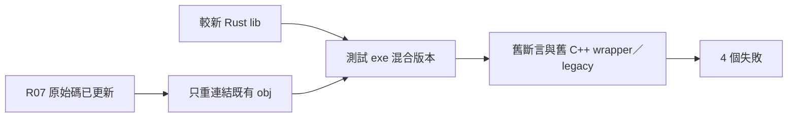
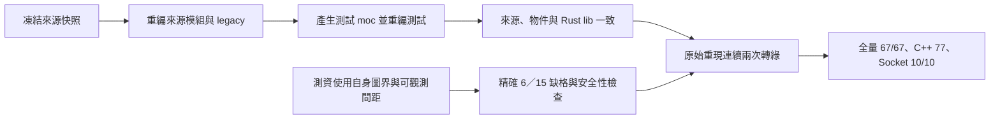

# R07.5–R07.7 四個回歸失敗的診斷與修復

## 修改紀錄

| 日期 | 修改者 | 說明 |
|---|---|---|
| 2026-10-29 | Codex (gpt-6.1-sol) | 補入根因、修復後流程、完整與 Socket 驗證；不 commit／push。 |
| 2026-10-28 | Codex (gpt-6.1-sol) | 建立可重現迴圈、假設與修改前流程。 |

## 重現與搜尋邊界

`build/qmake-r08/bin` 的四個 Qt Test，分別只執行：

- `tst_generate_objects missingPartsBecomeInferredCandidatesWithoutScores`
- `tst_lattice aStaggeredBlockPredictsExactlyItsMissingCells`
- `tst_presenter theProposalMatchesWhatTheUseCaseReturnsForTheSameInput`
- `tst_domain_rs_diff basisFinderAndAcceptanceRulesAgree`

以 `-o <log>,txt` 收集結果，兩次均失敗；單項 8–1198 ms。log 在 `build/r09-repro/`。未修改任何演算法或測試斷言。

## 假設（按檢驗順序）

1. 建置中混入較舊產物：以相同來源重建後，失敗會消失。
2. Rust/C++ 的 R07 規則不同：重建後差異仍存在，定位至第一個不同判定。
3. FFI 遺失 cells：Rust 原生與橋接結果不同。
4. 標準答案舊：兩份演算法一致，但都與測試預期不同。

## 已取得的證據

- 目前 `tests/ui/tst_presenter.cpp` 的斷言已是 37，但測試執行檔仍印「預期 44」。來源最後修改 18:37，obj 為 18:21。
- `tst_generate_objects.cpp` 的 Oracle 已有 R07 `backed` 規則，來源 18:37，obj 為 18:12。
- legacy acceptance 來源 18:11，obj 為 18:02；Rust 靜態庫已是 18:28。
- 三個建置位置的 Rust lib SHA-256 相同；Makefile 的連結路徑指向正確的 shadow build。
- `jom -n` 已顯示目前來源需要重新產生 moc／編譯，不能將既有 exe 的結果視為目前來源的行為。

## 修改前流程

## 決策審查

| 面向 | Decision / Evidence / Verification |
|---|---|
| 架構與資料契約 | 先不改 ADR-013／031；現有來源與 obj 不一致。相同來源重建後驗證四個案例。 |
| 所有權與並行 | 不動 runtime 邏輯；先凍結來源快照，只用本計畫的建置目錄和 log。 |
| 可靠性／信任邊界 | 不放寬測試、不刪來源樹生成檔、不讀認證資料。保留 git diff 與源檔 hash。 |
| 效能與容量 | 無演算法最佳化；量測僅重現迴圈。若證實需改程式，再補對應微基準。 |
| 交付與相容 | 修正建置產物一致性後，再跑完整 Rust／C++ 差異及 Socket；保留 R07 交錯陣列／長槽測試。 |
| 驗證 | 四個最小案例紅→綠、全量 67 項、Socket 真實圖圈選／編輯／配方往返；skip 與 XFAIL 如實列出。 |

## 結果

三組失敗為過期 C++ 產物。重建來源模組、legacy、測試 moc 與測試後，GenerateObjects、Presenter 與差異案例轉綠。三個 Rust lib 副本 hash 相同，並非路徑選錯；目前 FFI 完整傳遞 cells。未修改演算法或 FFI。

Lattice 重建後的兩個測資問題：

1. `staggeredPosition(9,5)` 位於 x=2994，`kBig` 只到 x=2000。預測器正確裁掉兩格，測試卻要求 6 格。改用覆蓋合成板的 `kStaggeredBounds`，精確驗證 6 個；另外保留舊範圍的 4 個及兩個裁切位置檢查。
2. 棋盤式缺件沒有 154 px 相鄰對，卻要求預設方向投票恢復該格距。正面資料改成每欄連續三點且高度交錯，仍缺 30/60；仍要求一組二維、所有 30 個內點、154 px，並逐點驗證手列的 15 個缺格。原棋盤資料另保留安全性案例，任何推算位置必須是真實缺件格；另加無相鄰證據角落不補的案例。

## 修改後流程

## 實際驗證

| 檢查 | 結果與證據 |
|---|---|
| 四個原始最小案例 | 各連續兩次 exit 0；`build/r09-repro/*-final-1.txt`、`*-final-2.txt`。 |
| 完整 Release（Rust、OpenCV、HALCON） | `scripts/dev/test.ps1 -BuildDir build/qmake-r08 -NoBuild` exit 0；67/67；log：`build/r09-repro/full-regression.log`。 |
| 四個群組 | GenerateObjects 54/0/0、Lattice 77/0/0、Presenter 86/0/1、Rust/C++ 差異 170/0/1；`build/qmake-r08/test-logs/`。 |
| C++ 對照 | 重建 cpp domain 與 tst_lattice，77/0/0；`build/r09-repro/cpp-lattice.txt`。 |
| Socket 操作 | 重連結後 10/0/0；實際 Qt 滑鼠圈選、數值改大小、移動／刪除、取消舊工作、配方存讀與錯圖保護；`build/r09-repro/socket-final.txt`。 |
| 真實圖 smoke | 5314×4594，選區 (1100,120,900,550) 得到 28 框；UI 往返 82.4 ms，非準確率或 p95；`build/r09-repro/Socket-verified.png`。 |
| 保留既有工作 | tracked domain/Rust/tests 與 source-before.json 比對，只有 tests/domain/tst_lattice.cpp 改變。 |
| 清理 | src、rust、tests 無 DEBUG-r07-reg／AOI_R07_DIAGNOSTICS；中間探針只保留於 ignored build/r09-repro。 |

本次無新增效能指標：沒有更改 runtime 程式或做效能最佳化，未改 `perf/budgets.json`。重現迴圈與 UI smoke 時間僅作診斷及可操作確認。

## 既有驗證限制

整體為 **PARTIALLY VERIFIED**。67/67 表示各執行檔／檢查無失敗，並非所有資料與平台條件均已驗證：

- 7 組 skip：tst_repeatability、tst_backend_registry、tst_shell、tst_presenter、tst_opencv_image、tst_image_sources_agree、tst_domain_rs_diff。原因為缺真實 CSV、此組態沒有不可用 backend、未要求 review 截圖、OpenCV 無法寫 EXR／2-channel PNG。
- 2 個既有 XFAIL：OpenCV B1 low contrast、palette BMP。未新增或放寬 XFAIL。
- 未操作 Qt Creator GUI 或量產機台；Socket 使用真實 Qt Widgets 自動事件及影像／配方往返驗證。

## 預防

來源更新或多個 session 同時修改時，不能用 NoBuild／只重連結代替完整重編對應來源與 moc。先比對來源／obj 時間與來源快照，再接受結果。合成資料應帶自身影像範圍；正面缺件資料應保留方向證據，原證據不足資料保留為安全性測試。

沒有改變介面、演算法或依賴，不需新 ADR。本次不 stage、commit 或 push。
