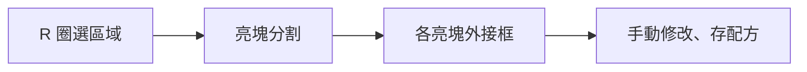
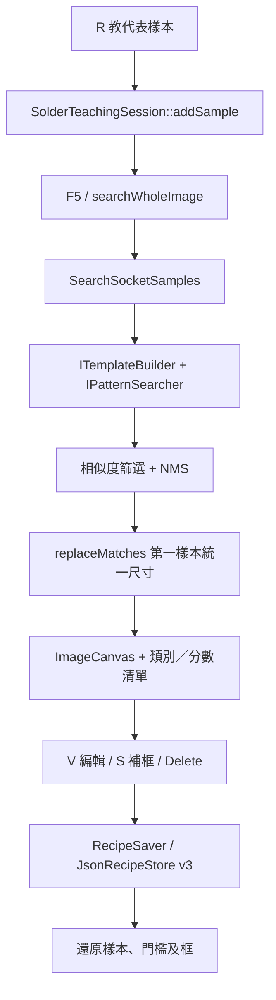
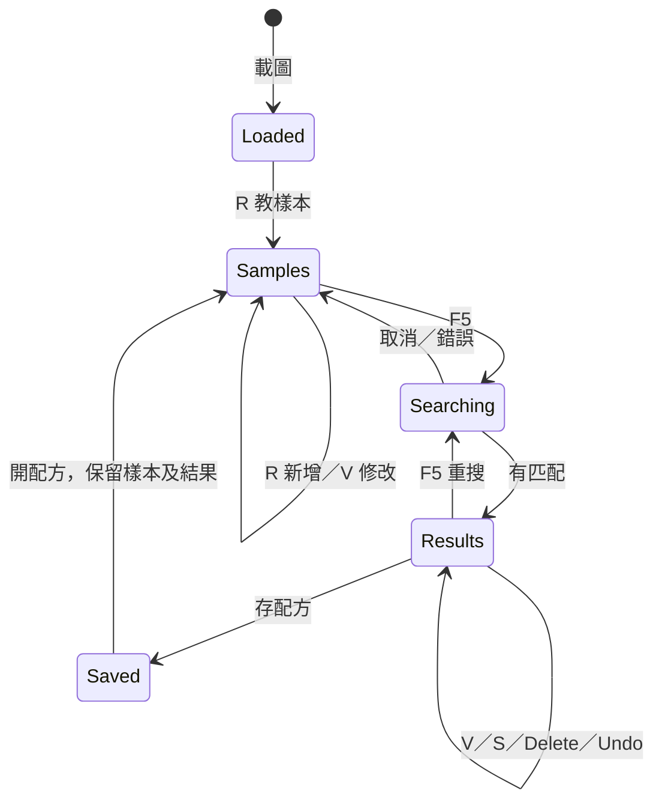

> 目前主要流程已改為 [區域 CAD 註冊](region-workflow.md)，見 [ADR-036](../../adr/036-socket-region-cad.md)。下列為原版歷史。

# Socket 樣本搜尋接線

## 修改紀錄

| 日期 | 修改者 | 說明 |
|---|---|---|
| 2026-10-29 | Codex (gpt-6.1-sol) | 主流程改為 R 教樣本、F5 全圖搜尋、統一尺寸與樣本配方。 |
| 2026-10-28 | Codex (gpt-6.1-sol) | 初版亮塊定位與可編輯框。 |

## 修改前

## 修改後

