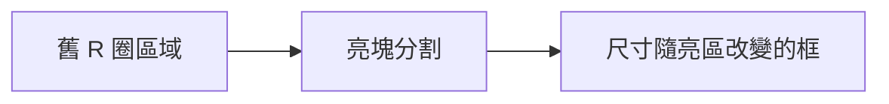
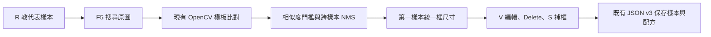

# Socket 樣本全圖搜尋操作與驗證

## 修改紀錄

| 日期 | 修改者 | 說明 |
|---|---|---|
| 2026-10-29 | Codex (gpt-6.1-sol) | 新操作流程、固定框尺寸與樣本配方契約。 |

## 操作

1. 載入原始 RGB／灰階圖片。
2. 按 R，只圈一個焊點作樣本。可繼續圈幾個明暗或外觀不同的代表焊點，最多 16 個；左右外觀不同時，各教一個。
3. 按 F5「搜尋整張圖」。相似度預設 90%，不是亮度門檻；提高可減少較不相似的結果，降低可能增加漏框的召回與誤框。
4. 結果表會區分樣本、結果、手動框，並顯示相似度。新結果的尺寸全數採第一個樣本；第一樣本大小可用 V 與數字表單修改，再按 F5。
5. 用 V 拖移／拖把手或數字修改結果，Delete 刪掉錯框，S 手動補漏。Ctrl+Z／Ctrl+Y 復原重做。
6. 儲存 JSON 配方；保留原圖。開配方後，樣本、結果與門檻還原，可再次 F5。

重搜會替換上次的自動結果，保留樣本與手動補框；完成重搜後再進行最後人工修正及儲存。

## 前後流程

## 邊界

沒有使用高度圖，沒有缺陷 OK/NG。全圖搜尋表示掃描全圖；未教過的外觀不一定匹配。相似度是相關性，不是正確率。手動改框允許個別尺寸不同，只有新產生的結果統一尺寸。錯誤、空匹配與取消不清掉原資料。

## 驗證紀錄

- 合成明亮干擾物、不同／重複樣本、固定尺寸、取消與存讀均通過。
- 真實圖 3 個樣本得到 632 個 44×24 結果，涵蓋右側與下半部；沒有完整標註，不宣稱辨識率。
- 共享版專項 15 passed、0 failed、0 skipped；全量 67/67，既有 skip／XFAIL 保留。
- Release 及 Debug 無 OpenCV／HALCON 建置成功；執行包啟動通過。
- log、截圖與完整資料在 build/r08-samples。本次維持不 stage、commit 或 push。
