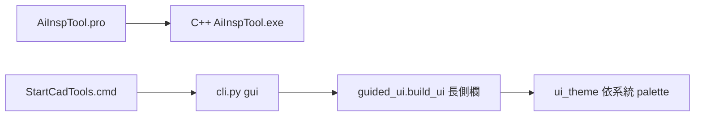
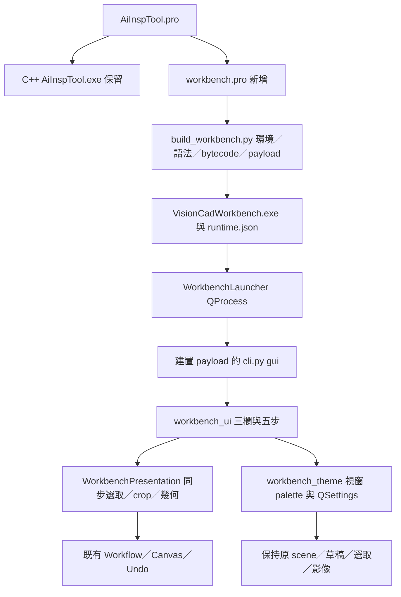
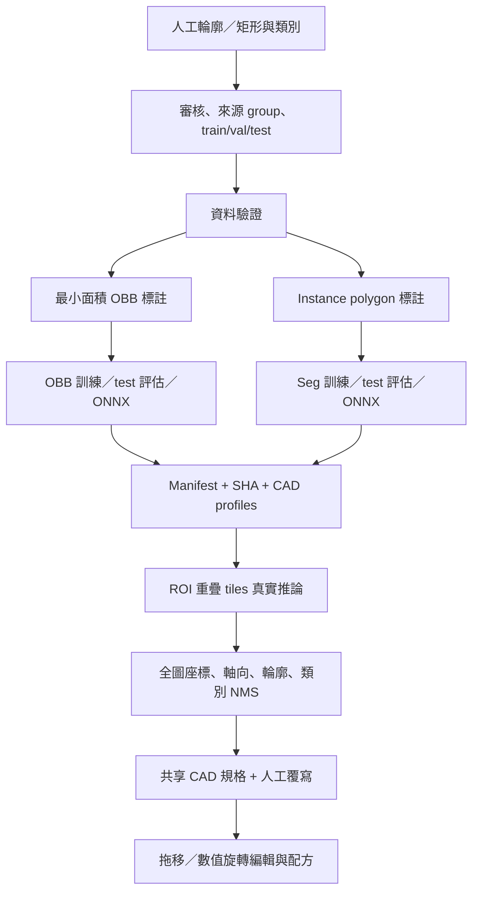
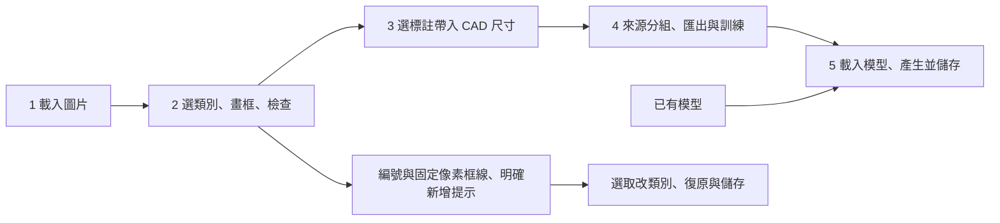
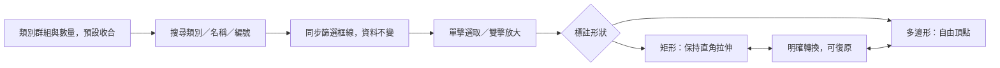

# 資料與推論流程

## 修改紀錄

| 日期 | 修改者 | 說明 |
|---|---|---|
| 2026-10-30 | Codex (gpt-6.1-sol) | 加入 Qt Creator 建置與主題／選取流程。 |

## 本次修改前

## 本次修改後

模型未載入、task 不符或類別／規格缺失：明確停止生成。人工標註與模型提案分開保存。

## 新手操作引導（R09.9）

## 類別查詢與形狀（R09.12–R09.13）

