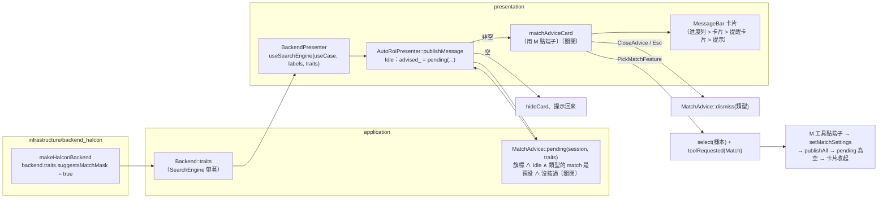
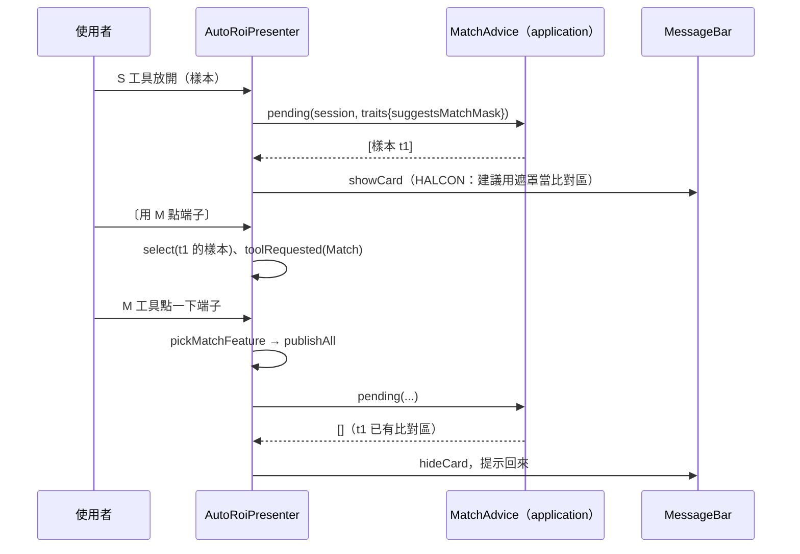

# R09 — 圖解

## 修改前：建完樣本之後訊息列只有提示

這張圖要讓你看到：`publishMessage` 在 Idle 一律收起卡片，沒有任何地方知道「這個 back end 用整框比較差」。

## 修改後：Idle 時多一個規則，back end 的特性跟著 engine 走

這張圖要讓你看到：和修改前不同的節點是 `makeHalconBackend`（填旗標）、`Backend::traits`、`useSearchEngine` 的第三個參數、`publishMessage` 的 Idle 分支（新增 `MatchAdvice`），以及卡片的兩個新動作。搜尋的路徑（F5 → Searching → Preview）一個節點都沒改。

## 時序：建完樣本到設好遮罩

