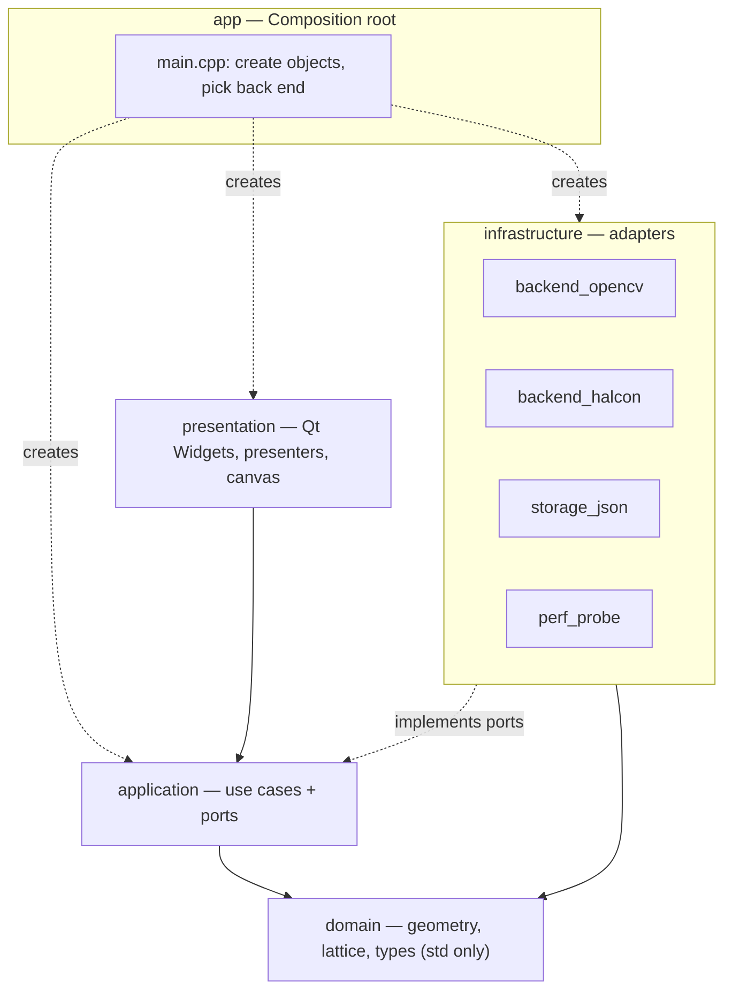
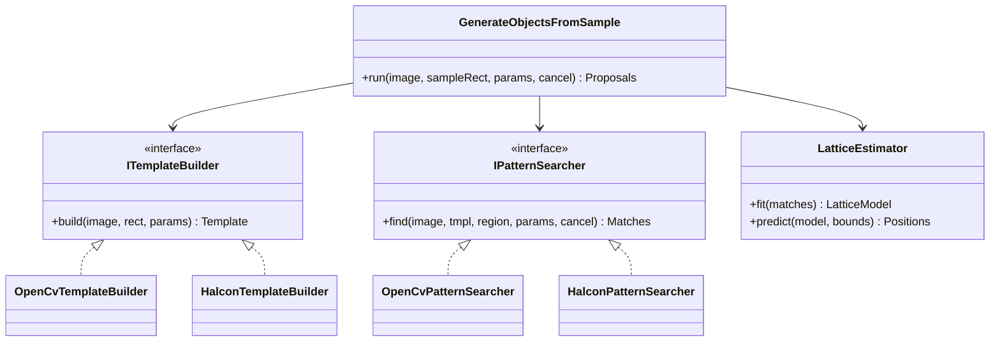
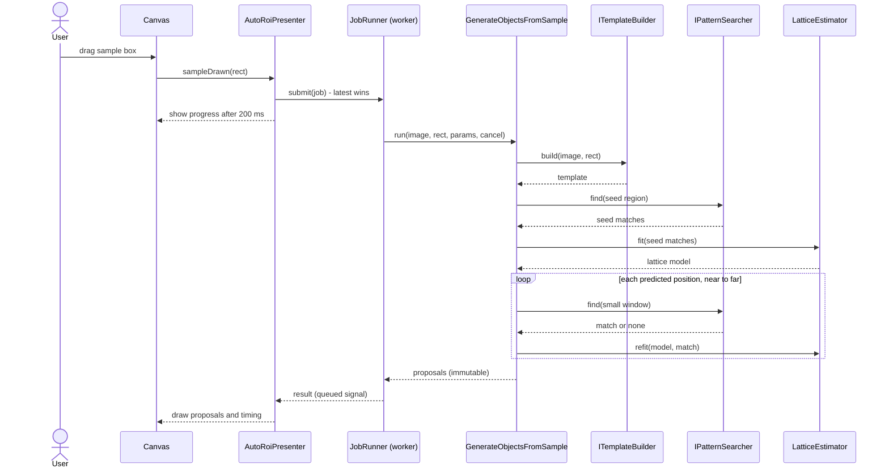
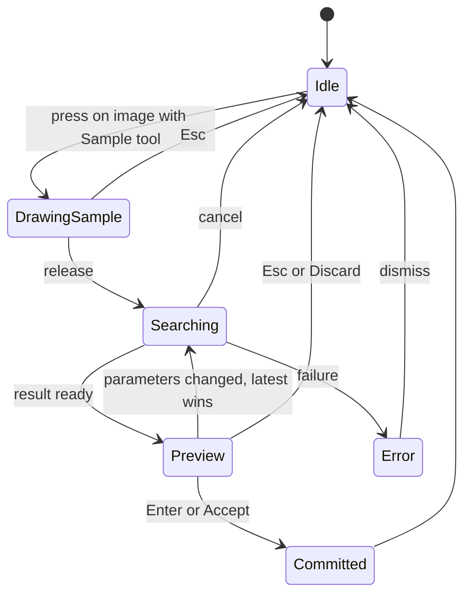
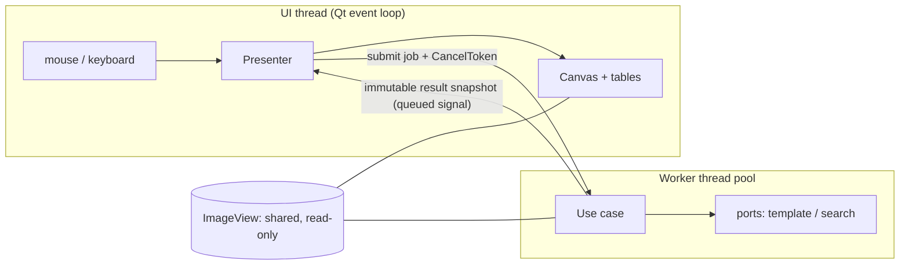

# S00 — 圖解

圖比文字更快傳達結構。以下圖在 GitHub、VS Code（Markdown Preview Mermaid）與 Qt Creator 的 Markdown 預覽中可渲染；互動版見 [explainer.html](explainer.html)。

## 1. 分層與依賴方向

實線 = 「可以依賴」。虛線 = 「實作 port / 負責組裝」。**依賴只由外往內。**

## 2. Port 與 Adapter（為什麼能換 back end）

`LatticeEstimator` 在 domain：兩個 back end 共用同一份、已測試的幾何邏輯。

## 3. 「框一個 → 全部出現」的執行序列

## 4. 介面互動狀態機

## 5. 執行緒與資料流

重點：UI 與 worker 之間只傳**不可變的快照**與**取消權杖**，不共享可變狀態，所以不需要鎖。
