# S01 — 圖解

圖在 GitHub、VS Code（Markdown Preview Mermaid）與 Qt Creator 的 Markdown 預覽中可渲染。互動版（可以真的走一遍）見 [explainer.html](explainer.html)。線框的 ASCII 草圖在 [`docs/ux/ux-spec.md`](../../ux/ux-spec.md) 第 4、5 節。

## 1. 三個流程

流程 A（教樣本）、B（區域掃描）、C（編輯元件類型）怎麼接在一起；A 的結果可以存成樣本庫條目，B 找不到的元件回到 A。

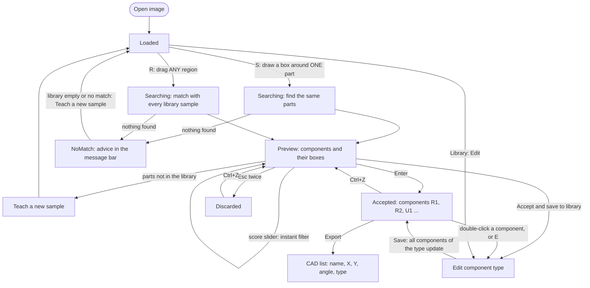

這張圖要讓你看到：每個死路（無匹配）都有下一步；教出來的樣本進入樣本庫，下一次就能用流程 B；接受與捨棄都能用 `Ctrl+Z` 回到預覽。

## 2. 互動狀態機（修訂 S00 §4）

8 個狀態。與 S00 的差異：新增 `Empty`、`NoMatch`、`EditingType`，移除 `Committed`，`DrawingSample` 改名 `DrawingRegion`，新增 `UndoToPreview`。`DrawingRegion` 結束時回到它開始前的狀態（圖中三條回來的線）。

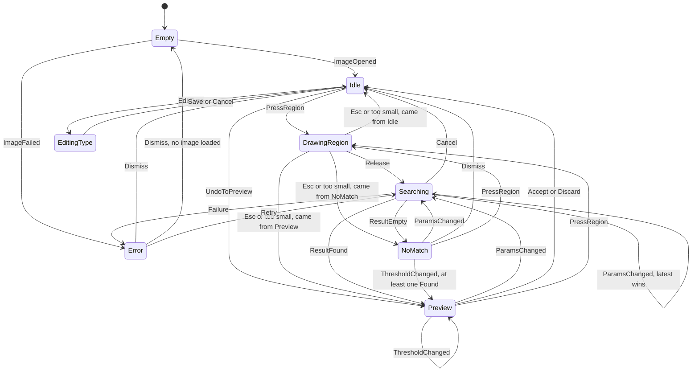

這張圖要讓你看到：只有 `Searching` 會自己離開（結果、失敗、取消）；`EditingType` 只能從 `Idle` 進出，所以編輯類型時不會有搜尋在背景改畫面。`ImageOpened` 在大多數狀態都會回到 `Idle`（為了圖面乾淨未畫出，完整表在 `ux-spec.md` 第 6 節）。

## 3. 資料模型：Board › Component › Box（ADR-006）

框不單獨儲存，而是由「元件類型」與「元件位姿」推導出來。改類型，所有同類型元件一起更新。

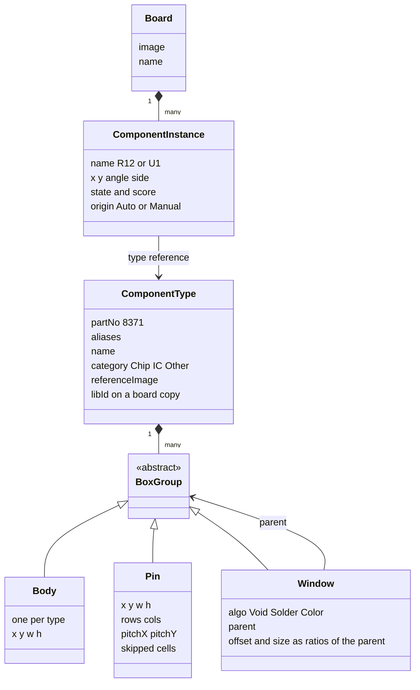

這張圖要讓你看到：8371 ＝ 1 個 Body ＋ 1 個 Pin 矩陣（2 列 × 10 欄）＋ 1 組 Solder 窗（每支腳一個）＝ 41 個框，但只存 3 個群組。矩陣的「一次建立多個框」與窗的「相依」都是這個結構的自然結果。

## 4. 元件類型編輯器：改一個參數，整組框一起變

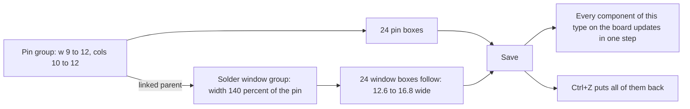

數字來自原型的測試：Pin 寬 9 → 12，窗寬 12.6 → 16.8；列數改 12 得 24 支 Pin 與 24 個窗；儲存後板上 3 顆 IC 從 41 個框變 33 個框（欄數改 8），`Ctrl+Z` 後回到 41。

## 4b. 樣本庫與板子：複本關係（ADR-006 §5，使用者決定）

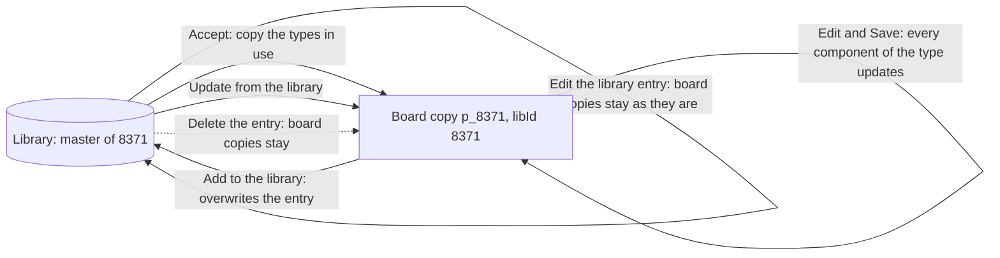

這張圖要讓你看到：庫與板子只透過兩個明確的動作同步（〔從樣本庫更新〕、〔存入樣本庫〕），都是文件堆疊上的 Command，可復原；改庫、刪庫都不會偷偷改到舊板子。

## 5. 區域掃描怎麼辨識（流程 B）

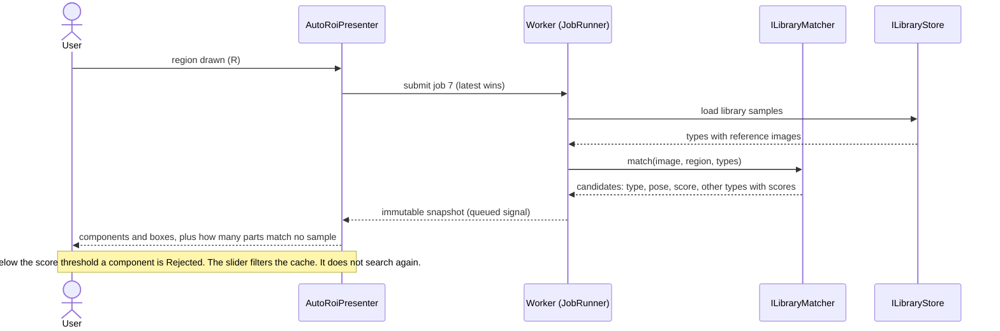

這張圖要讓你看到：UI 與 worker 只交換不可變的快照；門檻變動不重新搜尋；庫裡沒有的元件只計數，由使用者決定要不要教新樣本。

## 5b. 樣本庫很大時：少比，不是只靠跑快（ADR-006 §7）

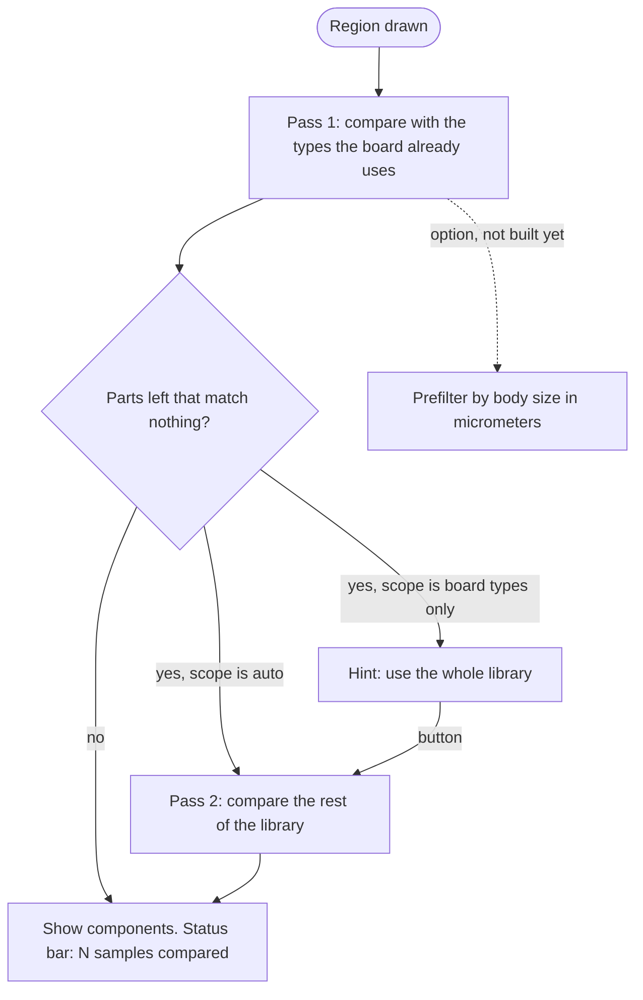

這張圖要讓你看到：第一輪只比板子已經用到的類型（通常很少）；庫裡其他樣本只在需要時才比。預篩選是 S07 要量測後再決定的選項（虛線）。

## 6. Presenter 與介面（給 S04）

Presenter 只依賴窄介面（各 ≤ 5 個方法），View 只呼叫自己需要的 Controller 介面。為了圖面可讀，這裡只畫主幹；完整名單在 `ux-spec.md` 第 12 節。

```mermaid
classDiagram
  class ICanvasController {
    <<interface>>
    +onRegionDrawn(rect, mode)
    +onRegionAborted()
    +onAddRequested(point)
    +onComponentsMoved(ids, delta)
    +onOpenTypeEditor(componentId, boxHint)
  }
  class IProposalController {
    <<interface>>
    +accept()
    +acceptAndSave()
    +discard()
    +cancelSearch()
    +chooseAlternative(componentId, typeId)
  }
  class ITypeEditorController {
    <<interface>>
    +addGroup(kind, rect)
    +updateGroup(groupId, change, scope)
    +addWindow(parentId)
    +addStandardWindows()
    +deleteSelection()
  }
  class ICanvasView {
    <<interface>>
    +showImage(image)
    +showComponents(snapshot)
    +showRegionDraft(rect, mode)
    +setSelection(ids)
    +setInteraction(mode)
  }
  class ITypeEditorView {
    <<interface>>
    +showType(typeSnapshot)
    +showSelection(groupId)
    +showValidation(errors)
    +setDirty(on)
    +close()
  }
  class IStatusView {
    <<interface>>
    +showSummary(summary)
    +showBusy(level)
    +showProgress(fraction)
    +showToast(key, args)
  }
  class AutoRoiPresenter
  class TypeEditorPresenter
  class InteractionStateMachine
  class InspectionDocument
  AutoRoiPresenter ..|> ICanvasController
  AutoRoiPresenter ..|> IProposalController
  TypeEditorPresenter ..|> ITypeEditorController
  AutoRoiPresenter ..> ICanvasView
  AutoRoiPresenter ..> IStatusView
  TypeEditorPresenter ..> ITypeEditorView
  AutoRoiPresenter --> InteractionStateMachine
  AutoRoiPresenter --> InspectionDocument
  TypeEditorPresenter --> InspectionDocument
```

## 7. 復原：三個範圍（ADR-002）

提案和類型草稿各有自己的堆疊；接受、捨棄、儲存類型進文件堆疊。接受與捨棄帶著提案的快照，所以復原能回到預覽。

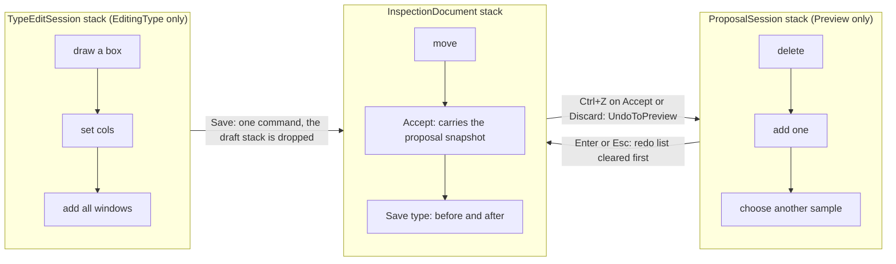

## 8. 回饋時間與訊息位置

訊息一律在畫布下方的訊息列，不蓋在影像上（使用者回饋後新增）。

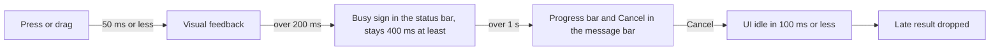

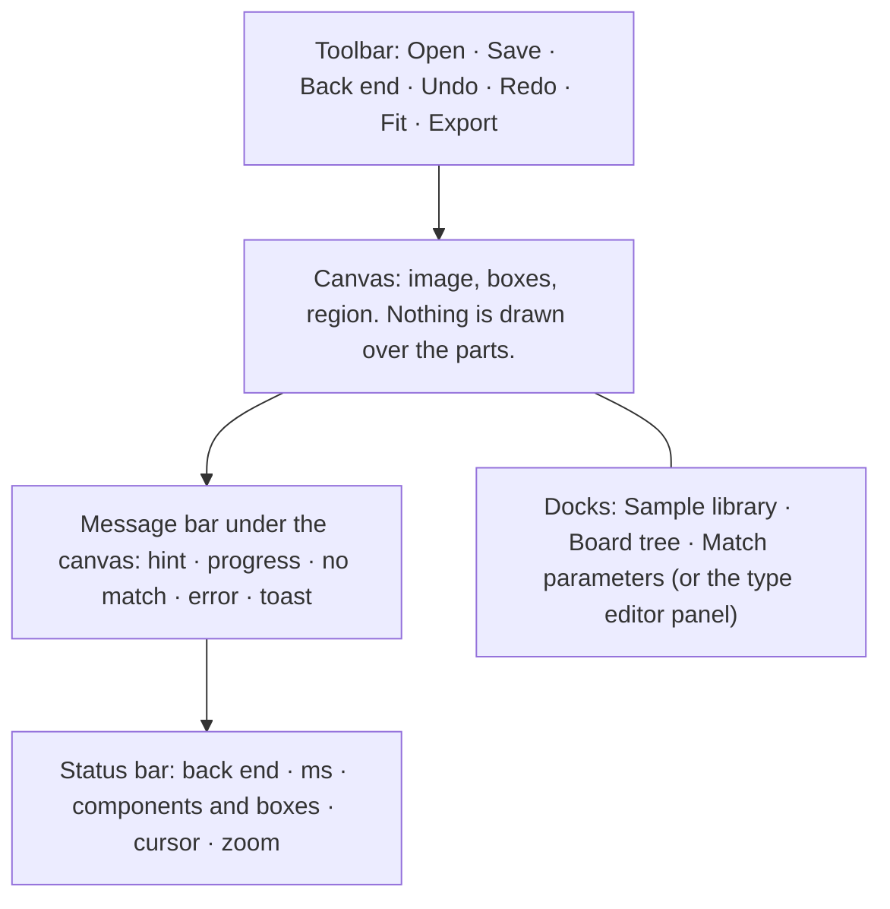

## 9. 取消與「過期結果丟棄」（I4）

UI 不等 worker 停止；worker 的單次比對呼叫無法中途中斷，晚到的結果以工作編號辨識並丟棄。

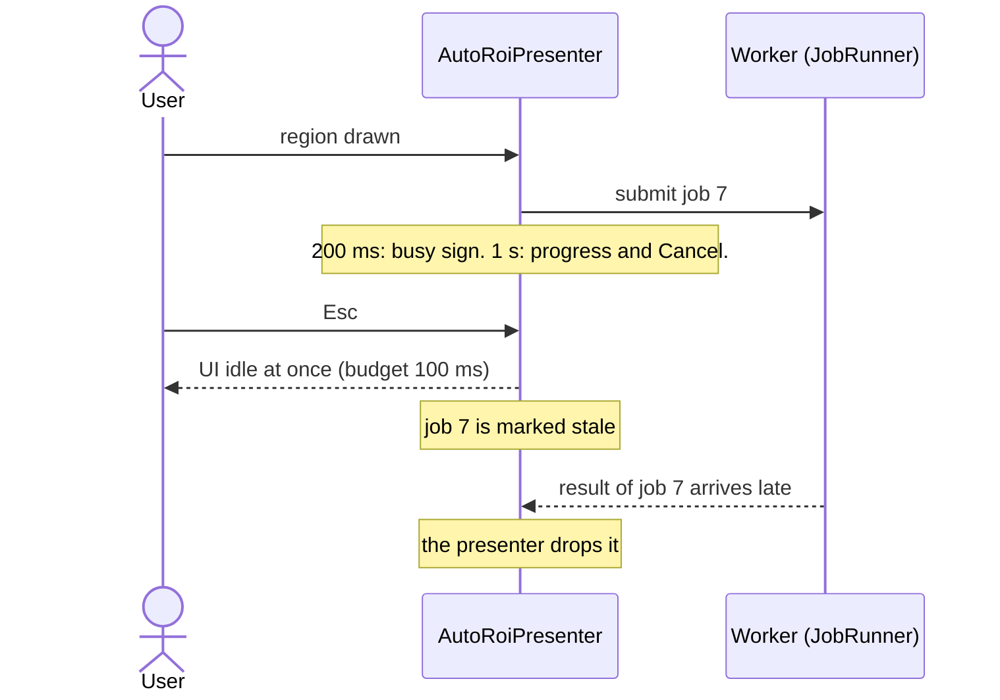
