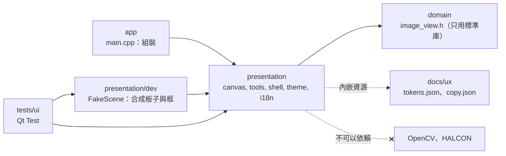
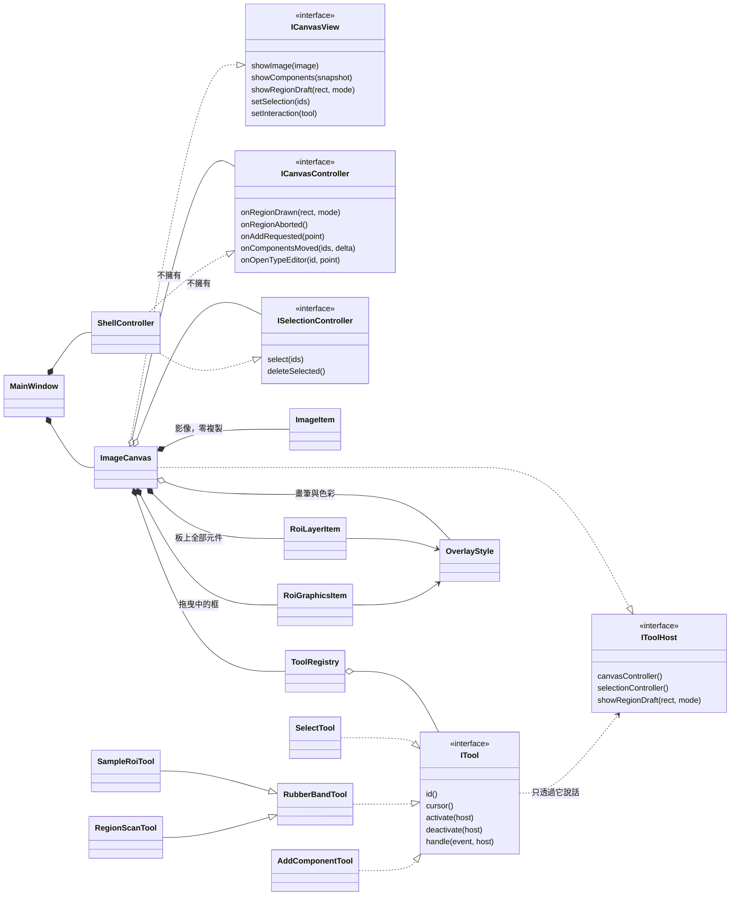
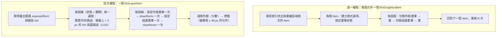
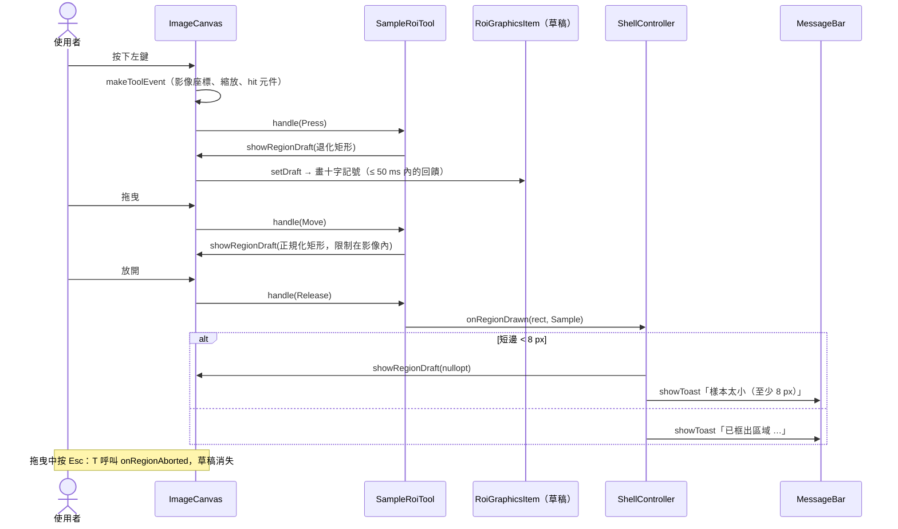

# S02 — 圖解

圖在 GitHub、VS Code（Markdown Preview Mermaid）與 Qt Creator 的 Markdown 預覽中可渲染。互動版（調框數量、切換繪製方式、看實測數字）見 [explainer.html](explainer.html)。
圖中的名稱都是 `src/` 裡真的存在的類別與檔案；若程式改了，這裡要一起改。

## 1. 依賴方向（本步驟實際建立的部分）

箭頭是「依賴」。S02 只有 `domain`、`presentation`、`app` 三層有程式碼；`application` 與 `infrastructure` 從 S03 起才有。測試與示範場景不屬於五層，它們依賴 `presentation`。



這張圖要讓你看到：畫布完全不認識視覺函式庫；顏色與文案只有一個來源（`docs/ux`），內嵌進執行檔。

## 2. 畫布與工具的類別圖

三個重點：**畫布只看窄介面**（View 5 個方法、Controller 5 個方法、Tool 5 個方法）；**工具是一個類別一個**，新增工具不改畫布；**板上的框用一個 `RoiLayerItem` 批次畫**，需要個別互動的才用 `RoiGraphicsItem`。



`ShellController` 是 S02 的暫代品：它讓每個操作都有回應（訊息列、選取外框），但不接任何 use case。S04 的 Presenter 實作同樣的介面來取代它，畫布與工具不必改。

## 3. 繪製管線：逐一繪製 vs 批次繪製

左邊是「一個框一個 `QGraphicsItem`」（逐一）。右邊是 `RoiLayerItem`（批次）。差別不在「畫」本身，而在每個 Item 都要付的固定成本與每個框都要切換的畫筆。實測數字見 [perf.md](perf.md) 與 [explainer.html](explainer.html)。



注意：LOD 與「只畫露出範圍」是批次繪製才有的優化；逐一繪製的 `RoiGraphicsItem` 也套 LOD（同一條規則），但沒有跨 Item 的批次與桶。

## 4. 一次拖曳：事件怎麼流過畫布

從滑鼠到訊息列。重點：**畫布把 Qt 事件翻成 `ToolEvent`**（影像座標、縮放、點擊到的元件），工具只看這個值；**放開時不論框多小都回報**，「太小」由 controller 判斷（S04 起是 Presenter 的 `ReleaseTooSmall`）。



## 5. 版面：訊息列為什麼固定高度

畫布大小不因訊息改變，所以訊息列的高度固定（`tokens.json` 的 `sizes.messageBarHeight`，96 px），內容放不下就在列內捲動。S01 的規格說「訊息列的高度會隨內容變化，但畫布大小不變」，桌面程式要同時做到這兩件事，只能預留空間。

```
┌ 選單：檔案 編輯 檢視 ───────────────────────────────────────────────┐
│ 開啟 儲存 │ Back end [尚未連接] ········· 復原 重做 適配視窗 匯出      │  頂部工具列
├────┬────────────────────────────────────────────┬──────────────────┤
│ V  │                                            │ 樣本庫（空殼）     │
│ S  │          ImageCanvas                       │ ──────────────── │
│ R  │      （空白時只有置中的卡片）                  │ 物件（空殼）       │
│ ＋ ├────────────────────────────────────────────┤ ──────────────── │
│    │ MessageBar：固定 96 px，內容多就捲動          │ 比對參數（停用）    │
├────┴────────────────────────────────────────────┴──────────────────┤
│ 後端 · — ms · 0 個物件                      x y     縮放 62%         │  狀態列 28 px
└────────────────────────────────────────────────────────────────────┘
```
