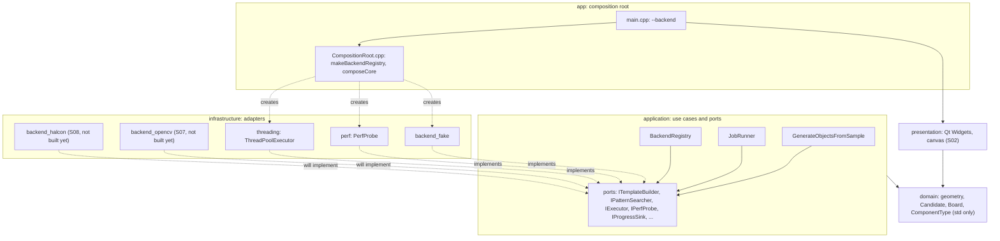
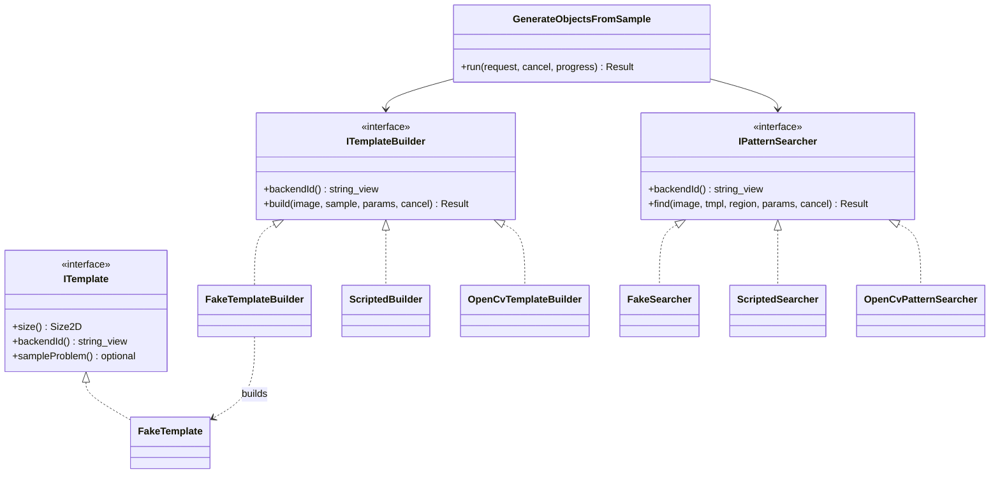
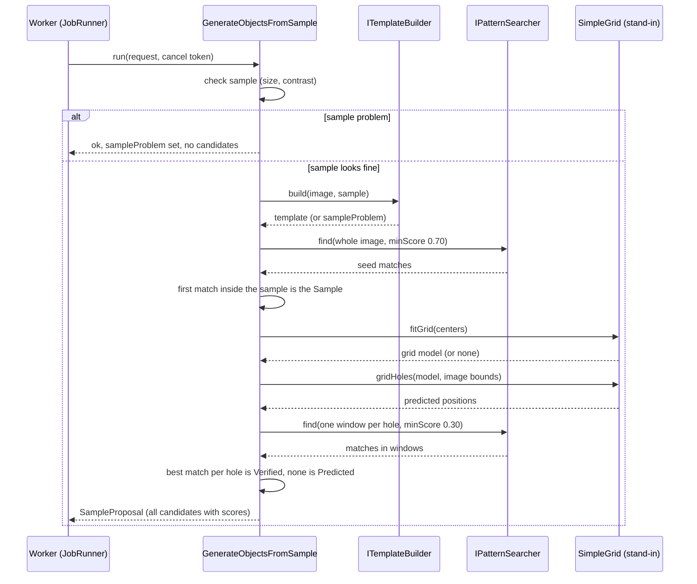
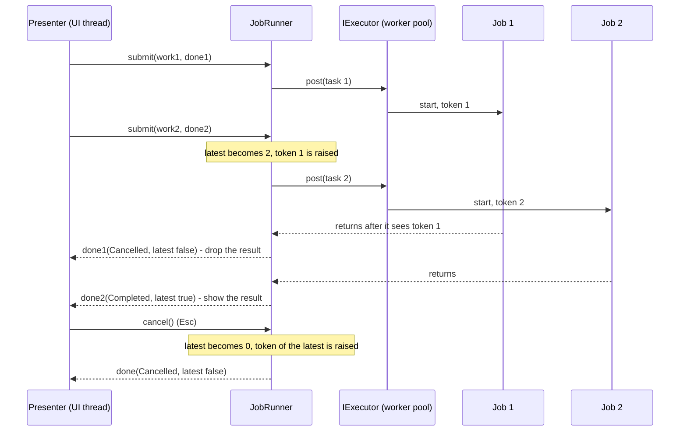
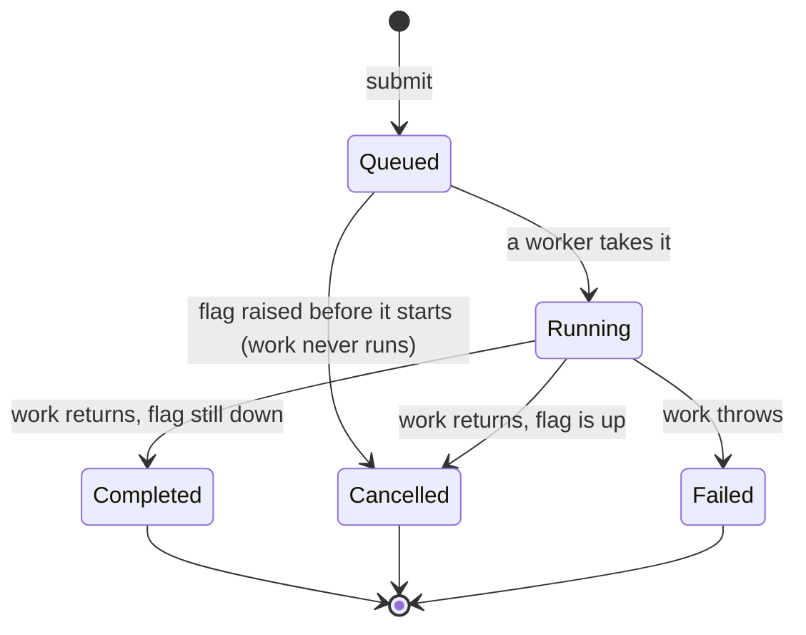
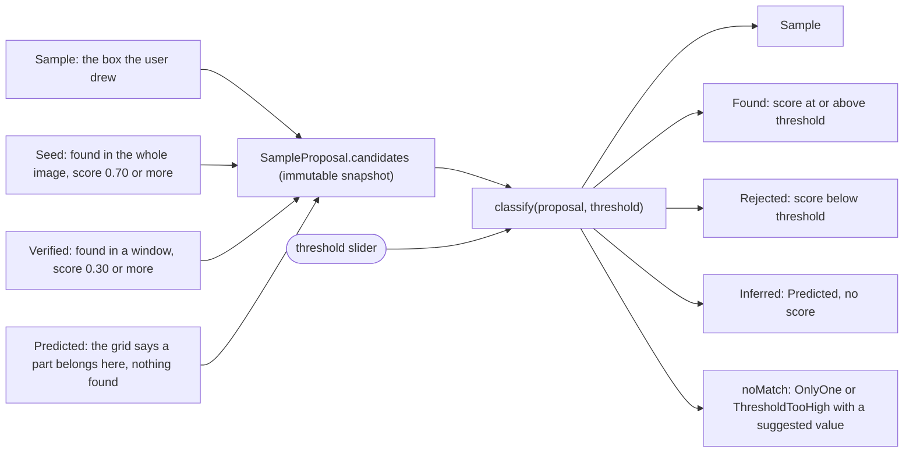
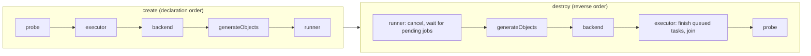
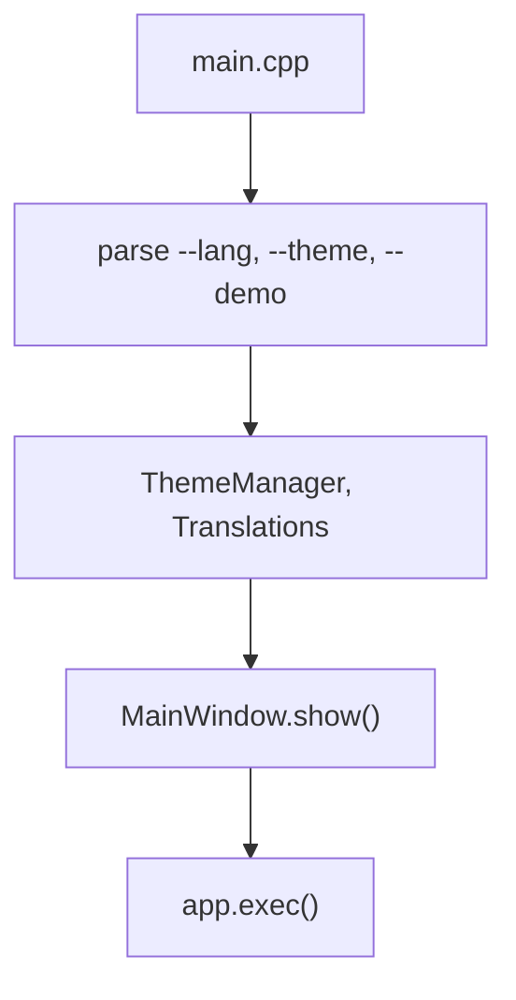
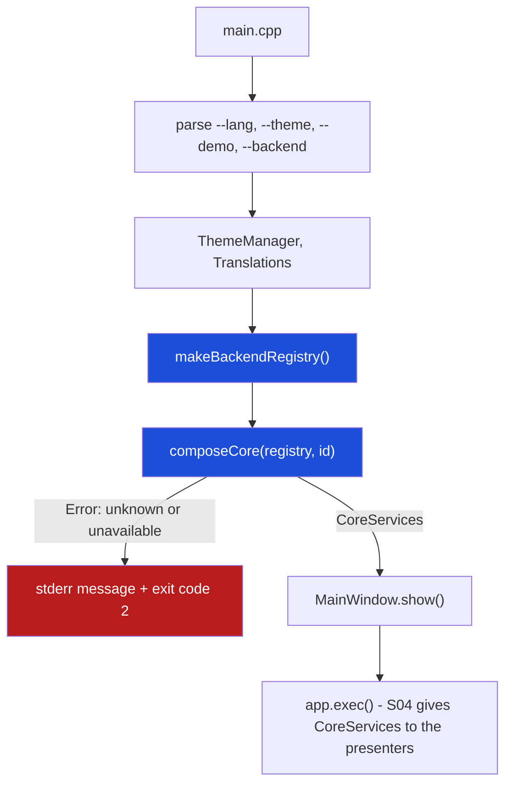
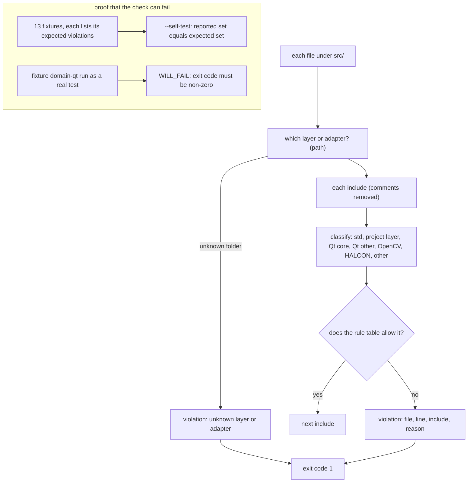

# S03 — 圖解

圖在 GitHub、VS Code（Markdown Preview Mermaid）與 Qt Creator 的 Markdown 預覽中可渲染。互動版見 [explainer.html](explainer.html)。圖裡的名稱都是程式裡真的存在的類別與函式（`src/` 下可搜尋）。

## 1. 現在有哪些層、誰依賴誰（S03 之後）

實線＝「可以依賴」（CMake 的 `target_link_libraries` 與 `#include` 方向一致）；虛線＝「實作 port」。`application` 與 `domain` 不連任何 adapter，也不連 Qt。

## 2. Ports 與 adapter（為什麼換 back end 不必改 use case）

`FakeTemplateBuilder`、`FakeSearcher` 在 `src/infrastructure/backend_fake/`。`ScriptedBuilder`、`ScriptedSearcher` 只存在於 `tests/core/tst_backend_registry.cpp`：它們證明「全新的 back end」不必動 use case。`OpenCv*` 是 S07 才會有的類別（虛線代表還沒有）。

## 3. 流程 A：use case 的階段（每個階段之間都檢查取消）

## 4. 工作生命週期：提交、取代、取消、完成

## 5. 一項工作的狀態

`done` 在三種終點都會被呼叫恰好一次；`JobReport::usable()` 只有 `Completed` 且 `latest` 為真時才成立。

## 6. 候選怎麼變成畫面上的物件（門檻只是重新過濾）

## 7. 組裝與解構順序（`CoreServices`）

## 8. 修改前後：`main` 的啟動流程

**修改前（S02）**：`main` 只認識畫面。沒有 back end 的概念，`--backend` 不存在。

**修改後（S03）**：多了兩個節點（深色）：解析 `--backend`、`composeCore`。back end 不可用時在顯示視窗之前就以結束碼 2 離開。

## 9. 依賴檢查怎麼運作（以及怎麼證明它會失敗）

