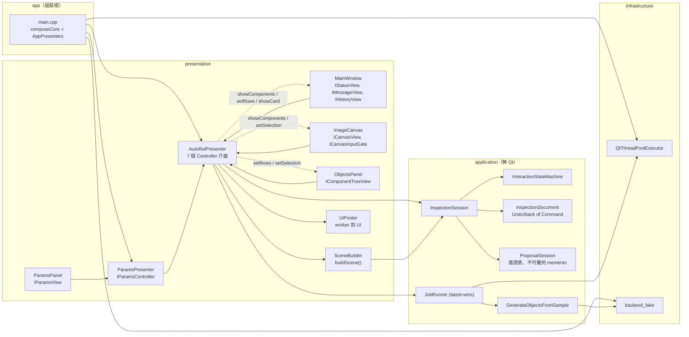
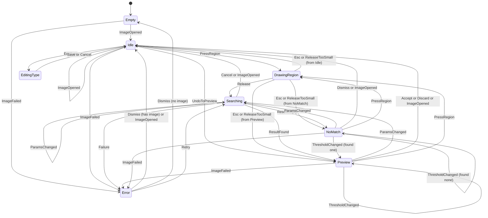
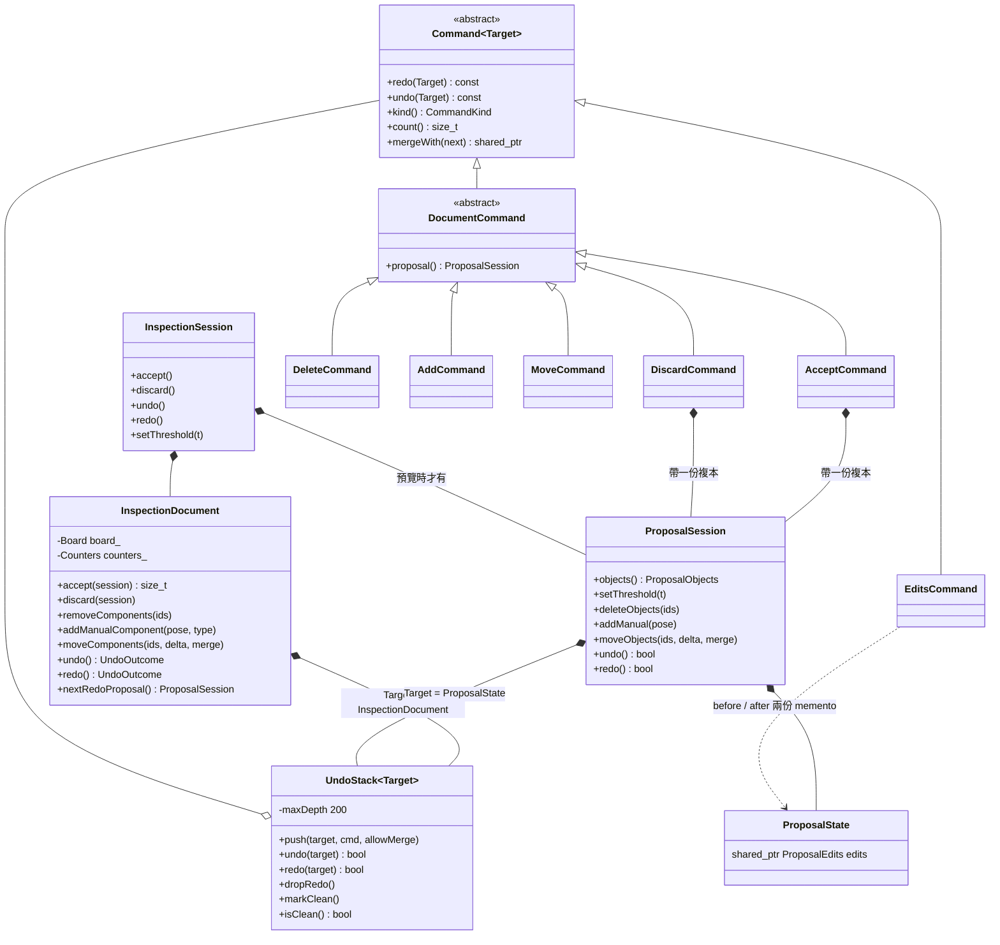
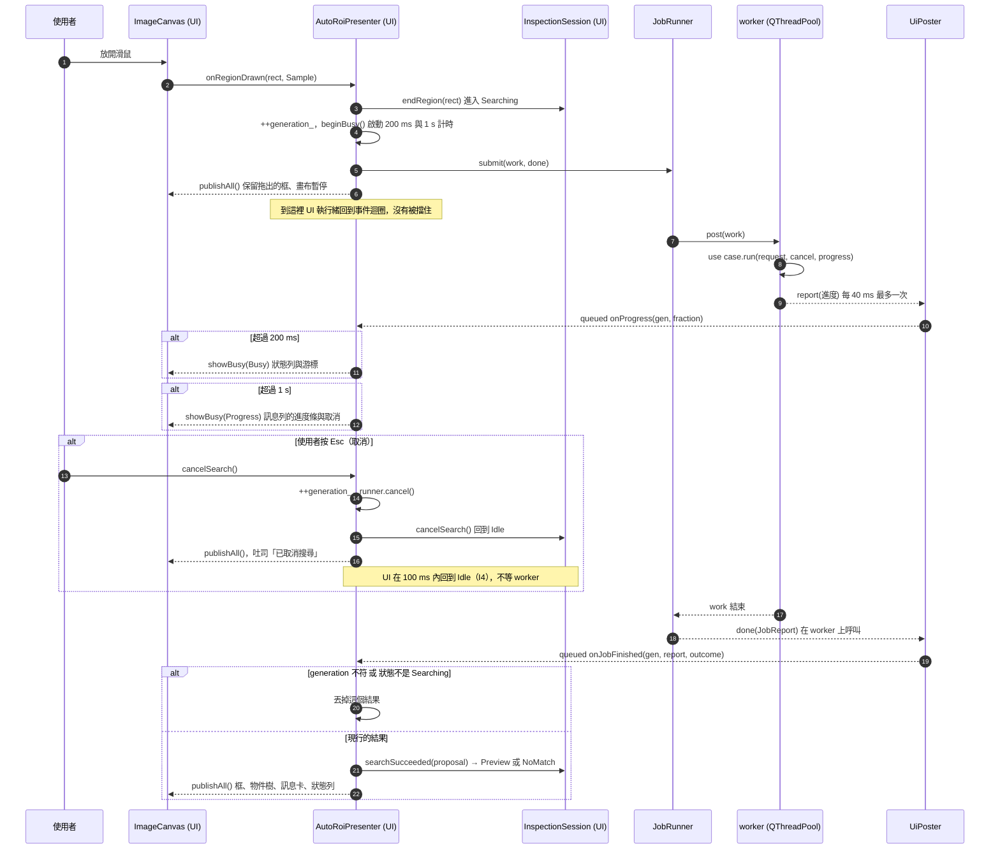
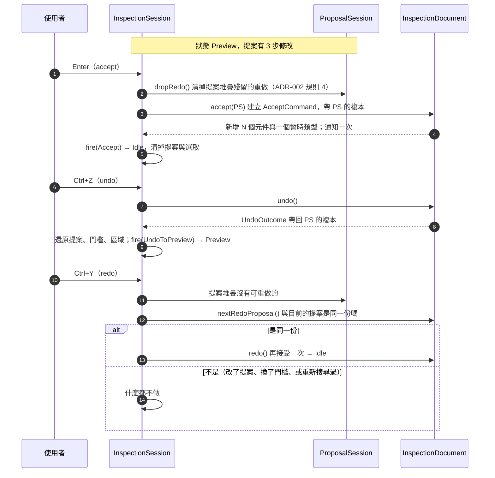
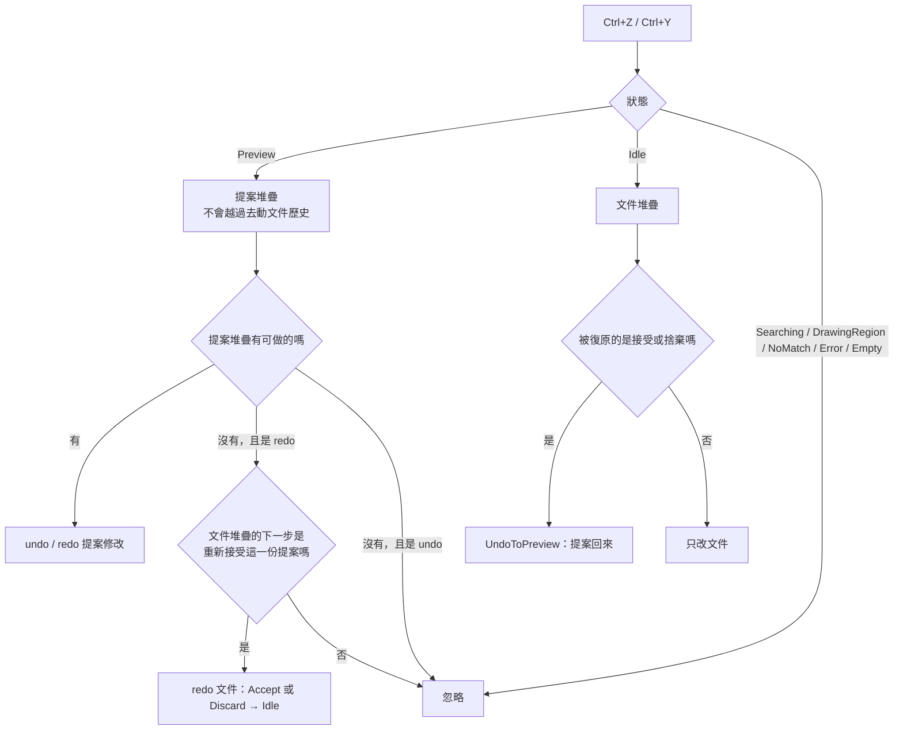
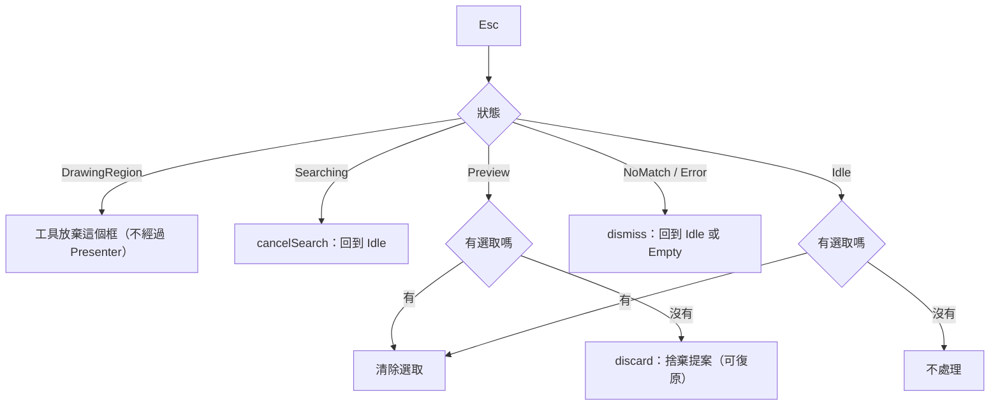
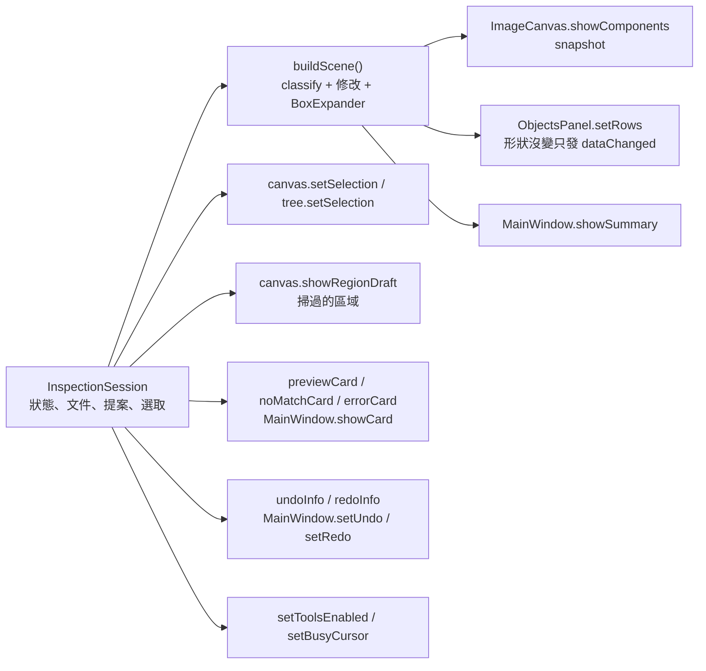
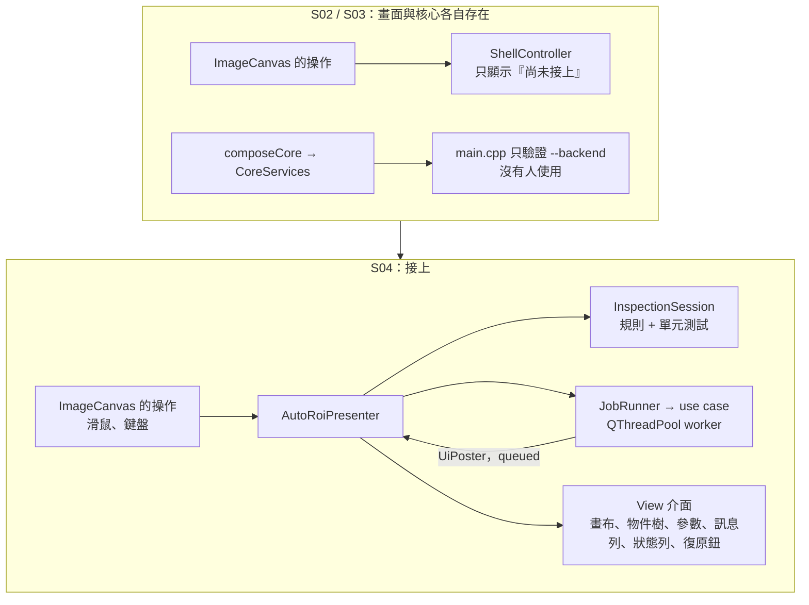

# S04 — 圖解

> 圖都從程式碼推導（節點標檔名或函式名）。語法用 mermaid 11 的解析器檢查過（只驗語法，沒有渲染）。
> 設計說明在 [`spec.md`](spec.md)，實測數字在 [`perf.md`](perf.md)，決策在 [ADR-011](../../adr/011-interaction-logic-in-application-layer.md)、[ADR-012](../../adr/012-dashed-frames-as-fill-rects.md)。

## 1. 誰認識誰（分層與接線）

規則（狀態、復原、接受時發生什麼事）在沒有 Qt 的 application 層；Presenter 只做 Qt 這一側（執行緒、計時、把資料畫出來）；View 只有窄介面。`app/main.cpp` 是唯一同時認識所有人的地方。

## 2. 互動狀態機（8 個狀態）

轉移表照 `docs/ux/ux-spec.md` 第 6 節；`tst_state_machine` 把表裡的 40 列各驗一次，其餘 118 組 (狀態, 事件) 驗證一律被拒絕。`EditingType` 在狀態機裡，但編輯器本身不在 S04。

## 3. Command 與復原（類別圖）

Command 建立後不可變，所以同一個 Command 可以被多份堆疊共用；合併回傳新的 Command，不改舊的。`ProposalSession` 是值型別：接受或捨棄時，整份（含它的修改堆疊）被複製進文件堆疊的 Command。

## 4. 搜尋：UI 執行緒與 worker（序列圖）

UI 執行緒只做三件事：發出工作、收結果、畫畫面。結果以不可變的 `SampleProposal` 經 `UiPoster` 排回 UI；過期的結果靠世代丟掉。

## 5. 接受、復原、重做（提案的生命週期）

「接受」是文件堆疊上的一個 Command，帶著當時的提案。復原它，狀態回到 `Preview`（`UndoToPreview`），提案連同它的修改堆疊與門檻一起回來。

## 6. Ctrl+Z 作用在哪個堆疊

## 7. Esc：往回一步

## 8. 發布：規則的結果怎麼變成畫面

每次狀態或內容變了，Presenter 用 `publishAll()` 一次把畫面對齊工作階段。分數門檻拖動時也是這一條（沒有另一條「快速路徑」，量測後再決定要不要，見 perf.md）。

## 9. 修改前後

