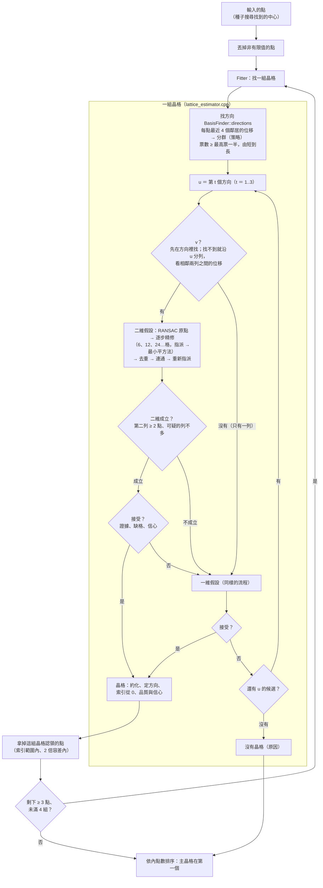
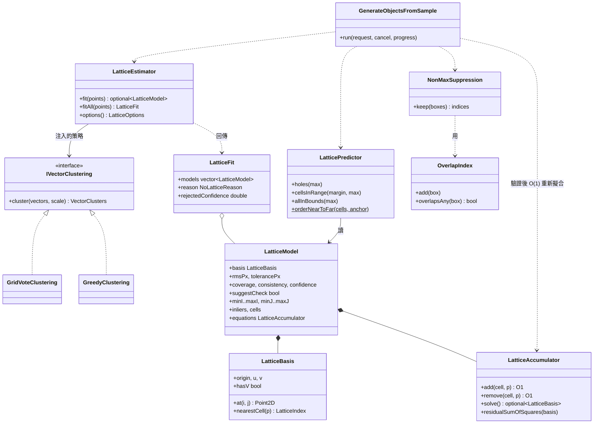
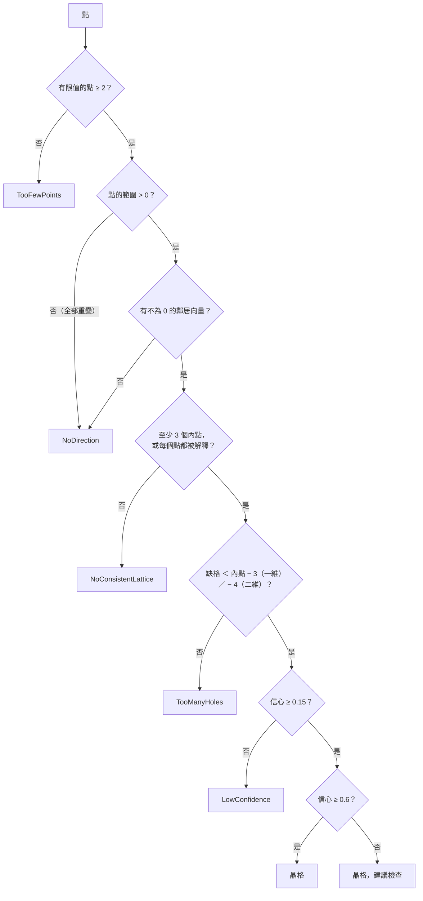
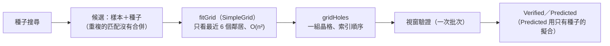
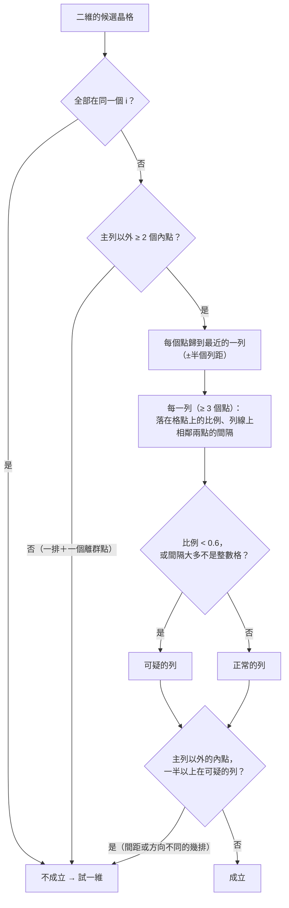

# S05 — 圖解

五張圖：擬合流程、資料結構、退化情況決策樹、use case 修改前後、二維成立的判斷。文字說明在 [`spec.md`](spec.md)。

## 1. 擬合流程（`LatticeEstimator::fitAll`）

讀這張圖要看到兩件事：（1）同一個 u 先試二維、二維被任何一條規則擋下時仍要試一維（S05 用測試找到的漏洞：沒有這一步，三排間距不同時會錯過真的那一排）；（2）多組晶格是「依序擬合、拿掉認領的點」，不是把基底向量分群——同樣間距、不同位置的兩個陣列基底相同，分群分不開。

## 2. 資料結構

模型帶著自己的正規方程（`equations`）：use case 在視窗驗證之後把找到的元件加進去重新擬合，每個 O(1)，不必回頭看所有的點。內部的 `BasisFinder`、接受規則（`lattice_acceptance`）、連通（`cell_components`）沒有畫：它們只在估計器裡用。

## 3. 退化情況與「沒有晶格」的決策樹

例：1 個點 → TooFewPoints；3 個重疊的點 → NoDirection；2 個點 → 一組 2 點的一維晶格（每個點都被解釋，不補缺格，信心 0.28 → 建議檢查）；20–100 個隨機點 → 大多沒有晶格，偶爾有 3–4 點「不補缺格」的一維晶格（建議檢查）。use case 拿到「沒有晶格」時只回傳找到的（合併重複之後），不做視窗驗證。

## 4. use case 的流程：修改前與修改後

修改前（S03／S04）：

修改後（S05；★ 與琥珀色是新的或改過的節點）：

```mermaid
flowchart LR
  S2["種子搜尋"] --> N2["★ NMS<br/>同一個元件只留分數最高的"]
  N2 --> C2["候選：樣本＋種子"]
  C2 --> F2["★ LatticeEstimator::fitAll<br/>可能多組；沒有晶格就不補"]
  F2 --> G2["★ LatticePredictor::holes<br/>＋ 與已有候選重疊的不補"]
  G2 --> O2["★ 由近到遠、上限內留近的"]
  O2 --> W2["視窗驗證（一次批次）"]
  W2 --> R2["★ O(1) 重新擬合<br/>驗證找到的加進正規方程"]
  R2 --> P2["★ Verified／Predicted<br/>Predicted 在修正後的位置"]
  classDef changed fill:#fff3d6,stroke:#b45309,stroke-width:2px,color:#18212b
  class N2,F2,G2,O2,R2,P2 changed
```

presentation 沒有改：Presenter 只透過 use case 的 `candidates` 與 `classify` 用到這些，順序改成由近到遠也不影響它（S04 的 `tst_presenter` 照舊通過）。

## 5. 二維成立嗎？逐列判斷

為什麼要看「間隔」：一排間距 34 的元件配上 20 的格子，個別的點有 6 成碰巧落在格點容差內（比例會過 0.6），但相鄰兩點的間隔永遠是 34 ＝ 1.7 格，不是整數格。為什麼要「歸到最近的一列」：另一排斜著穿過時，只有幾個點正好在列線上，其中幾個又碰巧在格點上；整列一起看，比例才會反映實情（說明頁的「兩排方向不同」情境在 S05 抓到這個漏洞）。
