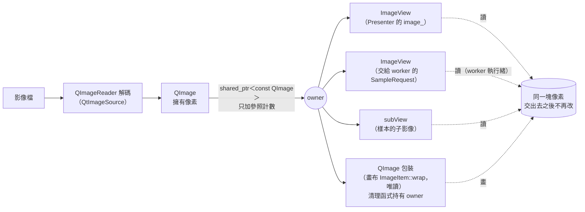
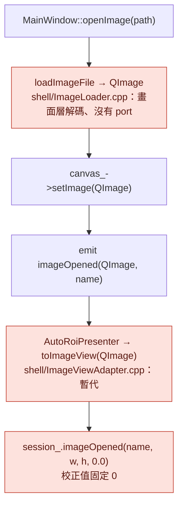
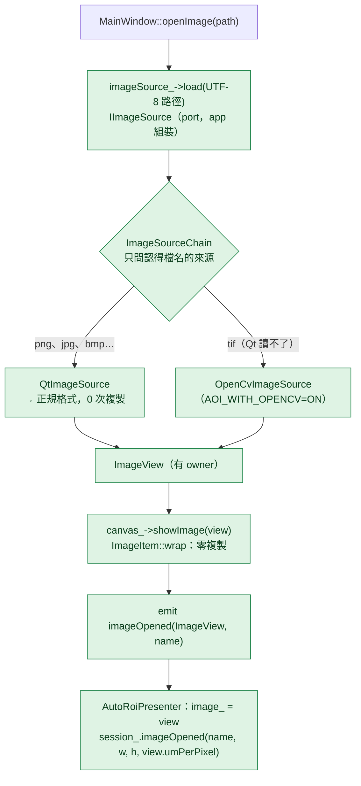
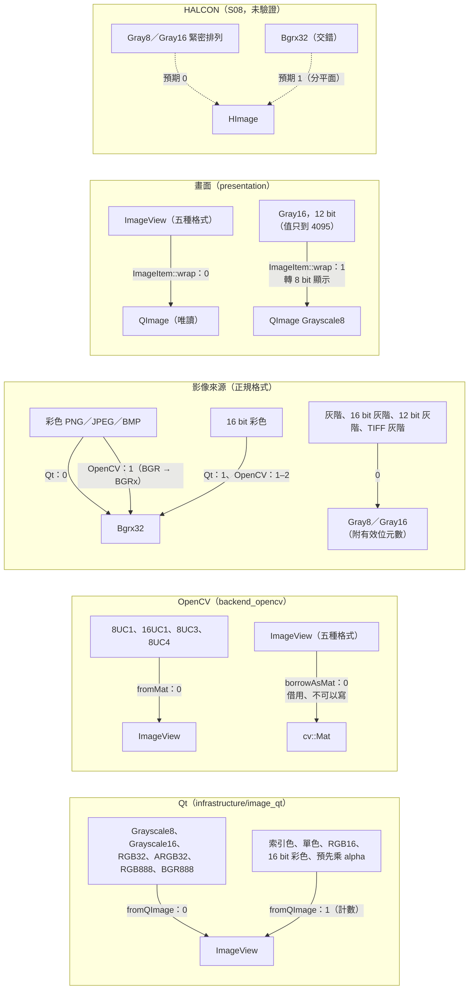
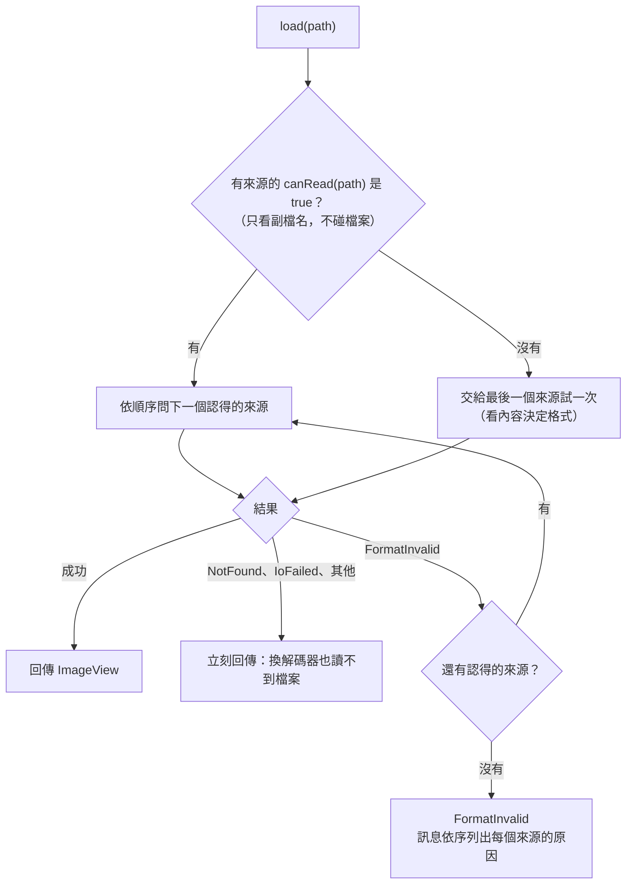
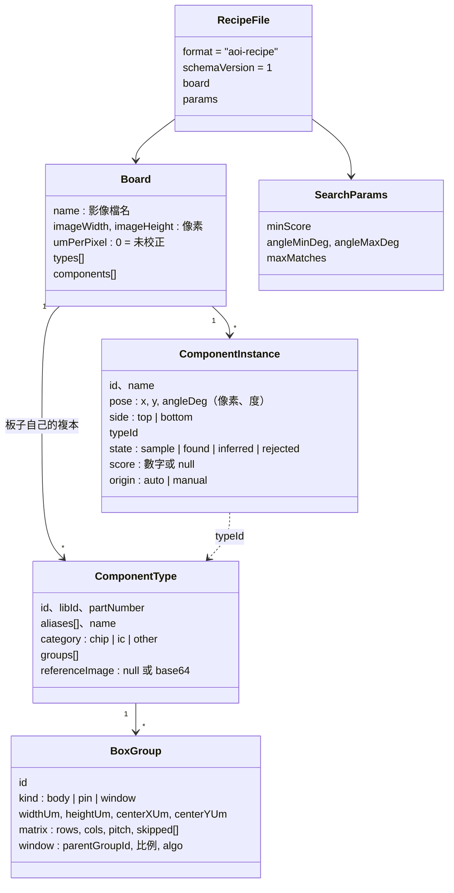
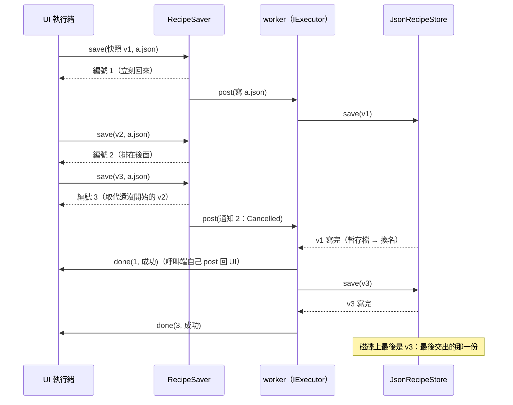
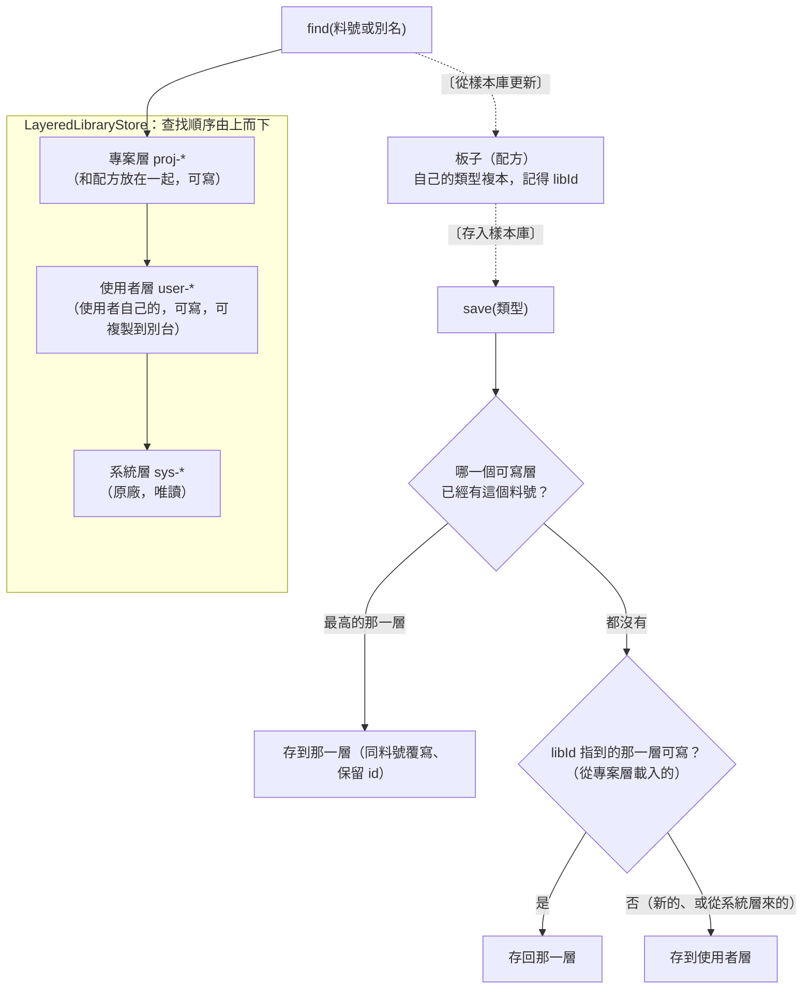

# S06 — 圖解

七張圖：影像的所有權、開圖流程的修改前後、轉換與複製次數、影像來源的組合、配方的檔案格式、背景存檔、樣本庫的分層。文字說明在 [`spec.md`](spec.md)，決策在 [ADR-014](../../adr/014-image-ownership-and-copies.md)、[ADR-015](../../adr/015-recipe-and-library-storage.md)。

## 1. 影像資料的所有權：誰持有、誰借用

讀這張圖要看到：像素只有一塊，擁有它的是解碼出來的 QImage；所有的 view 與包裝只持有 owner 的參照計數（ImageView 規則 2、3、5）。像素交出去之後沒有人再改（規則 1），所以 UI 執行緒畫圖、worker 執行緒搜尋可以同時讀，不加鎖。最後一個 view 或包裝消失時，像素才釋放。

## 2. 開啟影像：修改前與修改後

修改前（S02–S05）：

修改後（S06）：

不同的地方（綠色）：解碼從畫面層移到 port 後面（`ImageLoader` 刪除）；訊號帶的是 `ImageView`，Presenter 不必再轉（`ImageViewAdapter` 刪除），拿到的就是畫布畫的那一塊像素；校正值從 view 來（影像來源給 0，配方或使用者之後補）。`imageOpened`／`imageOpenFailed` 這兩條路沒有變（S04 的提醒）。

## 3. 轉換路徑與複製次數

讀這張圖要看到：「0」是測試用指標相等與計數斷言的；「1」的每一個都呼叫 `countImageCopy`。12 bit 的影像（使用者的影像有這種）像素照原樣交給搜尋，只有畫面顯示前轉一次 8 bit。OpenCV 讀彩色檔要多一次複製，是組裝時 Qt 排在前面的理由（ADR-014）。HALCON 那一格是虛線：S06 沒有 HALCON 的開發檔，只是預期。

## 4. 影像來源的組合（`ImageSourceChain::load`）

## 5. 配方的檔案格式（schema v1）

讀這張圖要看到：每個欄位都寫進檔案（用不到的也寫），所以讀回來逐欄位相同；元件的 `typeId` 必須指到同一塊板子的類型（讀寫都檢查）；類型與框群組是 µm，元件位姿是像素。樣本庫的檔案是 `{format: "aoi-library", schemaVersion, nextEntryNumber, entries: [ComponentType…]}`。

## 6. 背景存檔（`RecipeSaver`）：同一個檔案依序寫

## 7. 樣本庫的分層（TRI；使用者 2026-10-06 決定）

讀這張圖要看到：查找從專案層往下，第一個找到的就是答案（上層遮住下層同料號的條目）；存檔的三條規則照 TRI（「從 Project 載入的存回 Project，其他存到 User」），再加一條「已經有這個料號的最高可寫層優先」，存完 `find(料號)` 才一定是剛存的內容。板子的類型複本不屬於任何一層（在配方裡，ADR-006 §5）。
