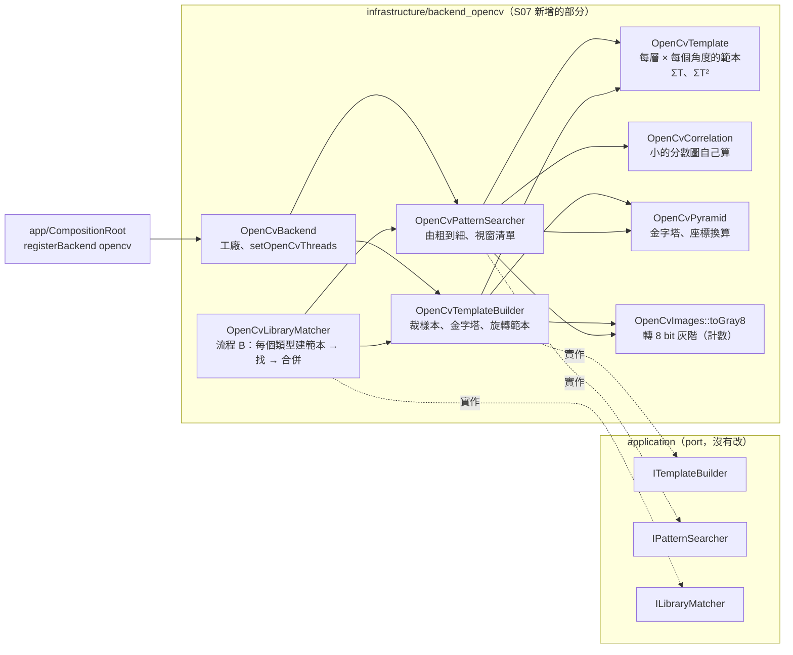
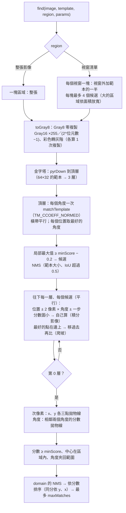
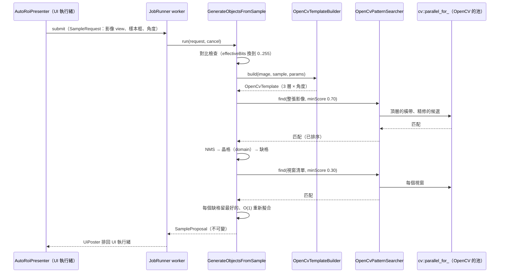
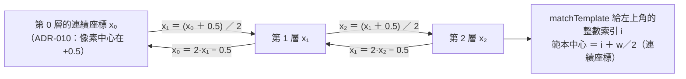
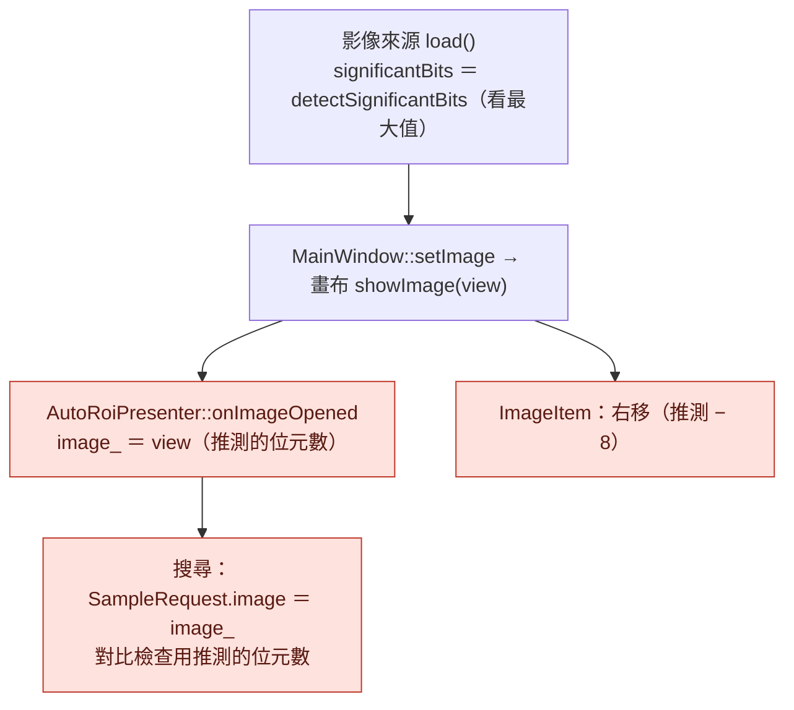
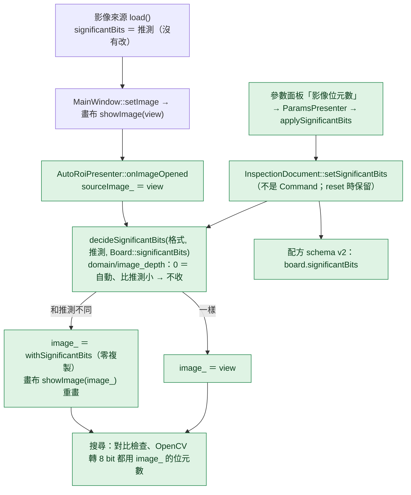
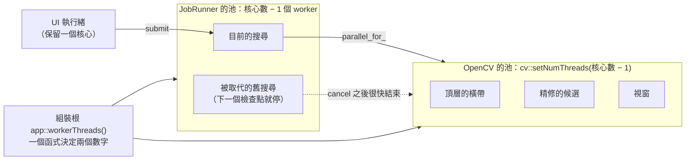

# S07 — 圖解

六張圖：OpenCV adapter 的結構、搜尋管線（由粗到細）、use case 與搜尋器的序列、金字塔的座標換算、有效位元數的修改前後、執行緒。文字說明在 [`spec.md`](spec.md)，決策在 [ADR-016](../../adr/016-opencv-coarse-to-fine-search.md) 與 [ADR-014 的 S07 後續](../../adr/014-image-ownership-and-copies.md)，數字在 [`perf.md`](perf.md)。

## 1. 結構：哪個類別實作哪個 port

讀這張圖要看到：S07 只在 `infrastructure/backend_opencv` 加類別，並在組裝根多註冊一個 back end；port、use case、domain 沒有為了 OpenCV 改（開放封閉，`check-deps` 0 違規）。範本建立與搜尋是兩個類別（單一職責），共用的只有範本的資料、金字塔與換算。`OpenCvLibraryMatcher` 由建立器與搜尋器組成，UI 還沒有接（使用者決定）。

## 2. 搜尋管線：由粗到細

讀這張圖要看到：昂貴的「每個角度掃整張影像」只發生在頂層（縮小 4 倍的 64×32 範本是 16×8、影像是 1/16）；往下每一層只在候選附近比幾十個位置。精修的分數圖很小，`matchTemplate` 對它仍走 DFT，固定成本主宰，所以自己算（ADR-016 §2，T2a 從 193 降到 64 ms）。

## 3. use case 與搜尋器的序列（流程 A，沒有改 use case）

讀這張圖要看到：use case（S03–S05）一行都沒改，換成 OpenCV 只是組裝根給的 builder、searcher 不同。搜尋器內部的平行用 OpenCV 自己的池；JobRunner 的 worker 只是發起的執行緒（它也會參與 `parallel_for_` 的工作）。

## 4. 金字塔的座標換算

讀這張圖要看到：`cv::pyrDown` 的第 l＋1 層像素 i 以第 l 層像素 2i 為中心，所以每往上一層是「加 0.5、除以 2」。這個換算與 OpenCV 的「像素中心在整數」都在 adapter 裡處理（ADR-010 的要求）；`tst_opencv_backend` 用已知位置的合成元件鎖住（誤差 < 0.25 像素），`tst_opencv_end_to_end` 的位置誤差最大 0.21 像素。

## 5. 影像的有效位元數：修改前與修改後

修改前（S06）：

修改後（S07）：

不同的地方（綠色）：Presenter 保留來源給的原樣（`sourceImage_`），依板子的設定決定 `image_` 的位元數；畫布、use case、OpenCV 搜尋器都讀 `image_` 的欄位，所以它們自己不必改。設定存在 `Board`，開新影像（`InspectionDocument::reset`）時保留，存配方時一起存（v2）。影像來源與 `MainWindow::setImage` 沒有改（設定和推測一樣時不重畫）。

## 6. 執行緒

讀這張圖要看到：同一時間通常只有一個搜尋在跑（latest-wins），它的平行部分在 OpenCV 的池裡；兩個池的大小由同一個函式決定，改一處就好（ADR-016 §4）。實測 T2a（中位數）：1 個執行緒 126–133 ms、15 個 50–57 ms（`perf.md`）。
