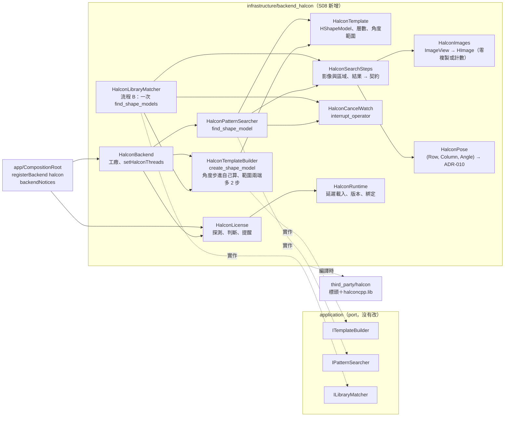
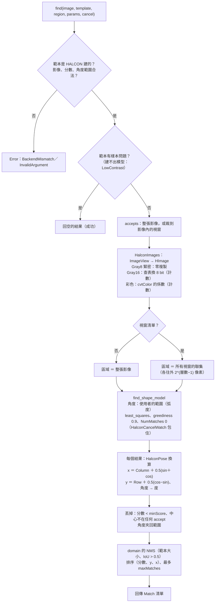
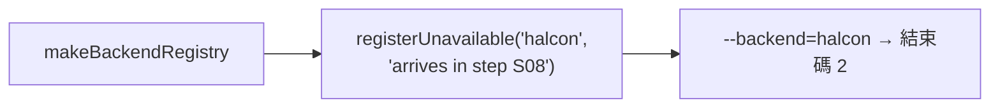
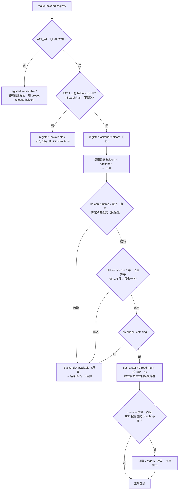
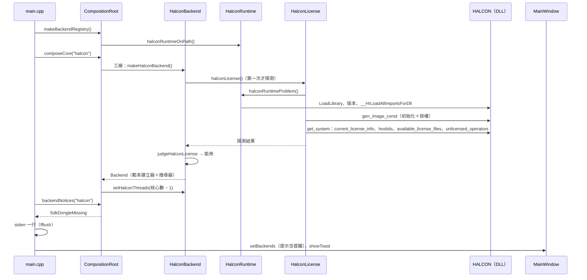
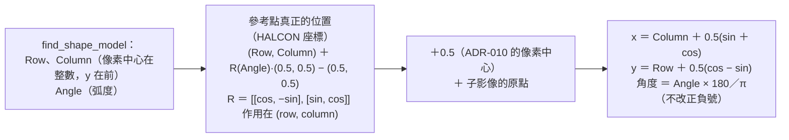
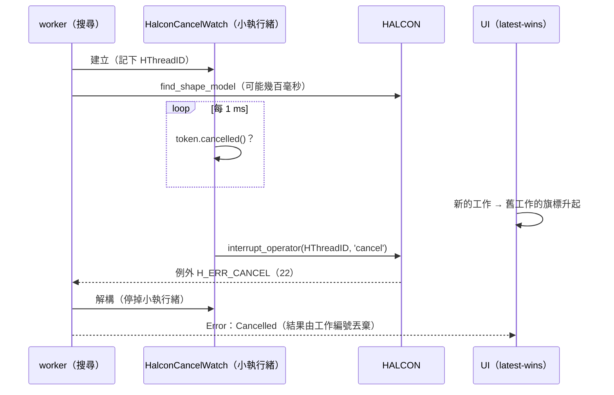
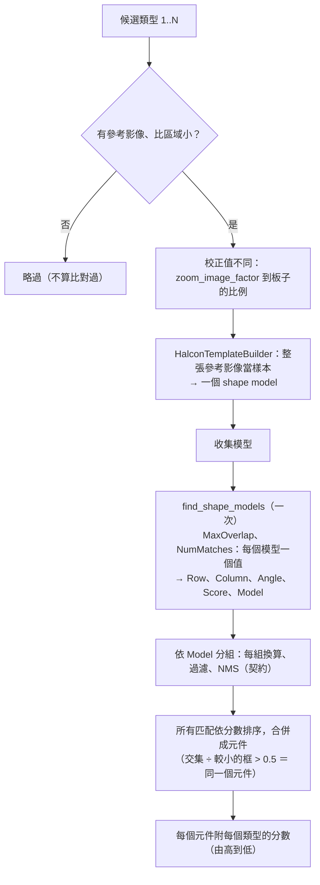

# S08 — 圖解

七張圖：HALCON adapter 的結構、搜尋管線、back end 可用性的決策（修改前後）、啟動到授權提醒的序列、位姿換算、取消、流程 B。文字說明在 [`spec.md`](spec.md)，決策在 [ADR-017](../../adr/017-halcon-shape-model-backend.md)（與 ADR-010、ADR-014 的「後續（S08）」），數字在 [`perf.md`](perf.md)。

## 1. 結構：哪個類別實作哪個 port

## 2. 搜尋管線（一次 `find_shape_model`）

## 3. back end 可用性的決策（修改前 → 修改後）

修改前（S03–S07）：`halcon` 永遠登記成不可用，原因是「S08 才會有」。

修改後（S08）：粗框是新增或改變的節點。

## 4. 啟動到授權提醒（序列）

## 5. 位姿換算（HALCON → ADR-010）

## 6. 取消：interrupt_operator

## 7. 流程 B：一次 find_shape_models

