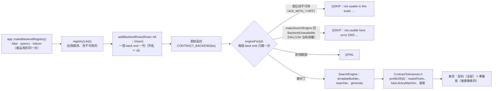
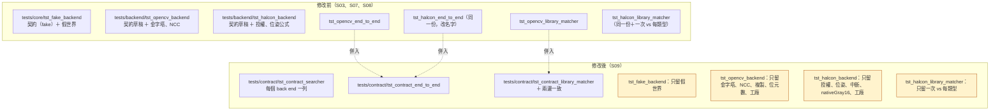
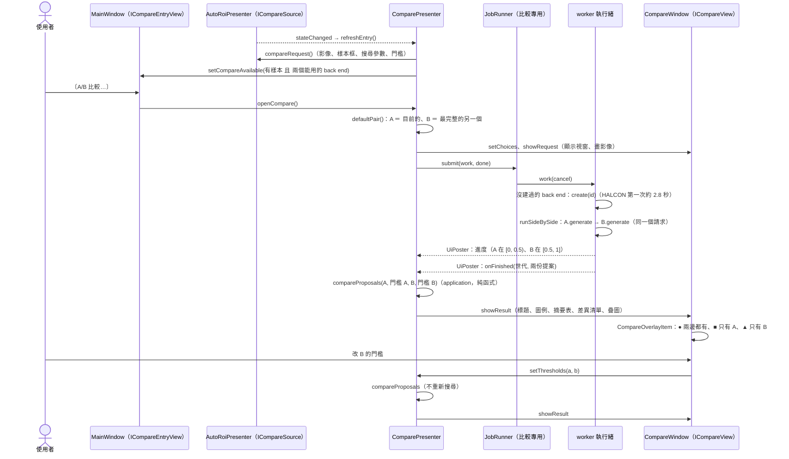
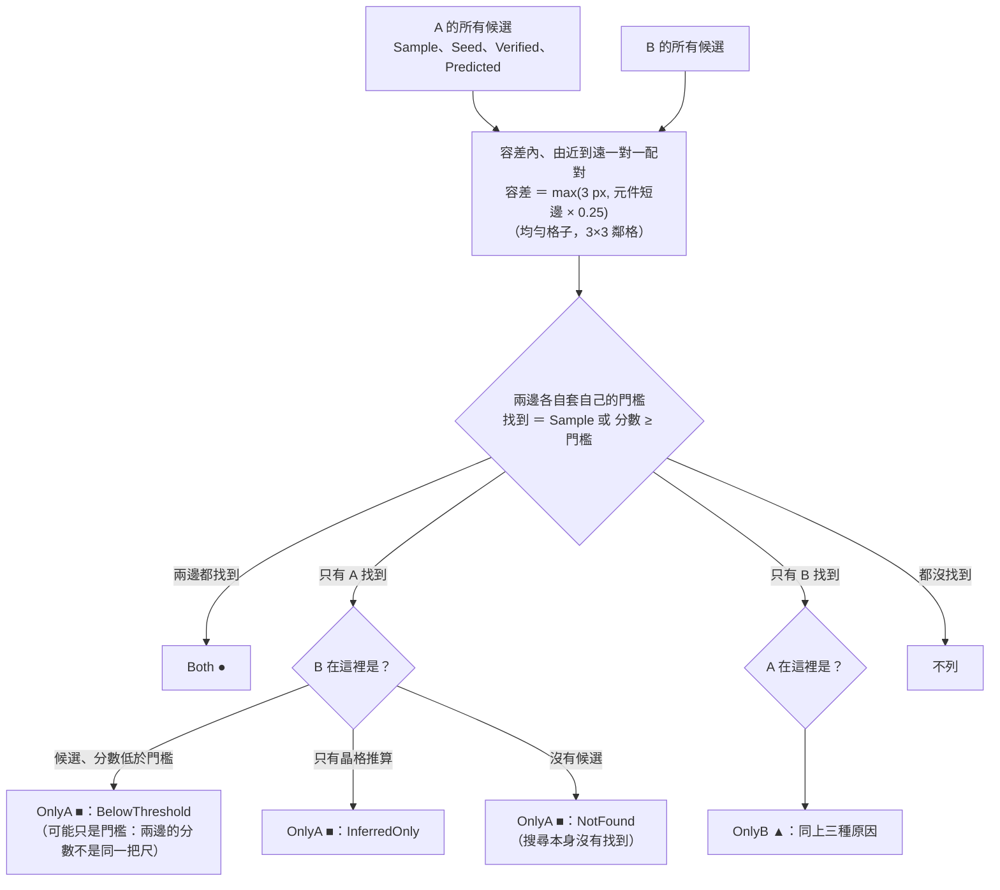
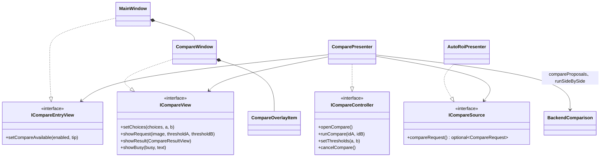

# S09 — 契約測試與 A/B 比較：圖解

> 圖的原始碼是 Mermaid（GitHub、Qt Creator 的 Markdown 預覽、VS Code 都能畫）。文字說明在 [`spec.md`](spec.md)，數字在 [`perf.md`](perf.md)，接受的差異在 [ADR-004](../../adr/004-backend-divergence.md)。

## 1. 契約測試的參數化（Liskov）

同一組測試函式，資料列是「組裝根註冊的每一個 back end」。沒編進程式或沒有授權的那一列 **SKIPPED 並寫出原因**，不是 PASSED。容差只在 `ContractTolerances.h`。

三個測試執行檔共用這個結構（`tests/contract/`）：

| 執行檔 | port | 資料列 |
|---|---|---|
| `tst_contract_searcher` | `ITemplateBuilder`、`IPatternSearcher` | 契約：fake、opencv、halcon；慣例與準確度：opencv、halcon（× 角度、× 範圍） |
| `tst_contract_end_to_end` | use case ＋ 兩個 port | opencv、halcon × 8 種合成板子；有效位元數的覆寫 |
| `tst_contract_library_matcher` | `ILibraryMatcher` | opencv、halcon（× 樣本庫大小 N）；兩邊一致（一個函式，兩個都能用才跑） |

## 2. 修改前後的測試結構

修改前：三份契約的草稿各寫一遍，兩份端到端幾乎一樣（`diff` 只差 back end 的名字與 HALCON 的角度上限）。修改後：共同的部分只有一份；各 back end 的測試只留它自己才有的事。

## 3. A/B 比較的資料流

比較是另一個視窗：不改板子、不進復原堆疊、不經過主視窗的互動狀態機。兩個 back end **依序**跑（每一邊都用得到所有執行緒，耗時才能比），在比較自己的 `JobRunner` 上（和主視窗共用執行緒池，但不會互相作廢）。

## 4. 配對與分類（`application/compare/BackendComparison`）

## 5. 類別（presentation/compare）

