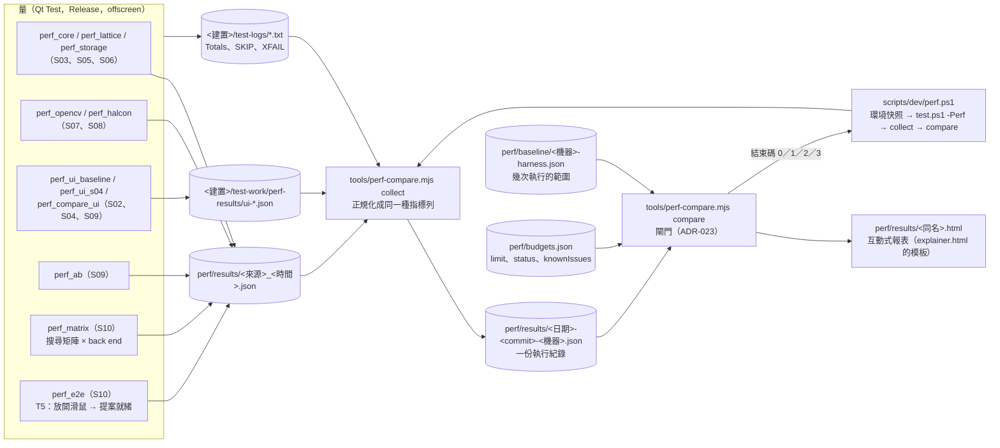
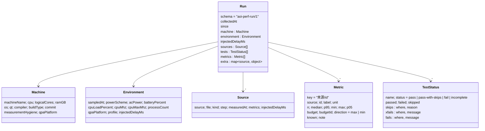
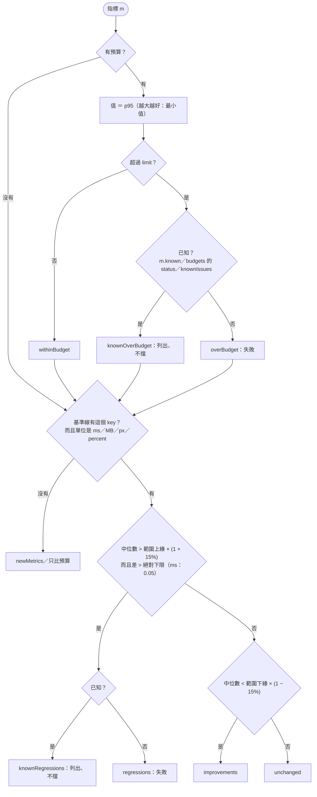
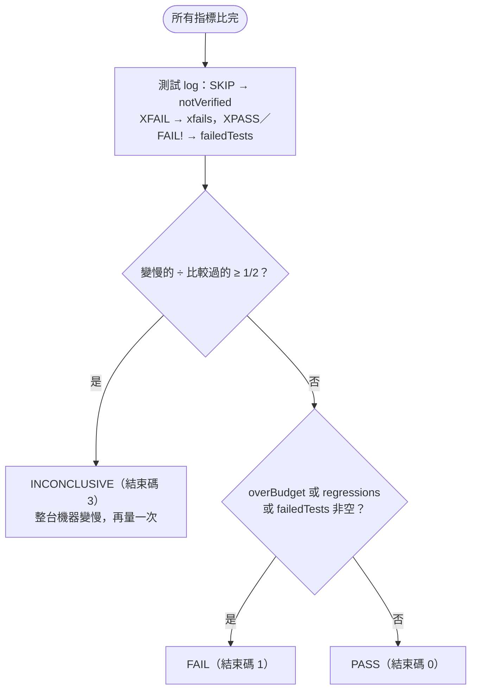
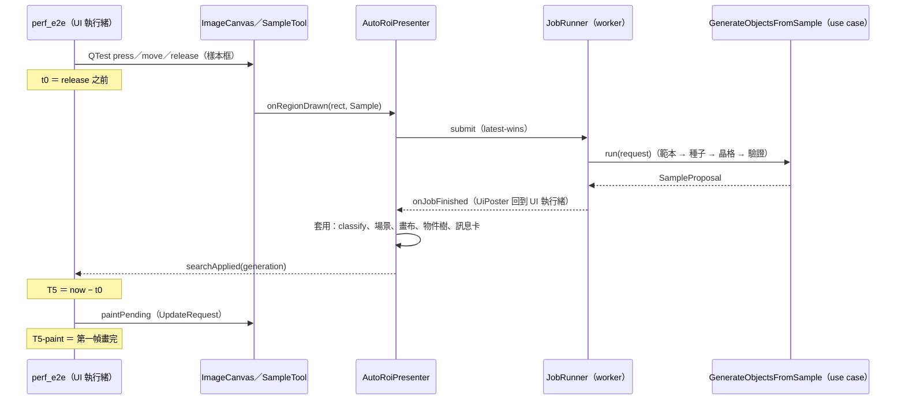
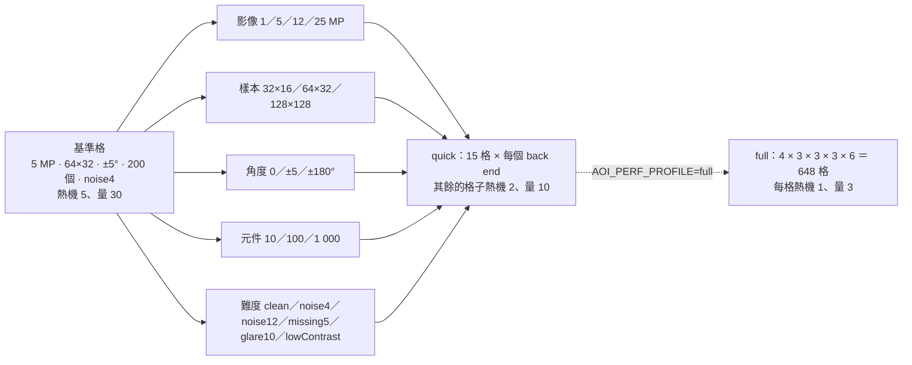

# S10 — 圖解

## 1. harness 的結構：誰量、誰彙整、誰判定

這張圖要讓你看到：S02–S09 的量測程式一個都沒有改，它們的結果檔就是輸入；新的只有兩個量測（矩陣、T5）、一個彙整與判定的工具、一個流程腳本。閘門的三個輸入（執行紀錄、基準線、預算）都是檔案，所以可以離線重算、也可以在報表上拖門檻重算。

## 2. 執行紀錄的 schema（`aoi-perf-run/1`）

基準線（`aoi-perf-baseline/1`）：`metrics` 是 `key → { label, unit, direction, n, medianRange[lo, hi], p95Range[lo, hi], medians[], p95s[] }`，加上 `machineName`、`buildType`、`qt`、`commit`、`runs[]`（來源的執行紀錄檔名）、`limitPercent`。比較的結果（`aoi-perf-compare/1`）：`verdict`、`exitCode`、`overBudget[]`、`knownOverBudget[]`、`regressions[]`、`knownRegressions[]`、`improvements[]`、`unchanged[]`、`missing[]`、`newMetrics[]`、`notVerified[]`、`xfails[]`、`failedTests[]`、`warnings[]`。

## 3. 閘門的決策流程（每一個指標）

這兩張圖要讓你看到：「已知」只擋失敗、不擋列出；跳過與 XFAIL 一定出現在報表上，但不改結束碼；一半以上變慢時不下回歸的結論。

## 4. T5 的路徑（`perf_e2e` 量的是哪一段）

T5 不含影像載入、不含 HALCON 第一次建立 back end 的授權檢查（熱機 3 次之後才開始量）；`PerfProbe` 的切片（`uc.sample.*`、`job.queue`、`job.run`、`ui.*`）另外寫進結果，S11 用它找最大的一塊。

## 5. 搜尋矩陣的格子（quick 與 full）

每一格記：總時間（中位數、p95）、四個階段、峰值記憶體（熱機之後）、召回率、位置誤差、誤判、有沒有晶格。1 000 個元件的那一格就是 T2 的條件（種子搜尋帶 T2a／T2b 的預算）；HALCON 在 lowContrast 與 noise12 的格子標 known（ADR-004 §5 的 B1、B3）。
