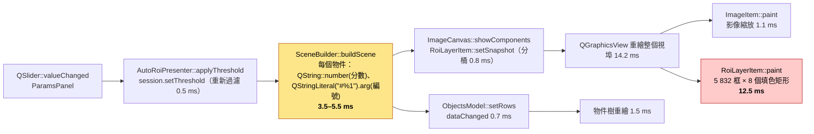
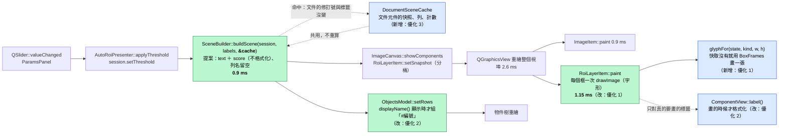
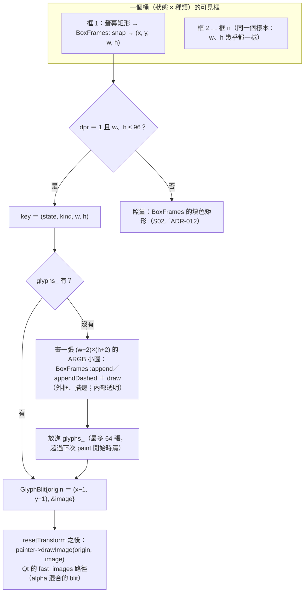
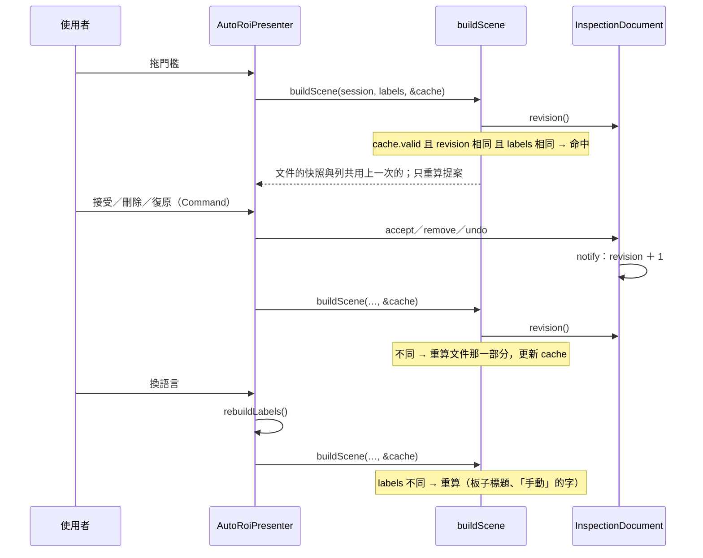

# S11 — 圖解：U3 的管線改前與改後

U3 ＝ 分數滑桿變動到重繪。三張圖：改前的管線（標出三個慢的節點）、改後的管線（標出改了什麼）、字形快取的細節。

## 1. 改前（S10 的程式，5 832 個提案物件，中位數）

這張圖要讓你看到：U3 的 18.9 ms（中位數）裡，框層的繪製佔 12.5 ms、場景重建 3.5–5.5 ms；影像的縮放只有 1 ms（S04 的推測「畫布重繪是主因」對，但原因不是影像）。背景有已接受的元件時（U3-bg），`buildScene` 還要把文件裡的元件全部重算（展開框、名稱、列），多 9 ms（圖裡沒有畫，見第 2 圖的虛線節點）。

## 2. 改後（S11，同一個流程，標出不同的節點）

這張圖要讓你看到：節點的順序沒有變，只有三個地方不同——框層的畫法（字形）、場景重建不再做字串（延後到畫的時候與顯示的時候）、文件那一部分走快取。U3 中位數 18.9 → 6.5–8.8 ms、p95 23.5 → 7.6–11.2 ms（預算 16）。

## 3. 字形快取（優化 1）：一個桶怎麼畫

這張圖要讓你看到：字形與填色矩形用**同一套** `BoxFrames` 產生像素，差別只在「畫一次、貼 n 次」；不符合條件（高 DPI、太大的框）的框走原本的路。`tst_items` 對四種狀態 × 三種框、三種縮放逐像素比對兩條路的輸出相同。

## 4. 文件快取（優化 3）：什麼時候重算

這張圖要讓你看到：快取的鍵來自 application 層（修訂號只在變更通知時加 1），presentation 不自己猜文件有沒有變；語言切換也會讓它失效。
